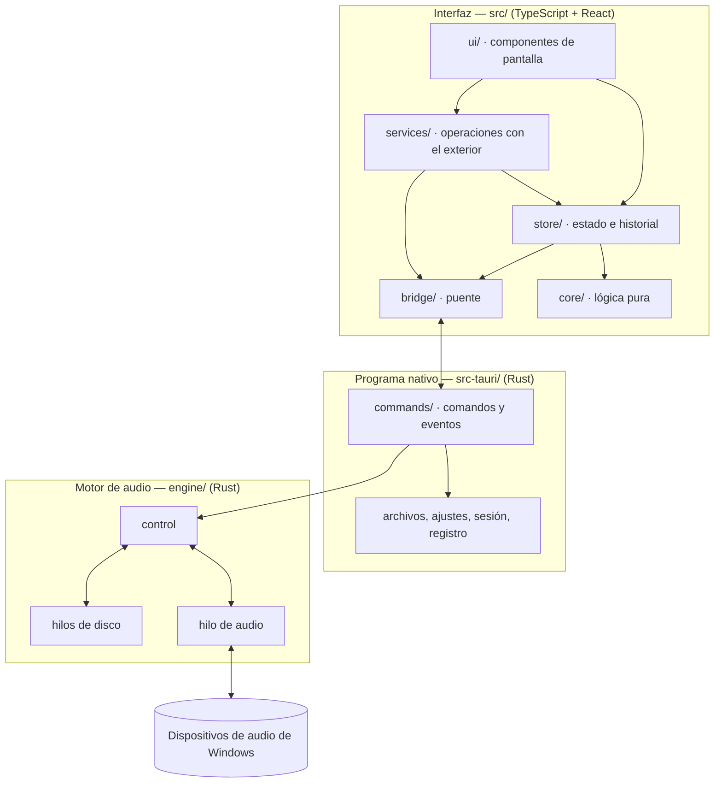
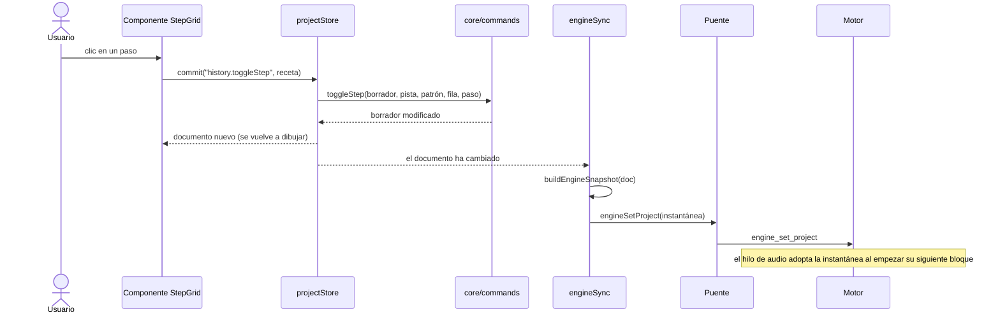
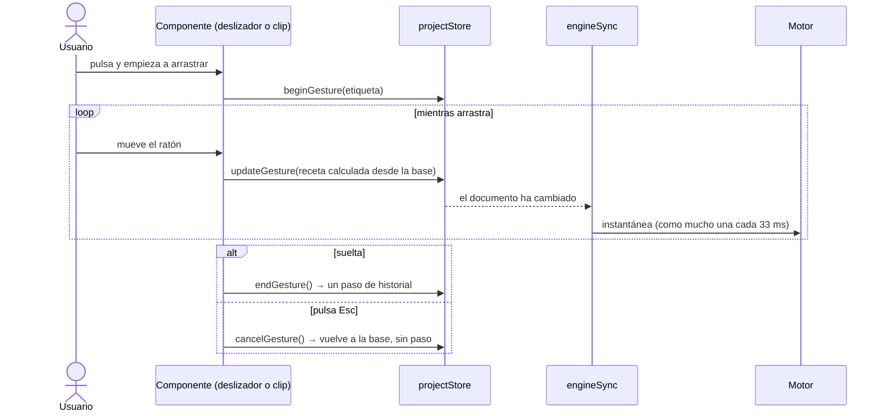
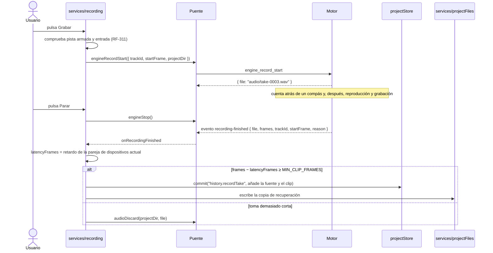

# Carabo · Especificación · 04 — Arquitectura

> **PROMPT PARA EL AGENTE — léelo antes de seguir**
>
> Eres un agente de programación que trabaja en el repositorio de **Carabo**, un DAW de escritorio para Windows 11. Este documento define **en qué partes se divide el programa, qué hace cada una y cómo se hablan entre sí**: módulos, la API del puente entre la interfaz y el programa nativo, los hilos y los flujos principales.
>
> - Léelo antes de crear o modificar un módulo, un comando del puente o un evento.
> - Cada módulo tiene una única responsabilidad. No pongas en un módulo lo que este documento asigna a otro, y respeta las reglas de dependencia de §9.
> - Los nombres de comandos, métodos, eventos y códigos de error de §6 son **exactos**. Este documento manda sobre los demás en cuanto a la API del puente (00 §5).
> - Las estructuras de datos (proyecto, instantánea, ajustes) están en 05. El interior del motor de audio está en 06. Las rutas de archivos y las versiones de las bibliotecas están en 07.
> - Los términos (instantánea, segmento, gesto continuo, puente…) están en el glosario (00 §7).

---

## 1. Visión general

Carabo tiene tres capas. Cada una vive en una carpeta del repositorio y en un lenguaje:

| Capa | Carpeta | Lenguaje | Qué hace |
|---|---|---|---|
| **Interfaz** | `src/` | TypeScript y React | Todo lo que el usuario ve y toca. Es la dueña del proyecto: guarda su estado, lo edita, lleva el historial de deshacer y decide qué debe sonar. |
| **Programa nativo** | `src-tauri/` | Rust (Tauri 2) | Crea la ventana, lee y escribe archivos, guarda ajustes y sesión, y expone al motor mediante comandos y eventos. No contiene lógica musical. |
| **Motor de audio** | `engine/` (crate `carabo-engine`) | Rust | Produce el sonido, graba, importa y exporta. No depende de Tauri ni de la interfaz. No decide nada: reproduce la instantánea que recibe. |



## 2. Principios de arquitectura

Son reglas, no recomendaciones. Si una tarea parece exigir saltarse una, la tarea está mal leída.

| Id | Principio | Consecuencia práctica |
|---|---|---|
| AR-01 | **La interfaz es la dueña del proyecto.** | El único estado del proyecto está en `store/projectStore`. El programa nativo y el motor no guardan ni modifican el proyecto. |
| AR-02 | **El motor reproduce instantáneas.** | El motor recibe una `EngineSnapshot` completa (05 §10) cada vez que el documento cambia. No hay comandos para cambiar un parámetro suelto. |
| AR-03 | **Los datos fluyen en un solo sentido.** | Acción del usuario → documento → instantánea → motor. Del motor a la interfaz solo vuelven telemetría, resultados de grabación y errores. |
| AR-04 | **La lógica pura no conoce React ni el puente.** | Todo cálculo sobre el proyecto está en `core/`, en funciones puras que se prueban sin navegador. |
| AR-05 | **Todo acceso al exterior pasa por el puente.** | Ningún módulo de la interfaz llama a Tauri directamente salvo `bridge/tauriBridge.ts`. Existe `bridge/mockBridge.ts` para las pruebas. |
| AR-06 | **El motor funciona sin dispositivo de sonido.** | La misma función que genera el sonido en directo genera un archivo. Así se prueba y así se exporta. |
| AR-07 | **Una fórmula, un lugar.** | Las constantes (00 §4) y las conversiones (05 §2) se escriben una vez en TypeScript y una vez en Rust, con pruebas que comparan ambos resultados (08). |
| AR-08 | **El hilo de audio no espera a nadie.** | Se comunica con el resto solo mediante colas y valores atómicos sin bloqueo (06). |

## 3. Módulos de la interfaz

### 3.1 `core/` — lógica pura

No importa React, ni `store/`, ni `bridge/`. Todas sus funciones son puras o trabajan sobre el borrador que reciben.

| Módulo | Responsabilidad | Entradas | Salidas | Lógica |
|---|---|---|---|---|
| `core/constants.ts` | Las constantes de 00 §4 | — | Valores exportados | Ninguna |
| `core/model.ts` | Los tipos de 05 §3 y §10 | — | Tipos | Ninguna |
| `core/time.ts` | Conversiones de 05 §2 | Ticks, frames, pasos, compases, tempo, compás | Números | Fórmulas de 05 §2.2 y §2.3 |
| `core/factory.ts` | Crear elementos con sus valores iniciales | Parámetros del elemento | Proyecto, pista, patrón, canal… nuevos | Tabla de 05 §3.5 |
| `core/ids.ts` | Dar identificadores y valores de `z` | Borrador del documento | `"trk-7"`, un `z` | 05 §3.2: usa y aumenta `nextId` y `nextZ` |
| `core/lanes.ts` | Regla de tapado | Elementos de un carril | Segmentos | `resolveLane` (05 §10.2) |
| `core/snapshot.ts` | Construir la instantánea | Documento, carpeta, archivos que faltan | `EngineSnapshot` | `buildEngineSnapshot` (05 §10.3) |
| `core/validate.ts` | Validar un proyecto leído | Texto JSON | `ProjectFile` o un error con su motivo | Esquema de 05 §5.2 e invariantes de 05 §4 |
| `core/serialize.ts` | Convertir el proyecto en texto | `ProjectFile` | Texto JSON | Reglas de 05 §5.1 |
| `core/kits.ts` | Datos de los kits | `assets/kits/*/kit.json` | Nombres de kits y de sonidos por idioma | Lectura de los JSON incluidos al compilar |
| `core/presets.ts` | Ritmos hechos | `assets/presets/presets.json` | Lista filtrada por compás; pasos de un ritmo hecho | Conversión de cadenas a niveles (05 §9) |
| `core/peaks.ts` | Leer un archivo de picos para dibujar ondas | Contenido binario del archivo; región del clip y ancho en píxeles | Mínimo y máximo de cada columna de píxeles | Formato de 05 §6.3 |
| `core/commands/*.ts` | **Una función por cada operación de edición** | Borrador del documento y parámetros | Modifica el borrador | Reglas de 02 y de 05 §3.3 y §3.4 |

Los archivos de `core/commands/` y sus funciones:

| Archivo | Funciones |
|---|---|
| `tracks.ts` | `createRhythmTrack`, `createAudioTrack`, `renameTrack`, `moveTrack`, `deleteTrack`, `setKit`, `setRowGain`, `setRowMute` |
| `patterns.ts` | `createPattern`, `duplicatePattern`, `renamePattern`, `deletePattern`, `toggleStep`, `setPatternBars`, `loadPreset`, `clearPattern` |
| `blocks.ts` | `addBlock`, `moveBlock`, `resizeBlock`, `duplicateBlock`, `deleteBlock` |
| `clips.ts` | `addClip`, `moveClip`, `trimClipLeft`, `trimClipRight`, `setClipRepeat`, `splitClip`, `duplicateClip`, `deleteClip` |
| `mixer.ts` | `setStripGain`, `setStripPan`, `setStripMute`, `setStripSolo`, `setEqEnabled`, `setEqBand`, `setReverbEnabled`, `setReverbParam`, `setMasterGain` |
| `transport.ts` | `setTempo`, `setTimeSignature` |

Reglas para toda función de `core/commands/`:

1. Recibe un borrador mutable del documento (`ProjectDoc`) y lo modifica; no devuelve nada o devuelve el `id` de lo creado.
2. Aplica ella misma los límites (00 §4 y RF-112): si la operación no se puede hacer, no modifica nada y devuelve un resultado que lo indica, con el motivo (`"maxTracks"`, `"songLimit"`…).
3. Deja el documento cumpliendo todos los invariantes de 05 §4. En particular, quita de `sources` lo que quede sin usar (INV-11).
4. No lee ni escribe nada fuera del borrador.

### 3.2 `store/` — estado e historial

Se implementa con Zustand; los cambios del documento se hacen con Immer para obtener los parches del historial (07).

**`store/projectStore.ts`**

| Aspecto | Contenido |
|---|---|
| Responsabilidad | Guardar el proyecto abierto y su historial de deshacer |
| Estado | `doc: ProjectDoc`; `view: ViewState`; `dir: string` (carpeta de proyecto); `isTemp: boolean` (nunca se ha guardado); `missingFiles: string[]`; `past: HistoryEntry[]`; `future: HistoryEntry[]`; `savedIndex: number \| null`; `gesture: Gesture \| null` |
| Entradas | Llamadas de componentes y servicios |
| Salidas | Estado observable; `isDirty()`; `canUndo()`; `canRedo()`; etiquetas del paso siguiente |

```ts
interface HistoryEntry { label: HistoryLabel; patches: Patch[]; inversePatches: Patch[] }
interface Gesture { label: HistoryLabel; baseDoc: ProjectDoc; pending: HistoryEntry | null }
```

Lógica (RF-030 a RF-032):

```text
commit(label, receta):
    si hay un gesto en curso → error de programación
    (doc', parches, inversos) = aplicar receta a doc
    si no hay parches → no hace nada
    doc = doc'; past.push({label, parches, inversos}); future = []
    si past.length > HISTORY_LIMIT → quita el primero; si savedIndex no es null, savedIndex -= 1; si queda < 0, savedIndex = null

beginGesture(label):   gesture = { label, baseDoc: doc, pending: null }
updateGesture(receta): (doc', parches, inversos) = aplicar receta a gesture.baseDoc   ← siempre desde la base, no acumulado
                       doc = doc'; gesture.pending = {label, parches, inversos}
endGesture():          si gesture.pending tiene parches → igual que el final de commit; gesture = null
cancelGesture():       doc = gesture.baseDoc; gesture = null

undo():  e = past.pop(); doc = aplicar e.inversos; future.push(e)
redo():  e = future.pop(); doc = aplicar e.parches; past.push(e)

setView(cambios):   view = {...view, ...cambios}                 ← no toca el historial
load(file, dir, isTemp, missingFiles):  sustituye todo; past = future = []; savedIndex = 0
addMissingFiles(files):  missingFiles = unión de missingFiles y files    ← no toca el historial (RF-028)
markSaved(dir):     savedIndex = past.length; isTemp = false
isDirty():          savedIndex !== past.length
```

- `HistoryLabel` es una clave de traducción (03) que nombra el paso: `"history.moveClip"`, `"history.recordTake"`…
- `undo`, `redo` y `commit` no se pueden llamar durante un gesto ni durante una grabación.

**`store/uiStore.ts`** — estado de la interfaz que no pertenece al proyecto: pestaña activa; pista de ritmo y patrón seleccionados en Ritmo; pista seleccionada y elemento seleccionado en Canción; posición del cursor en ticks; posición a la que vuelve el cursor; desplazamientos; pista armada; cuadro de diálogo abierto; mensaje de la barra de estado. Nada de esto entra en el historial ni se guarda.

**`store/engineStore.ts`** — copia de la última telemetría (§6.4), dispositivos en uso y estado del audio. Solo lo modifica el manejador de eventos del puente.

**`store/settingsStore.ts`** — los ajustes (05 §7.1). Cada cambio se escribe en disco con `settingsWrite`.

**`store/engineSync.ts`** — mantiene al motor al día.

| Aspecto | Contenido |
|---|---|
| Responsabilidad | Enviar una instantánea al motor cada vez que cambia lo que debe sonar |
| Entradas | Cambios de `doc`, `dir` y `missingFiles` en `projectStore` |
| Salidas | `bridge.engineSetProject(instantánea)` |
| Lógica | Al cambiar cualquiera de las tres entradas, marca «pendiente». En el siguiente cuadro de animación, y como mucho una vez cada 33 ms, construye la instantánea con `buildEngineSnapshot` y la envía. Los cambios hechos durante un gesto se envían igual, de modo que el usuario oye el resultado mientras arrastra. |

También reenvía al motor los cambios de claqueta y de bucle de `view` con `engineSetMetronome` y `engineSetLoop`. El tramo de bucle se convierte a frames con `stepToFrame(barToStep(compás))` (05 §2.2), y se vuelve a enviar cuando cambian el tempo o el compás.

### 3.3 `bridge/` — puente

| Archivo | Contenido |
|---|---|
| `bridge/bridge.ts` | La interfaz `Bridge` y los tipos de sus argumentos y resultados (§6) |
| `bridge/tauriBridge.ts` | Implementación real: traduce cada método a un comando o evento de Tauri. Es el **único** archivo de `src/` que importa de `@tauri-apps/*` |
| `bridge/mockBridge.ts` | Implementación simulada en memoria para pruebas y para ejecutar la interfaz en un navegador: un sistema de archivos falso, un motor falso que avanza la posición con un temporizador y emite telemetría, y fallos configurables |
| `bridge/index.ts` | Exporta `bridge`: la implementación real si la aplicación corre dentro de Tauri; la simulada en caso contrario |

### 3.4 `services/` — operaciones con el exterior

Cada servicio coordina almacenes y puente para una tarea. Los componentes llaman a los servicios; nunca al puente.

| Servicio | Responsabilidad | Requisitos |
|---|---|---|
| `services/projectFiles.ts` | Arranque, nuevo, abrir, recientes, guardar, guardar como, copia de recuperación, recuperación, limpieza de archivos sin uso, archivos de audio que faltan o que el motor no puede cargar, cierre. Mantiene el título de la ventana con `setWindowTitle` cada vez que cambian el nombre del proyecto o `isDirty()` | RF-001, RF-004, RF-010, RF-020 a RF-029 |
| `services/playback.ts` | Reproducir, parar, mover el cursor, modo patrón o canción según la pestaña | RF-101 a RF-105, RF-114 |
| `services/recording.ts` | Armar, empezar a grabar, recibir la toma y crear el clip | RF-310 a RF-314, RF-507 |
| `services/importer.ts` | Importar un archivo y crear su clip | RF-315 |
| `services/exporter.ts` | Exportar y mostrar el progreso | RF-600 a RF-603 |
| `services/devices.ts` | Dispositivos, cambios de dispositivo, calibración, tono de prueba | RF-500 a RF-508 |
| `services/shortcuts.ts` | Atajos de teclado | RF-703 |
| `services/messages.ts` | Mostrar avisos y diálogos de error; convertir los errores del puente en mensajes del catálogo | RF-007 |

### 3.5 `ui/` — componentes

Los componentes leen los almacenes y llaman a `projectStore` (para editar) o a un servicio (para todo lo demás). No contienen lógica del proyecto: la piden a `core/`. La lista de componentes y su aspecto están en 03.

| Carpeta | Contenido |
|---|---|
| `ui/app/` | `App`, `TopBar`, `TransportBar`, `StatusBar` y los cuadros de diálogo |
| `ui/common/` | Controles reutilizables (03 §4): `Button`, `ToggleButton`, `OptionGroup`, `Slider`, `NumberField`, `Select`, `Menu`, `Tooltip`, `Dialog`, `Meter`, `OverloadIndicator`; y `usePointerDrag`, la ayuda común de arrastre |
| `ui/rhythm/` | Pestaña Ritmo |
| `ui/song/` | Pestaña Canción |
| `ui/mix/` | Pestaña Mezcla |

## 4. Módulos del programa nativo

| Módulo | Responsabilidad | Entradas | Salidas | Estado interno |
|---|---|---|---|---|
| `src-tauri/src/lib.rs` | Arranque: crea la ventana, arranca el motor, registra comandos, lanza el hilo de telemetría | — | Aplicación en marcha | — |
| `state.rs` | Estado compartido de la aplicación | — | `AppState` | El `EngineHandle`, las rutas de la aplicación, la bandera de cancelación de la exportación en curso |
| `error.rs` | Tipo de error del puente | Errores de E/S y del motor | `BridgeError` (§6.3) | — |
| `paths.rs` | Rutas de 05 §7 | Identificador de la aplicación | Carpetas de configuración, datos locales, registro, recursos y `Documentos\Carabo` | — |
| `atomic.rs` | Escritura atómica (RNF-13) | Ruta y contenido | Archivo escrito | — |
| `logging.rs` | Registro (RNF-20) | Nivel, módulo y mensaje | Líneas en `carabo.log` | Tamaño del archivo actual |
| `telemetry.rs` | Emitir telemetría y eventos del motor | `EngineHandle` | Eventos de §6.4 | — |
| `commands/project.rs` | Comandos `project_*`, `recovery_*`, `session_*`, `settings_*`, `default_projects_dir` | Argumentos de §6.2 | Resultados de §6.2 | — |
| `commands/audio_files.rs` | `audio_import`, `audio_discard`, `peaks_get` | Rutas | Resultados; eventos de progreso | — |
| `commands/export.rs` | `export_start`, `export_cancel` | Instantánea, formato y ruta | Resultado; eventos de progreso | — |
| `commands/engine.rs` | Comandos `engine_*` | Argumentos | Llamadas al `EngineHandle` | — |
| `commands/devices.rs` | `devices_list`, `devices_select`, `calibration_run`, `engine_test_tone` | Argumentos | Resultados | — |
| `commands/system.rs` | `app_info`, `log_write` | — | Versión e idioma del sistema | — |

Reglas:

1. Un comando valida sus argumentos, llama al motor o al sistema de archivos y devuelve el resultado. No contiene lógica musical ni interpreta el proyecto: el archivo de proyecto es para él un texto.
2. Todo comando que pueda tardar más de 50 ms (importar, exportar, calibrar, copiar archivos) se ejecuta fuera del hilo principal.
3. Ningún comando escribe fuera de la carpeta de proyecto que recibe, de las carpetas de la aplicación o de la ruta que el usuario ha elegido en un cuadro nativo.

## 5. El motor de audio visto desde fuera

El interior del motor está en 06. Aquí solo se fija lo que ofrece al programa nativo. El crate `carabo-engine` no depende de Tauri.

```rust
pub struct EngineConfig { pub kits_dir: PathBuf }

pub struct Engine;                      // posee los hilos; se crea una vez al arrancar
impl Engine {
    pub fn start(config: EngineConfig) -> Result<Engine, EngineError>;
    pub fn handle(&self) -> EngineHandle;        // clonable; se puede usar desde cualquier hilo que no sea el de audio
}

impl EngineHandle {
    pub fn set_project(&self, snapshot: EngineSnapshot) -> Result<(), EngineError>;
    pub fn play(&self, request: PlayRequest) -> Result<(), EngineError>;
    pub fn stop(&self);
    pub fn seek(&self, frame: u64);
    pub fn set_loop(&self, enabled: bool, start_frame: u64, end_frame: u64);
    pub fn set_metronome(&self, enabled: bool);
    pub fn audition(&self, track_id: &str, row: usize);
    pub fn record_start(&self, request: RecordRequest) -> Result<RecordStarted, EngineError>;
    pub fn input_open(&self) -> Result<(), EngineError>;
    pub fn input_close(&self);
    pub fn devices(&self) -> DeviceList;
    pub fn select_devices(&self, output: Option<String>, input: Option<String>) -> Result<ActiveDevices, EngineError>;
    pub fn calibrate(&self) -> Result<u32, EngineError>;   // retardo de ida y vuelta, en frames
    pub fn test_tone(&self) -> Result<(), EngineError>;
    pub fn telemetry(&self) -> Telemetry;                  // lectura inmediata, sin bloqueo
    pub fn poll_events(&self) -> Vec<EngineEvent>;         // grabación terminada, cambio de dispositivos,
                                                           // audio que no se ha podido cargar, error interno
    pub fn audio_pool(&self) -> AudioPool;                 // audio ya cargado en memoria, para compartirlo con la exportación (06 §9.1)
}

// Funciones que no necesitan el motor en marcha ni un dispositivo de sonido:
pub fn render_offline(snapshot: &EngineSnapshot, kits_dir: &Path, pool: &AudioPool, sink: &mut dyn AudioSink,
                      progress: &dyn Fn(f32), cancel: &AtomicBool) -> Result<RenderStats, EngineError>;
pub fn import_audio(src: &Path, project_dir: &Path, progress: &dyn Fn(f32)) -> Result<ImportedAudio, EngineError>;
pub fn ensure_peaks(project_dir: &Path, file: &str) -> Result<PathBuf, EngineError>;
```

Los tipos `EngineSnapshot`, `PlayRequest`, `RecordRequest`, `Telemetry`, `DeviceList`, `ActiveDevices` e `ImportedAudio` tienen los mismos campos que sus equivalentes de TypeScript de §6, con los nombres en `snake_case` en Rust y en `camelCase` en JSON. `RecordStarted` tiene un único campo, `file`: la ruta relativa de la toma, que es lo que devuelve `engineRecordStart`. `RenderStats` tiene los campos `frames` y `clipped_samples`, que `export_start` devuelve como `ExportResult`.

El motor carga entero en memoria el audio de los clips que suenan (06 §9.1). `export_start` pasa a `render_offline` el almacén del motor en marcha (`audio_pool()`), para no cargar dos veces el mismo audio.

## 6. API del puente

### 6.1 La interfaz `Bridge`

Es la única puerta de la interfaz hacia el exterior. Todos los métodos son asíncronos. Cuando fallan, rechazan con un `BridgeError` (§6.3).

```ts
type Unsubscribe = () => void;
type ExportFormat = "wav" | "mp3";

interface Bridge {
  // ---- Archivos de proyecto ----
  projectCreateTemp(): Promise<{ dir: string }>;
  projectRead(file: string): Promise<{ dir: string; json: string }>;
  projectCheckFiles(dir: string, files: string[]): Promise<{ missing: string[] }>;
  projectCleanup(dir: string, keepFiles: string[]): Promise<void>;
  projectWrite(dir: string, json: string): Promise<void>;
  projectSaveAs(request: SaveAsRequest): Promise<{ dir: string }>;
  projectDiscardTemp(dir: string): Promise<void>;
  recoveryWrite(dir: string, json: string): Promise<void>;
  recoveryRead(dir: string): Promise<{ json: string; modifiedAt: string } | null>;
  recoveryDelete(dir: string): Promise<void>;
  sessionGet(): Promise<Session | null>;
  sessionSet(session: Session): Promise<void>;
  settingsRead(): Promise<string | null>;
  settingsWrite(json: string): Promise<void>;
  defaultProjectsDir(): Promise<string>;

  // ---- Cuadros nativos ----
  pickProjectFile(): Promise<string | null>;
  pickFolder(startDir: string): Promise<string | null>;
  pickAudioFile(): Promise<string | null>;
  pickExportPath(defaultName: string, format: ExportFormat): Promise<string | null>;
  revealInExplorer(path: string): Promise<void>;

  // ---- Audio en archivos ----
  audioImport(srcPath: string, projectDir: string): Promise<ImportedAudio>;
  audioDiscard(projectDir: string, file: string): Promise<void>;
  peaksGet(projectDir: string, file: string): Promise<ArrayBuffer>;
  exportStart(request: ExportRequest): Promise<ExportResult>;
  exportCancel(): Promise<void>;

  // ---- Motor ----
  engineSetProject(snapshot: EngineSnapshot): Promise<void>;
  enginePlay(request: PlayRequest): Promise<void>;
  engineStop(): Promise<void>;
  engineSeek(frame: number): Promise<void>;
  engineSetLoop(loop: LoopRequest): Promise<void>;
  engineSetMetronome(enabled: boolean): Promise<void>;
  engineAudition(trackId: string, row: number): Promise<void>;
  engineRecordStart(request: RecordRequest): Promise<{ file: string }>;
  engineInputOpen(): Promise<void>;
  engineInputClose(): Promise<void>;
  devicesList(): Promise<DeviceList>;
  devicesSelect(outputName: string | null, inputName: string | null): Promise<ActiveDevices>;
  calibrationRun(): Promise<{ latencyFrames: number }>;
  engineTestTone(): Promise<void>;

  // ---- Sistema ----
  appInfo(): Promise<{ version: string; systemLocale: string }>;
  logWrite(level: "error" | "warn" | "info", message: string): Promise<void>;
  setWindowTitle(title: string): Promise<void>;
  closeWindow(): Promise<void>;

  // ---- Eventos ----
  onTelemetry(callback: (t: Telemetry) => void): Unsubscribe;
  onRecordingFinished(callback: (r: RecordingFinished) => void): Unsubscribe;
  onDevicesChanged(callback: (d: DevicesChanged) => void): Unsubscribe;
  onEngineError(callback: (e: { detail: string }) => void): Unsubscribe;
  onAudioUnavailable(callback: (e: { files: string[] }) => void): Unsubscribe;
  onImportProgress(callback: (p: { percent: number }) => void): Unsubscribe;
  onExportProgress(callback: (p: { percent: number }) => void): Unsubscribe;
  onFileDrop(callback: (d: { paths: string[]; x: number; y: number }) => void): Unsubscribe;
  onCloseRequested(callback: () => void): Unsubscribe;
}

interface SaveAsRequest {
  fromDir: string;        // carpeta actual del proyecto (temporal o guardada)
  parentDir: string;      // ubicación elegida
  name: string;           // nombre del proyecto
  json: string;           // contenido de project.carabo
  files: string[];        // archivos de audio que se copian, relativos: "audio/take-0001.wav"
  deleteFromDir: boolean; // true si fromDir es una carpeta temporal y debe borrarse al terminar
}
interface ImportedAudio { file: string; frames: number; channels: 1 | 2; truncated: boolean }
interface ExportRequest { snapshot: EngineSnapshot; format: ExportFormat; path: string }
interface ExportResult { clippedSamples: number; frames: number }

type PlayRequest =
  | { mode: "song"; startFrame: number }
  | { mode: "pattern"; trackId: string; patternId: string };
interface LoopRequest { enabled: boolean; startFrame: number; endFrame: number }
interface RecordRequest { trackId: string; startFrame: number; projectDir: string }

interface DeviceList {
  outputs: { name: string; isDefault: boolean }[];
  inputs: { name: string; isDefault: boolean }[];
}
interface ActiveDevices {
  outputName: string | null;    // nombre real en uso, o null si no hay salida
  inputName: string | null;     // nombre real del dispositivo que se usará como entrada, o null si no hay
  outputFellBack: boolean;      // true si el dispositivo pedido no existe y se usa el predeterminado
  inputFellBack: boolean;
}
```

### 6.2 Comandos

Cada método del puente se corresponde con un comando de Tauri con el mismo nombre en `snake_case`. Los cuatro métodos `pick*`, `revealInExplorer`, `setWindowTitle`, `closeWindow`, `onFileDrop` y `onCloseRequested` no tienen comando propio: usan las funciones de Tauri para cuadros nativos, ventana y arrastre de archivos (07 §6).

**Archivos de proyecto**

| Comando | Qué hace | Errores |
|---|---|---|
| `project_create_temp` | Crea `unsaved/<uuid>/` en los datos locales, con `audio/`, `peaks/` y `recovery/` vacías, y devuelve su ruta | `IO` |
| `project_read` | Lee el archivo y devuelve su texto y la carpeta que lo contiene. No lo valida | `NOT_FOUND`, `IO` |
| `project_check_files` | Devuelve cuáles de los archivos relativos indicados no existen o no se pueden abrir | `IO` |
| `project_cleanup` | Borra de `audio/` y `peaks/` todo archivo que no esté en `keepFiles` ni sea el `.peaks` de uno que sí esté (RF-029) | `IO` |
| `project_write` | Escribe `project.carabo` de forma atómica | `IO` |
| `project_save_as` | Comprueba el nombre; crea `parentDir/name/` con sus subcarpetas; copia cada archivo de `files` y su `.peaks`; escribe `project.carabo`; si `deleteFromDir`, borra `fromDir`. Si algo falla, borra lo creado | `NAME_INVALID`, `ALREADY_EXISTS`, `IO` |
| `project_discard_temp` | Borra una carpeta de `unsaved/`. Rechaza cualquier ruta que no esté dentro de `unsaved/` | `IO` |
| `recovery_write` | Escribe `recovery/project.recovery.carabo` de forma atómica | `IO` |
| `recovery_read` | Devuelve el texto y la fecha de la copia, o `null` si no existe | `IO` |
| `recovery_delete` | Borra la copia si existe | `IO` |
| `session_get` / `session_set` | Lee o escribe `session.json` (05 §7.2) | `IO` |
| `settings_read` / `settings_write` | Lee (texto o `null`) o escribe de forma atómica `settings.json` | `IO` |
| `default_projects_dir` | Devuelve `Documentos\Carabo`, creándola si no existe | `IO` |

**Audio en archivos**

| Comando | Qué hace | Errores |
|---|---|---|
| `audio_import` | Convierte el archivo a `audio/import-NNNN.wav` (05 §6.2), calcula sus picos y devuelve sus datos. Emite `import://progress` | `UNSUPPORTED_FORMAT`, `IO`, `BUSY` (ya hay una importación en curso) |
| `audio_discard` | Borra un archivo de `audio/` y su `.peaks`. Solo se usa para una toma demasiado corta (RF-313) | `IO` |
| `peaks_get` | Devuelve el contenido binario del archivo de picos (05 §6.3); si no existe, lo calcula antes | `NOT_FOUND`, `IO` |
| `export_start` | Genera el archivo con `render_offline` en un hilo propio. Emite `export://progress`. Termina cuando el archivo está completo | `NOTHING_TO_EXPORT`, `CANCELLED`, `IO`, `BUSY` |
| `export_cancel` | Pide cancelar la exportación en curso; `export_start` termina con `CANCELLED` y borra el archivo incompleto | — |

**Motor**

| Comando | Qué hace | Errores |
|---|---|---|
| `engine_set_project` | Entrega la instantánea al motor | `INVALID_SNAPSHOT` |
| `engine_play` | Empieza a reproducir en el modo indicado | `NO_OUTPUT_DEVICE` |
| `engine_stop` | Para la reproducción, la cuenta atrás o la grabación. Si se estaba grabando, llega después el evento `engine://recording-finished` | — |
| `engine_seek` | Lleva la reproducción en modo canción a ese frame | — |
| `engine_set_loop` | Fija el estado y el tramo del bucle | — |
| `engine_set_metronome` | Activa o desactiva la claqueta | — |
| `engine_audition` | Hace sonar una vez el sonido de una fila (RF-206) | `NO_OUTPUT_DEVICE` |
| `engine_record_start` | Elige el nombre de la toma, empieza la cuenta atrás y después graba y reproduce desde `startFrame`. Devuelve la ruta relativa de la toma | `NO_INPUT_DEVICE`, `NO_OUTPUT_DEVICE`, `IO` |
| `engine_input_open` / `engine_input_close` | Abre o cierra el dispositivo de entrada (RF-310) | `NO_INPUT_DEVICE` |
| `devices_list` | Enumera los dispositivos de Windows | — |
| `devices_select` | Cambia de dispositivos (`null` = predeterminado de Windows) y devuelve los que quedan en uso | — |
| `calibration_run` | Ejecuta la calibración (RF-506) | `CALIBRATION_FAILED`, `NO_INPUT_DEVICE`, `NO_OUTPUT_DEVICE` |
| `engine_test_tone` | Emite el tono de prueba (RF-700) | `NO_OUTPUT_DEVICE` |

**Sistema**

| Comando | Qué hace |
|---|---|
| `app_info` | Devuelve la versión del programa y el idioma de Windows (por ejemplo `"es-ES"`) |
| `log_write` | Añade una línea al registro |

### 6.3 Errores

```ts
interface BridgeError {
  code: BridgeErrorCode;
  detail: string;        // texto técnico para el registro; nunca se muestra al usuario
}
type BridgeErrorCode =
  | "IO" | "NOT_FOUND" | "ALREADY_EXISTS" | "NAME_INVALID"
  | "UNSUPPORTED_FORMAT" | "BUSY" | "CANCELLED" | "NOTHING_TO_EXPORT"
  | "NO_OUTPUT_DEVICE" | "NO_INPUT_DEVICE" | "CALIBRATION_FAILED"
  | "INVALID_SNAPSHOT" | "ENGINE_INTERNAL";
```

### 6.4 Eventos

| Evento de Tauri | Método | Cuándo | Contenido |
|---|---|---|---|
| `engine://telemetry` | `onTelemetry` | `TELEMETRY_HZ` veces por segundo, siempre | `Telemetry` |
| `engine://recording-finished` | `onRecordingFinished` | Al terminar una grabación o al cancelarse una cuenta atrás | `RecordingFinished` |
| `engine://devices-changed` | `onDevicesChanged` | Al desaparecer un dispositivo en uso | `DevicesChanged` |
| `engine://error` | `onEngineError` | Error interno del motor (RNF-12) | `{ detail }` |
| `engine://audio-unavailable` | `onAudioUnavailable` | El motor no ha podido cargar en memoria algún archivo de audio de la instantánea (06 §9.1) | `{ files }`: el texto `file` de cada uno, tal como iba en la instantánea |
| `import://progress` | `onImportProgress` | Durante una importación, como mucho 10 veces por segundo | `{ percent }`, de 0 a 100 |
| `export://progress` | `onExportProgress` | Durante una exportación, como mucho 10 veces por segundo | `{ percent }` |

```ts
interface Telemetry {
  state: "stopped" | "countIn" | "playing" | "recording";
  mode: "song" | "pattern" | null;        // null si está parado
  positionFrame: number;                  // modo canción: frame de la canción; modo patrón: frame desde el principio del patrón
  patternStep: number | null;             // modo patrón: paso que está sonando
  trackPeaks: Record<string, [number, number]>;  // por id de pista: pico izquierdo y derecho desde la telemetría anterior, en amplitud lineal
  masterPeak: [number, number];
  inputPeak: number | null;               // null si la entrada está cerrada
  xruns: number;                          // cortes de audio desde que empezó la última reproducción
  recordedFrames: number | null;          // frames grabados hasta ahora, o null si no se graba
  outputAvailable: boolean;               // false si no hay dispositivo de salida
}

interface RecordingFinished {
  file: string;            // ruta relativa: "audio/take-0003.wav"
  frames: number;          // frames grabados; 0 si se canceló la cuenta atrás
  trackId: string;
  startFrame: number;      // frame de la canción donde empezó la grabación
  reason: "stopped" | "cancelled" | "songLimit" | "inputLost" | "outputLost" | "diskError";
}

interface DevicesChanged {
  lostOutputName: string | null;   // dispositivo de salida que ha desaparecido, si es el caso
  lostInputName: string | null;
  active: ActiveDevices;           // lo que queda en uso
}
```

La posición del arrastre de archivos (`onFileDrop`) se entrega en píxeles lógicos relativos a la esquina superior izquierda de la zona de contenido de la ventana.

### 6.5 De error del puente a mensaje

`services/messages.ts` convierte cada error en un mensaje del catálogo (03 §13) según la operación que lo produjo. `detail` se escribe en el registro con `logWrite`.

| Operación | Código | Mensaje |
|---|---|---|
| Abrir proyecto | `NOT_FOUND` desde recientes | E-102 |
| Abrir proyecto | `IO`, o JSON no válido, o esquema o invariantes incumplidos | E-100 |
| Abrir proyecto | `formatVersion` mayor que `FORMAT_VERSION` | E-101 |
| Nuevo proyecto | `IO` | E-107 |
| Guardar | `IO` | E-103 |
| Guardar como | `NAME_INVALID` / `ALREADY_EXISTS` / `IO` | E-104 / E-105 / E-103 |
| Copia de recuperación | `IO` | Sin mensaje; solo registro |
| Reproducir, escuchar un sonido, tono de prueba | `NO_OUTPUT_DEVICE` | E-110 |
| Armar, grabar | `NO_INPUT_DEVICE` / `NO_OUTPUT_DEVICE` / `IO` | E-111 / E-110 / E-117 |
| Importar | `UNSUPPORTED_FORMAT` / `IO` / `BUSY` | E-120 / E-121 / E-009 |
| Exportar | `NOTHING_TO_EXPORT` / `IO` / `CANCELLED` | E-130 / E-131 / sin mensaje |
| Calibrar | `CALIBRATION_FAILED` / `NO_INPUT_DEVICE` / `NO_OUTPUT_DEVICE` | E-140 / E-111 / E-110 |
| Cualquiera | `ENGINE_INTERNAL`, `INVALID_SNAPSHOT`, o el evento `engine://error` | E-150 |
| Reproducción | El evento `engine://audio-unavailable` | E-106, con esos archivos (§7.6) |
| Ajustes | `IO` al leer o escribir | Sin mensaje; solo registro (RF-702) |

## 7. Flujos principales

### 7.1 Una edición de un clic



### 7.2 Un gesto continuo



### 7.3 Reproducción y telemetría

1. El usuario pulsa Reproducir. `services/playback` mira la pestaña activa (RF-102):
   - Ritmo: `enginePlay({ mode: "pattern", trackId, patternId })`.
   - Canción o Mezcla: guarda la posición de vuelta en `uiStore` y llama a `enginePlay({ mode: "song", startFrame: tickToFrame(cursor) })`.
2. El motor empieza a sonar. El hilo de telemetría del programa nativo lee `EngineHandle::telemetry()` 30 veces por segundo y emite `engine://telemetry`.
3. `engineStore` guarda cada telemetría. Los componentes la leen para dibujar el cursor, el paso que suena, los medidores y la posición.
4. El usuario pulsa Parar: `engineStop()`; `uiStore` devuelve el cursor a la posición de vuelta (RF-105).

Mientras se reproduce en modo canción, la posición que se muestra es la de la telemetría, no la de `uiStore`.

Si durante una reproducción en modo patrón cambian la pista de ritmo o el patrón seleccionados, `services/playback` vuelve a llamar a `enginePlay` con los nuevos; el motor sigue sonando y conserva el paso actual módulo la nueva longitud (RF-102).

### 7.4 Grabación



El clip creado tiene `startTick = frameToTick(startFrame)`, `regionStartFrame = latencyFrames`, `regionLengthFrames = lengthFrames = frames − latencyFrames` y `repeat = false` (RF-313).

El retardo de cada pareja de dispositivos se guarda en los ajustes en milisegundos enteros (05 §7.1). Para usarlo: `latencyFrames = milisegundos · 48`. Al terminar una calibración se guarda `round(latencyFrames / 48)`. Si la pareja no tiene valor, `latencyFrames = DEFAULT_LATENCY_FRAMES`.

### 7.5 Arranque y recuperación

1. `settingsRead`. Si no hay ajustes, `appInfo` da el idioma del sistema y se crean los ajustes iniciales.
2. `devicesSelect` con los dispositivos guardados. Si alguno ha tenido que sustituirse, aviso E-010.
3. `sessionGet`. Si `cleanExit` es `false` y hay `projectDir`: `recoveryRead(projectDir)`.
   - Si hay copia y es válida: cuadro E-171. «Recuperar» carga la copia sobre esa carpeta, con cambios sin guardar. «Descartar» la borra y, si la carpeta era temporal, borra la carpeta.
   - Si la copia no es válida: se borra y se anota en el registro.
4. Si no se ha recuperado nada: pantalla de inicio (RF-004).
5. Al tener un proyecto abierto: `sessionSet({ projectDir, isTemp, cleanExit: false })`.

### 7.6 Abrir, guardar y cerrar

**Abrir** (RF-021): `projectRead` → `core/validate` → `projectCheckFiles` con los `file` de `sources` → `projectCleanup` con esos mismos archivos → `projectStore.load` → añadir a recientes → `sessionSet`. Si faltan archivos, cuadro E-106.

**Archivo que el motor no puede cargar** (RF-028): `onAudioUnavailable` → `services/projectFiles` convierte cada ruta en la ruta relativa de su fuente (quitándole la carpeta de proyecto) → `projectStore.addMissingFiles` → cuadro E-106 con esos archivos. Desde ese momento sus clips se tratan igual que los de un archivo que faltaba al abrir: se dibujan como «Archivo no encontrado» y no entran en la instantánea.

**Guardar** (RF-023): `core/serialize` → `projectWrite` → `projectStore.markSaved` → `recoveryDelete` → aviso E-001.

**Guardar como** (RF-024): cuadro propio (03) → `projectSaveAs` con los `file` de `sources` → `projectStore.markSaved(dirNueva)` → recientes → `sessionSet`.

**Copia de recuperación** (RF-026): un temporizador de `RECOVERY_INTERVAL_S` segundos y el final de cada grabación llaman a `recoveryWrite` si `isDirty()` y no hay gesto ni grabación en curso.

**Cerrar** (RF-010): `onCloseRequested` → si hay cambios, cuadro E-170 → `sessionSet({ ..., cleanExit: true })` → `closeWindow()`.

### 7.7 Importar

`services/importer` recibe la ruta (del cuadro nativo o de `onFileDrop`) y el destino → `audioImport` (progreso en la barra de estado, E-007) → `commit("history.importAudio", …)`, que crea la pista si hace falta, añade la fuente y añade el clip → aviso E-014 o E-008 si se recortó.

### 7.8 Exportar

`services/exporter` → para la reproducción → `pickExportPath` → `buildEngineSnapshot` → `exportStart` (progreso en el cuadro) → estado final del cuadro de exportación (03 §11.3), con el texto E-132 si `clippedSamples > 0`. «Cancelar» llama a `exportCancel`.

## 8. Hilos

| Hilo | Capa | Qué hace | ¿Puede bloquear? | Cómo se comunica |
|---|---|---|---|---|
| Interfaz | Ventana de Tauri | Ejecuta todo el TypeScript | Sí, pero ninguna tarea debe pasar de 16 ms | Comandos y eventos del puente |
| Principal de Tauri | Programa nativo | Ventana y reparto de comandos | No más de 50 ms (§4, regla 2) | — |
| Tareas de comandos | Programa nativo | Importar, exportar, calibrar, copiar archivos | Sí | Devuelven su resultado al terminar; emiten eventos de progreso |
| Telemetría | Programa nativo | 30 veces por segundo lee la telemetría y los eventos del motor y los emite | Espera entre lecturas | `EngineHandle::telemetry()` y `poll_events()` |
| **Audio de salida** | Motor | Calcula cada bloque de sonido | **No, nunca** (06) | Colas sin bloqueo y valores atómicos |
| **Audio de entrada** | Motor | Recibe cada bloque del micrófono | **No, nunca** (06) | Cola sin bloqueo |
| Cargador | Motor | Lee los archivos de audio que van a sonar y los deja enteros en memoria (06 §9.1) | Sí | Canales con el hilo de control |
| Escritor de disco | Motor | Escribe la toma en el archivo | Sí | Cola sin bloqueo desde el hilo de entrada |
| Control | Motor | Atiende las llamadas del `EngineHandle`, prepara las instantáneas y dirige los demás hilos del motor | Sí | Cola sin bloqueo hacia el hilo de salida; canales con el cargador y el escritor |

## 9. Reglas de dependencia

Un módulo solo puede importar de los que tiene a su derecha en esta tabla.

| Módulo | Puede importar de |
|---|---|
| `src/core/` | Nada del proyecto (solo bibliotecas sin efectos: Immer, validador de esquemas) |
| `src/bridge/` | `core/` (solo tipos) |
| `src/store/` | `core/`, `bridge/` |
| `src/services/` | `core/`, `bridge/`, `store/`, `i18n/` (solo para los nombres que pone el programa, 03 §14.2, y el título de la ventana) |
| `src/i18n/` | Nada del proyecto |
| `src/ui/` | `core/`, `store/`, `services/`, `i18n/` — **nunca** `bridge/` |
| `engine/` | Nada del proyecto. No depende de Tauri |
| `src-tauri/` | `engine/` |

Además:

- Solo `bridge/tauriBridge.ts` importa de `@tauri-apps/*`.
- Solo `store/projectStore.ts` modifica el documento, y solo a través de funciones de `core/commands/`.
- `core/` no usa `Date`, números aleatorios ni nada que haga que la misma entrada dé distinta salida.

## 10. Gestión de errores

| Dónde ocurre | Qué se hace |
|---|---|
| Una función de `core/commands/` no puede aplicar la operación | Devuelve el motivo; el componente o servicio muestra el aviso correspondiente (03 §13). No se lanza excepción |
| Un comando del puente falla | Rechaza con `BridgeError`; el servicio lo convierte con §6.5 |
| Excepción inesperada en la interfaz | Un capturador global la escribe en el registro con `logWrite` y muestra E-150. El proyecto en memoria no se toca |
| Error en un hilo del motor que no es de audio | Se convierte en un evento `engine://error`; el motor para el sonido y sigue aceptando órdenes |
| Condición imposible en el hilo de audio | El hilo produce silencio en ese bloque, marca una bandera atómica y sigue; el hilo de control emite `engine://error` (06). NO DEBE provocar un cierre del programa (RNF-12) |

## 11. Preparación para las versiones siguientes

| Novedad | Dónde encaja sin rehacer nada |
|---|---|
| Pestaña Afinador [1.1] | Carpeta `ui/tuner/`, un servicio y dos comandos (`engine_tuner_start`, `engine_tuner_stop`) con un evento de lecturas |
| Efectos nuevos [1.1] | Tipos nuevos en `EffectUnit` (05 §3.6) y funciones nuevas en `core/commands/mixer.ts`; el motor añade unidades a su lista ordenada (06) |
| Campos nuevos de clips y patrones [1.1] | Campos opcionales en el modelo y en la instantánea, con `formatVersion` y `snapshotVersion` 2 |
| Pistas de instrumento [Posterior] | Un tercer valor de `Track.type` y una pestaña nueva; el motor añade un generador de sonido detrás de la misma interfaz que usa el de las pistas de ritmo (06) |
