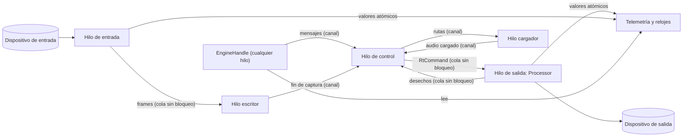
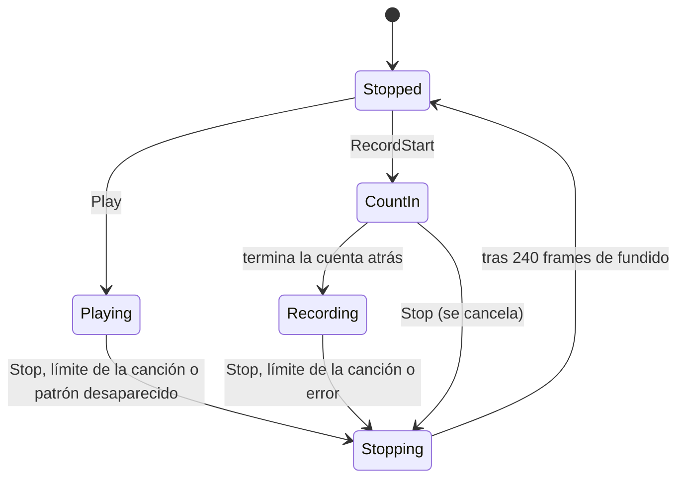

# Carabo · Especificación · 06 — Motor de audio

> **PROMPT PARA EL AGENTE — léelo antes de seguir**
>
> Eres un agente de programación que trabaja en el repositorio de **Carabo**, un DAW de escritorio para Windows 11. Este documento define **el interior del motor de audio**: el crate de Rust `carabo-engine`, en la carpeta `engine/`. Explica sus hilos, lo que está prohibido en el hilo de audio, el recorrido de la señal y cada algoritmo.
>
> - Léelo en toda tarea que toque `engine/`. Lee siempre §1 a §7 y, además, el capítulo del módulo que tu tarea toca.
> - **Las reglas de §4 no admiten excepciones.** Si para terminar tu tarea necesitas reservar memoria, usar un cerrojo o tocar el disco dentro del hilo de audio, el diseño de tu solución es incorrecto: mueve ese trabajo a otro hilo.
> - Las fórmulas y los números de este documento son exactos: impleméntalos tal cual, porque las pruebas (08) comparan muestra a muestra.
> - Este documento fija comportamientos y algoritmos, no firmas de bibliotecas externas. Para los nombres exactos de las funciones de `cpal`, `rubato`, `symphonia`, `hound`, `rtrb` y el codificador de MP3, consulta la documentación de la versión fijada en `Cargo.lock` (07).
> - Lo que el motor ofrece hacia fuera (API pública) está en 04 §5. Las estructuras de la instantánea están en 05 §10. Las constantes en `MAYÚSCULAS`, en 00 §4. Los términos, en el glosario (00 §7).

---

## 1. Qué hace el motor y qué no

El motor:

1. Recibe **instantáneas** (`EngineSnapshot`, 05 §10) y hace sonar lo que describen.
2. Lleva el **transporte**: reproducir, parar, cuenta atrás, grabar, bucle y posición.
3. **Graba** la entrada en un archivo WAV, alineada con lo que suena.
4. **Importa** archivos de audio, **exporta** la canción y calcula los **picos** para dibujar ondas.
5. Enumera y abre los **dispositivos** de audio, y mide el **retardo de ida y vuelta**.
6. Informa a la interfaz con **telemetría** y eventos.

El motor **no** hace nada de esto: guardar o editar el proyecto; conocer clips o bloques (solo recibe segmentos ya resueltos); resolver la regla de tapado; decidir nada musical; escribir en la carpeta de proyecto otra cosa que archivos de `audio/` y `peaks/`; depender de Tauri (AR-06).

Tres ideas sostienen todo el diseño:

1. **Un solo cálculo.** Un único objeto, el `Processor`, calcula el sonido bloque a bloque. Lo usan por igual el hilo de audio (en directo) y la exportación (sin dispositivo). No existe un segundo camino. Por eso lo que se exporta es exactamente lo que se oye (RF-601) y el motor se puede probar sin tarjeta de sonido.
2. **El audio que suena está en memoria.** Todo archivo de audio que aparece en la instantánea se carga entero en memoria antes de sonar (§9.1). El hilo de audio no lee nunca del disco. El coste es memoria: 11,5 MB por minuto de audio mono.
3. **El hilo de audio solo calcula.** Todo lo que puede tardar o fallar (archivos, dispositivos, memoria) ocurre en otros hilos, que le entregan datos ya preparados (§5).

Una advertencia de vocabulario: en este documento, «bloque» a secas es un **bloque de audio**, el grupo de frames que el dispositivo pide de una vez. El bloque de patrón de la pestaña Canción se nombra siempre completo, y el motor no lo conoce: solo recibe segmentos.

## 2. Estructura del crate

```text
engine/
├── Cargo.toml
├── src/
│   ├── lib.rs               API pública (04 §5)
│   ├── constants.rs         Constantes de 00 §4
│   ├── time.rs              Conversiones de 05 §2
│   ├── error.rs             EngineError
│   ├── snapshot.rs          Tipos de EngineSnapshot (05 §10) y su validación (§5.5)
│   ├── project.rs           EngineProject: la instantánea preparada para el hilo de audio (§5.3)
│   ├── kits.rs              Carga de los kits (§8.4)
│   ├── audio_pool.rs        Audio cargado en memoria e hilo cargador (§9.1)
│   ├── engine.rs            Engine, EngineHandle e hilo de control (§3, §5.1)
│   ├── telemetry.rs         Valores atómicos compartidos, Telemetry y EngineEvent (§18)
│   ├── rt/                  Todo lo que se ejecuta en el hilo de audio de salida
│   │   ├── processor.rs     Processor: calcula cada bloque (§7)
│   │   ├── transport.rs     Estados, posición, bucle, cuenta atrás y saltos (§6)
│   │   ├── sequencer.rs     De pasos a golpes (§8.1)
│   │   ├── sampler.rs       Voces de los sonidos de kit (§8.2)
│   │   ├── audio_track.rs   Segmentos de audio y microfundidos (§9.2)
│   │   ├── strip.rs         Canal: efectos, volumen, panorama y medidor (§10)
│   │   ├── master.rs        Canal maestro (§10.3)
│   │   ├── metronome.rs     Clic de la claqueta y tono de prueba (§12)
│   │   └── commands.rs      Órdenes del hilo de control al de salida (§5.2)
│   ├── dsp/                 Procesado de señal, sin estado global
│   │   ├── biquad.rs        Filtro de segundo orden (§11.1)
│   │   ├── eq.rs            Ecualizador de tres bandas (§11.2)
│   │   ├── reverb.rs        Reverb (§11.3)
│   │   └── ramp.rs          Rampas de parámetros (§10.2)
│   ├── io/                  Dispositivos
│   │   ├── devices.rs       Enumerar y elegir (§13.1)
│   │   ├── output.rs        Flujo de salida (§13.2)
│   │   ├── input.rs         Flujo de entrada y captura (§13.3, §14.1)
│   │   ├── resample.rs      Conversión de frecuencia en la frontera (§13.4)
│   │   └── clock.rs         Relación entre el reloj de entrada y el de salida (§14.2)
│   ├── record/
│   │   ├── recorder.rs      Secuencia de una grabación (§14.4, §14.5)
│   │   └── writer.rs        Hilo escritor (§14.3)
│   ├── files/
│   │   ├── wav.rs           Leer y escribir WAV
│   │   ├── decode.rs        Importación (§17.1)
│   │   ├── mp3.rs           Codificación MP3 (§16.3)
│   │   └── peaks.rs         Archivos de picos (§17.2)
│   ├── offline.rs           Cálculo sin dispositivo y exportación (§16)
│   ├── calibration.rs       Medición del retardo (§15)
│   └── bin/render.rs        Programa auxiliar de línea de órdenes (§21)
└── tests/                   Pruebas de integración (08)
```

Reglas de dependencia dentro del crate:

- `rt/` y `dsp/` no importan de `io/`, `record/`, `files/`, `audio_pool`, `engine` ni `offline`. Solo usan `constants`, `time`, `project`, `telemetry` y entre sí.
- `dsp/` no importa de `rt/`.
- Solo `io/` usa `cpal` y `rubato` (además de `files/decode.rs`, que usa `rubato` para importar). Solo `files/` usa `hound`, `symphonia` y el codificador de MP3.
- `lib.rs` expone además, bajo `#[doc(hidden)] pub mod testing`, lo necesario para que las pruebas de `engine/tests/` manejen el `Processor` sin dispositivo (08 §8.1). Ningún otro código usa ese módulo.

## 3. Hilos

| Hilo | Lo crea | Qué hace | Restricciones |
|---|---|---|---|
| **Salida de audio** | `cpal`, al abrir el flujo de salida | Cada vez que el dispositivo pide un bloque, llama a `Processor::process` y entrega el resultado | Tiempo real: §4 |
| **Entrada de audio** | `cpal`, al abrir el flujo de entrada | Recibe cada bloque del micrófono, mide su pico y, si hay una captura en curso, pasa los frames al escritor | Tiempo real: §4 |
| **Control** | `Engine::start` | Atiende las llamadas del `EngineHandle` (§5.1): prepara instantáneas, abre y cierra dispositivos, dirige grabaciones, recoge lo que el hilo de salida desecha y vigila errores. Da una vuelta cada 5 ms aunque no haya llamadas | Puede bloquear |
| **Cargador** | `Engine::start` | Lee archivos de audio del disco y los deja en memoria (§9.1) | Puede bloquear |
| **Escritor** | `Engine::start` | Escribe en su destino los frames capturados (§14.3) | Puede bloquear |

- Los flujos de `cpal` se crean, se guardan y se destruyen siempre en el hilo de control.
- La exportación, la importación y la calibración no tienen hilo propio en el motor: se ejecutan en el hilo desde el que se las llama (una tarea del programa nativo, 04 §8).



## 4. Reglas del hilo de audio

Se aplican a **todo** el código que se ejecuta dentro de las funciones que `cpal` llama para pedir o entregar audio: los hilos de salida y de entrada. Corresponden a RNF-11. Una prueba automática las hace cumplir (08).

| Id | En el hilo de audio está prohibido | Qué se hace en su lugar |
|---|---|---|
| RT-01 | Reservar memoria: `Box::new`, `Vec` que crece, `String`, `format!`, `clone` de algo que reserva, `collect` | Todos los búferes se reservan antes, en otro hilo, con su tamaño máximo (§19) |
| RT-02 | Liberar memoria: dejar que se destruya un `Arc`, un `Vec` o un `Box` cuya cuenta llega a cero | Lo que sobra se envía al hilo de control por la cola de desechos (§5.6) |
| RT-03 | Cerrojos y esperas: `Mutex`, `RwLock`, `Condvar`, canales que bloquean, `thread::sleep`, `park` | Colas sin bloqueo de un productor y un consumidor, y valores atómicos (§5) |
| RT-04 | Entrada y salida: archivos, consola, registro, red | Otros hilos leen y escriben; el de audio solo toca memoria |
| RT-05 | Llamadas al sistema que puedan bloquear | Solo se permite leer el reloj monótono (`Instant::now`) |
| RT-06 | Provocar un pánico: `unwrap`, `expect`, índices sin comprobar, división entera por cero | Todo acceso usa `get` o índices cuyo rango está garantizado por construcción; ante un estado imposible se aplica §20 |
| RT-07 | Bucles cuya duración depende de datos sin cota | Toda iteración está acotada por una constante de §19 |
| RT-08 | Dejar números desnormalizados en filtros y reverb | Todo valor de estado con valor absoluto menor que `1e-18` se sustituye por `0.0` |
| RT-09 | Entregar muestras que no sean números finitos | Antes de entregar un bloque, si alguna muestra no es finita, el bloque entero se sustituye por silencio y se aplica §20 |
| RT-10 | Depender del tamaño del bloque | El resultado de calcular N frames no depende de en cuántos bloques se parta (§16.4) |

Código que **sí** puede ejecutarse en el hilo de audio: aritmética, copias entre búferes ya reservados, lectura de datos inmutables compartidos (un `Arc` que ya existe), operaciones atómicas, y `push`/`pop` de colas sin bloqueo.

## 5. Comunicación entre hilos

### 5.1 Llamadas del `EngineHandle`

`EngineHandle` (04 §5) se puede clonar y usar desde cualquier hilo que no sea de audio. Salvo donde se indica, cada llamada envía un mensaje por un canal al hilo de control, que los atiende **en orden de llegada**; las que devuelven un resultado esperan la respuesta.

| Método | Qué hace | Errores (04 §6.3) |
|---|---|---|
| `set_project(snapshot)` | Valida la instantánea en el hilo que llama (§5.5). Si es válida, el hilo de control la prepara (§5.3) y la entrega al hilo de salida | `INVALID_SNAPSHOT` |
| `play(request)` | Modo canción: envía `Play`. Modo patrón: busca la pista y el patrón en la última instantánea y envía `Play` con su ranura y su índice; si no existen, no hace nada | `NO_OUTPUT_DEVICE` si no hay flujo de salida |
| `stop()`, `seek(frame)`, `set_loop(…)`, `set_metronome(…)` | Envían la orden correspondiente de §5.2 | — |
| `audition(track_id, row)` | Envía `Audition` con la ranura de la pista. Si la pista no existe, no es de ritmo, o no hay salida, no hace nada | — |
| `record_start(request)` | §14.4 | `NO_OUTPUT_DEVICE`, `NO_INPUT_DEVICE`, `IO` |
| `input_open()` | Abre el flujo de entrada si no está abierto (§13.3) | `NO_INPUT_DEVICE` |
| `input_close()` | Cierra el flujo de entrada. Con una captura en curso no hace nada | — |
| `devices()`, `select_devices(…)` | §13.1 | — |
| `calibrate()` | §15 | `NO_OUTPUT_DEVICE`, `NO_INPUT_DEVICE`, `CALIBRATION_FAILED` |
| `test_tone()` | Envía `TestTone` | `NO_OUTPUT_DEVICE` |
| `telemetry()` | Lee los valores atómicos (§18.1). No pasa por el hilo de control | — |
| `poll_events()` | Devuelve y vacía los eventos pendientes (§18.2) | — |
| `audio_pool()` | Devuelve el almacén de audio en memoria (§9.1), para que la exportación lo comparta | — |

`audition` no devuelve error: el comando `engine_audition` del programa nativo (04 §6.2) responde `NO_OUTPUT_DEVICE` consultando antes `telemetry().output_available`.

### 5.2 Órdenes del control al hilo de salida

Una cola sin bloqueo de un productor y un consumidor, con capacidad para 256 órdenes. El hilo de salida la vacía al principio de cada bloque, antes de calcular nada, y aplica las órdenes en orden.

```rust
enum RtCommand {
    SetProject(Arc<EngineProject>),          // instantánea preparada (§5.3)
    Play(PlayMode),                          // PlayMode::Song { start_frame: u64 }
                                             // PlayMode::Pattern { slot: usize, pattern_index: usize }
    Stop,
    Seek { frame: u64 },
    SetLoop { enabled: bool, start_frame: u64, end_frame: u64 },
    SetMetronome { enabled: bool },
    Audition { slot: usize, row: usize },
    RecordStart { slot: usize, start_frame: u64 },
    TestTone,
    Calibration(Arc<[f32]>),                 // señal que hay que emitir (§15)
}
```

Si la cola está llena, el hilo de control espera 1 ms y reintenta; nunca descarta una orden.

### 5.3 La instantánea preparada

El hilo de control convierte cada `EngineSnapshot` en un `EngineProject`: una estructura inmutable que contiene todo lo que el hilo de salida necesita, sin que este tenga que buscar, convertir ni calcular nada costoso.

| Contenido | Detalle |
|---|---|
| Tiempo | `tempo_bpm`; pasos por compás, pulsos por compás y ticks por pulso según `timeSignature` (4/4: 16, 4 y 960; 3/4: 12, 3 y 960; 6/8: 12, 6 y 480) |
| Pistas | Como mucho `MAX_TRACKS`, en el orden de la instantánea. Cada una lleva su **ranura** y la **generación** de esa ranura (§5.4) |
| Pista de ritmo | Índice de su kit (0 `acoustic`, 1 `electronic`, 2 `percussion`); ganancia lineal (`10^(gainDb/20)`) y silencio de cada fila; patrones; segmentos con el **índice** de su patrón en lugar de su identificador |
| Pista de audio | Segmentos con una referencia al audio en memoria (§9.1) en lugar de la ruta. Los segmentos cuyo audio aún no está cargado, o no se ha podido cargar, no figuran |
| Canal | Volumen lineal objetivo, ganancias de panorama, silenciar, solo, coeficientes del ecualizador ya calculados (§11.2) y parámetros de la reverb (§11.3) |
| Maestro | Volumen lineal objetivo |
| `any_solo` | Si alguna pista tiene «Solo» |
| `song_end_frame` | El mayor final de segmento de la instantánea: `startFrame + lengthFrames` en audio, `stepToFrame(startStep + lengthSteps)` en ritmo; 0 si no hay segmentos. Se calcula sobre la instantánea completa, incluidos los segmentos cuyo audio no está cargado |
| `audio_changed` | `true` si la lista de segmentos de audio de alguna ranura no es idéntica (mismos campos y mismo audio) a la de la instantánea preparada anterior. En la primera, `true` |
| `pattern_target` | La ranura y el índice del patrón que suena en modo patrón (el de la última llamada `play` en ese modo), o `None` si esa pista o ese patrón ya no existen o no hay ninguno |

El hilo de control conserva la última `EngineSnapshot` recibida para poder prepararla de nuevo cuando termina una carga de audio (§9.1).

### 5.4 Ranuras de pista

El hilo de salida guarda, para cada pista, un estado que debe sobrevivir a los cambios de instantánea: voces que suenan, memoria de los filtros y de la reverb, rampas y medidores. Ese estado vive en `MAX_TRACKS` **ranuras** (`slot`) fijas, numeradas de 0 a 15.

- El hilo de control lleva la correspondencia entre identificador de pista y ranura. Una pista conserva su ranura mientras exista en las instantáneas sucesivas. A una pista nueva se le da la ranura libre de número más bajo.
- Cada ranura tiene una **generación**: un número que el hilo de control aumenta en 1 cada vez que asigna la ranura a una pista nueva. Cada pista del `EngineProject` lleva su ranura y la generación de esa ranura.
- El hilo de salida recuerda la generación con la que puso a cero cada ranura por última vez. Al adoptar una instantánea (§6.6), pone a cero el estado de toda ranura cuya generación ha cambiado y el de toda ranura que ya no usa ninguna pista. Así no se hereda el estado de una pista anterior, aunque alguna instantánea intermedia no llegue a adoptarse.

### 5.5 Validación de la instantánea

`set_project` rechaza con `INVALID_SNAPSHOT` una instantánea que incumpla alguna de estas condiciones. El motor sigue con la anterior.

- `snapshotVersion` es 1; `tempoBpm` es un entero entre `TEMPO_MIN` y `TEMPO_MAX`; `timeSignature` es uno de los tres valores; hay como mucho `MAX_TRACKS` pistas; los identificadores de pista no se repiten.
- Canal de cada pista y maestro: `gainDb` entre `FADER_MIN_DB` y `FADER_MAX_DB`; `pan` entre −100 y 100; las dos unidades de efecto, `eq` y `reverb`, con sus valores dentro de los rangos de 05 §3.
- Pista de ritmo: 8 filas, con `gainDb` entre `ROW_GAIN_MIN_DB` y `ROW_GAIN_MAX_DB`; `kitId` es uno de los kits cargados; como mucho `MAX_PATTERNS_PER_TRACK` patrones; cada patrón tiene 8 filas de `lengthSteps` niveles entre 0 y 3, y `lengthSteps` es 1, 2 o 4 veces los pasos por compás; cada segmento se refiere a un patrón de la pista.
- Segmentos de toda pista: ordenados por su inicio, sin solapes, de longitud 1 o mayor, y terminan como muy tarde en `MAX_SONG_FRAMES` (los de ritmo, convertidos con `stepToFrame`).
- Segmento de audio: `channels` es 1 o 2; `regionLengthFrames ≥ 1`; `phaseFrames ≥ 0`; `regionStartFrame ≥ 0`.

Un archivo de audio que no existe o no se puede cargar no invalida la instantánea: se trata según §9.1.

### 5.6 Desechos

Una cola sin bloqueo del hilo de salida al de control, con capacidad para 64 elementos, para todo lo que el hilo de salida deja de usar y no puede liberar (RT-02): instantáneas preparadas anteriores y señales de calibración. El hilo de control vacía la cola en cada vuelta y, además, justo antes de enviar una orden `SetProject` o `Calibration`, de modo que la cola no llega a llenarse. Como defensa, si el hilo de salida la encuentra llena, guarda el elemento en una lista fija de 8 huecos y lo reintenta en el bloque siguiente.

### 5.7 Del hilo de audio hacia fuera

Solo con valores atómicos (§18.1) y con las dos colas sin bloqueo ya descritas: desechos (salida → control) y frames capturados (entrada → escritor). El hilo de audio nunca envía mensajes que reserven memoria.

## 6. Transporte

### 6.1 Estados



| Estado | Qué suena | Posición |
|---|---|---|
| `Stopped` | Solo las escuchas de sonidos (§8.3), el tono de prueba (que puede sonar en cualquier estado) y la señal de calibración | No avanza. Se informa como 0 |
| `Playing`, modo canción | La canción | Avanza; con el bucle en uso, salta |
| `Playing`, modo patrón | Un patrón de una pista de ritmo, en bucle | Frames desde el principio del patrón |
| `CountIn` | Solo los clics de la cuenta atrás | No avanza: vale el frame donde empezará la grabación |
| `Recording` | La canción, salvo la pista que se graba | Avanza. El bucle no actúa |
| `Stopping` | Lo mismo que en el estado del que viene, que se sigue calculando igual, multiplicado en el maestro por una rampa lineal de 1 a 0 en `MICROFADE_FRAMES` frames | Como en el estado del que viene |

Al pasar de `Stopping` a `Stopped`, el hilo de salida apaga todas las voces y pone a cero la memoria de filtros y reverbs de todas las ranuras.

En la telemetría (04 §6.4), `Stopping` se informa como `stopped`.

### 6.2 Posición y reloj del motor

- La **posición** es un número de frames (`u64`): en modo canción, desde el principio de la canción; en modo patrón, desde el principio del patrón.
- El **reloj del motor** es el número total de frames a 48 000 Hz que el hilo de salida ha calculado desde que arrancó el motor. Nunca retrocede ni se detiene, tampoco en `Stopped`. Sirve para relacionar la entrada con la salida (§14.2). En un cálculo sin dispositivo empieza en 0.

### 6.3 Órdenes de transporte

| Orden | Estado en que vale | Efecto |
|---|---|---|
| `Play(Song { start_frame })` | `Stopped` | Estado `Playing`, modo canción, posición `start_frame`; nivel de salto 0 (§6.5); el contador de cortes de audio vuelve a 0 |
| `Play(Pattern { slot, pattern_index })` | `Stopped` | Estado `Playing`, modo patrón, posición 0; el contador de cortes vuelve a 0 |
| `Play(Pattern { … })` | `Playing` en modo patrón | Cambia la pista o el patrón sin parar y **reubica la posición** (abajo) |
| `Stop` | `Playing`, `CountIn`, `Recording` | Estado `Stopping`. En `CountIn` y `Recording`, además, §14.5 |
| `Seek { frame }` | `Playing` en modo canción | Queda como cambio pendiente (§6.5) |
| `SetLoop`, `SetMetronome` | Cualquiera | Sustituyen el estado y el tramo del bucle, o el estado de la claqueta, desde este bloque |
| `Audition` | Todos menos `CountIn` | §8.3 |
| `RecordStart { slot, start_frame }` | `Stopped` | Estado `CountIn`; posición `start_frame`; el contador de la cuenta atrás vale `tickToFrame(ticksPorCompás · COUNT_IN_BARS)`; §14.4 |
| `TestTone` | Cualquiera | §12 |
| `Calibration` | `Stopped` | §15 |

- Una orden que llega en un estado en que no vale se ignora. Excepción: `Play` y `RecordStart` recibidas en `Stopping` dan el fundido por terminado, pasan por `Stopped` (con su puesta a cero) y se ejecutan.
- En toda transición que sale de `Stopped`, las ganancias con rampa (§10.2) toman su objetivo de golpe, sin transición.

**Reubicar la posición en modo patrón.** Se aplica al cambiar de patrón y cuando el patrón que suena pasa a ser más corto que la posición actual. Con `p` = posición actual y `L` = `lengthSteps` del patrón nuevo:

```text
s      = el mayor paso con stepToFrame(s) ≤ p
resto  = p − stepToFrame(s)
p      = min( stepToFrame(s mod L) + resto,  stepToFrame(L) − 1 )
```

Así el patrón nuevo sigue en el mismo paso, módulo su longitud, y en el mismo punto dentro del paso (RF-102).

### 6.4 Subbloques

Un bloque de `n` frames se calcula por **subbloques**: tramos en los que la posición avanza sin saltos y nada cambia de estado. Antes de calcular, el `Processor` parte lo que queda del bloque en el primer punto donde ocurre algo:

| Suceso | Dónde se parte | Qué ocurre en ese punto |
|---|---|---|
| Punto cero de un cambio pendiente (§6.5) | A `max(nivel − 1, 0)` frames | Se aplica el cambio |
| Empieza la bajada previa al fin del bucle (§6.5) | En `loop_end − 240` | El nivel de salto empieza a bajar |
| Fin del tramo de bucle | En `loop_end` | La posición pasa a `loop_start` |
| Fin del patrón (modo patrón) | En `stepToFrame(lengthSteps)` | La posición pasa a 0 |
| Fin de la cuenta atrás | Cuando su contador llega a 0 | Estado `Recording` |
| Límite de la canción (modo canción y grabación) | En `MAX_SONG_FRAMES` | Estado `Stopping`; en `Recording`, además, §14.5 |
| Fin del fundido de parada | A los `MICROFADE_FRAMES` frames de entrar en `Stopping` | Estado `Stopped` |

Además, ningún subbloque mide más de `MAX_BLOCK` frames (§19).

El **bucle está en uso** cuando el estado es `Playing` en modo canción, el bucle está activado y la posición es menor que `loop_end`. Si la reproducción empieza en `loop_end` o después, no hay salto (RF-111).

### 6.5 Envolvente de salto y cambios pendientes

Cuando la posición salta, o cuando cambia el audio que hay bajo ella, las pistas de audio sufrirían un corte brusco. Para evitarlo, la fuente de **todas las pistas de audio** se multiplica por una **ganancia de salto**, que baja a 0 antes del cambio y vuelve a 1 después. No afecta a las pistas de ritmo.

El transporte lleva un contador `jump_level` (el **nivel de salto**), entero entre 0 y 240 (`MICROFADE_FRAMES`). Para cada frame de `Playing` en modo canción y de `Recording`, **antes** de calcularlo:

```text
1. bajar = hay un cambio pendiente,
           o bien el bucle está en uso y loop_end − posición ≤ 240
2. si bajar:  jump_level = max(0, jump_level − 1)
   si no:     jump_level = min(240, jump_level + 1)
3. si jump_level = 0 y hay un cambio pendiente: se aplica ahora, antes de calcular este frame, y deja de estar pendiente
4. ganancia de salto de este frame = jump_level / 240
```

Dentro de un subbloque, `bajar` no cambia (§6.4), así que la ganancia de cada frame se obtiene sumando o restando 1 por frame al nivel, con sus límites.

Un **cambio pendiente** es una o las dos cosas siguientes, que se aplican juntas en el punto cero:

- **Un salto de posición** (`Seek`): la posición pasa a `frame`, y todas las voces que suenan en las pistas de ritmo empiezan a apagarse (`fade_left = MICROFADE_FRAMES`, §8.2). Si llega otro `Seek` antes del punto cero, vale el último.
- **Una instantánea con el audio cambiado** (§6.6). Si llega otra antes del punto cero, la sustituye y la sustituida va a la cola de desechos.

Al llegar a `Stopped` con un cambio pendiente, la instantánea pendiente se adopta al momento y el salto pendiente se descarta.

Consecuencias:

- Al empezar a reproducir, el nivel vale 0: el audio entra con un fundido de 5 ms.
- En el salto del bucle, el último frame antes de `loop_end` sale con ganancia 0 y el audio vuelve a entrar en `loop_start` con un fundido de 5 ms. Las voces de las pistas de ritmo no se tocan: los golpes siguen sonando a través del salto.
- Un `Seek` se hace efectivo como mucho 240 frames (5 ms) después de recibirse (RF-114).

### 6.6 Adopción de una instantánea

Al recibir `SetProject(nueva)`:

- Si el estado es `Playing` en modo canción o `Recording`, y además `nueva.audio_changed` es `true` o ya hay una instantánea pendiente: `nueva` queda como cambio pendiente (§6.5).
- En cualquier otro caso se adopta al momento.

**Adoptar** una instantánea es, en este orden:

1. Sustituir la referencia a la instantánea en uso; la anterior va a la cola de desechos.
2. Poner a cero las ranuras cuya generación ha cambiado y las que ya no usa ninguna pista (§5.4).
3. Si el tempo ha cambiado y el estado es `Playing` o `Recording`: la posición, `loop_start` y `loop_end` se multiplican por `tempoAnterior / tempoNuevo` y se redondean al entero más cercano, de modo que la posición musical se conserva (RF-106). La interfaz envía después el tramo de bucle exacto con `SetLoop` (04 §3.2).
4. En modo patrón: si `pattern_target` es `None`, el estado pasa a `Stopping`. Si no, la ranura y el índice del patrón que suena pasan a ser los de `pattern_target`, y si la posición es mayor o igual que `stepToFrame(lengthSteps)` se reubica (§6.3).
5. Los objetivos de las ganancias con rampa pasan a ser los de la instantánea nueva (§10.2). Los coeficientes del ecualizador y los parámetros de la reverb se sustituyen, conservando la memoria de los filtros.

## 7. Cálculo de un bloque

`Processor::process(out: &mut [f32], n: usize)` escribe `n` frames estéreo entrelazados (`L, R, L, R…`). Pasos, en este orden:

1. Vaciar la cola de órdenes y aplicar cada una (§5.2, §6.3, §6.6).
2. Mientras queden frames por calcular: determinar el siguiente subbloque de `m` frames (§6.4) y calcularlo:
   1. Poner a cero el búfer del maestro.
   2. Para cada pista de la instantánea, en su orden:
      - generar su **fuente** en el búfer de pista, estéreo, según la tabla siguiente (§8, §9);
      - pasarla por su **canal**: ecualizador, reverb, volumen, panorama y medidor (§10);
      - sumarla al búfer del maestro.
   3. Sumar al búfer del maestro los clics de la claqueta o de la cuenta atrás (§12).
   4. Aplicar el canal maestro (§10.3), que añade al final el tono de prueba y la señal de calibración si están activos.
   5. Copiar el resultado a `out`.
   6. Avanzar la posición (si el estado la hace avanzar) y el reloj del motor en `m` frames, y ejecutar el suceso que cerró el subbloque (§6.4).
3. Publicar los valores atómicos de la telemetría (§18.1).

Fuente y audibilidad de cada pista según el estado:

| Estado | Fuente de una pista de ritmo | Fuente de una pista de audio | `audible` |
|---|---|---|---|
| `Stopped`, `CountIn` | Solo sus voces ya disparadas (escuchas); no se secuencia | Silencio; su canal no se calcula | Ritmo: 1 |
| `Playing`, modo canción | Secuenciada (§8.1) | Sus segmentos (§9.2) | Regla de silenciar y solo |
| `Playing`, modo patrón | La pista elegida, secuenciada con el patrón elegido; las demás, solo sus voces ya disparadas | Silencio; su canal no se calcula | 1 la pista elegida; 0 las demás |
| `Recording` | Secuenciada | Sus segmentos, salvo la pista que se graba, que es silencio | Regla de silenciar y solo |
| `Stopping` | Como en el estado del que viene | Como en el estado del que viene | Como en el estado del que viene |

**Regla de silenciar y solo** (RF-403): `audible` vale 1 si la pista no tiene «Silenciar» y, además, ninguna pista tiene «Solo» o ella lo tiene; vale 0 en otro caso. `audible` no detiene el cálculo de la pista: multiplica su volumen objetivo (§10.2), de modo que silenciar y dejar de silenciar se oyen con una rampa de 10 ms y la reverb de una pista silenciada sigue su curso sin oírse.

La entrada no se suma nunca a la salida (RF-509).

## 8. Pistas de ritmo

### 8.1 De pasos a golpes

El frame en que suena el paso `s` (índice de paso contado desde el principio de la canción o del patrón) es el de 05 §2.2:

```text
frame(s) = round(s · 720000 / tempoBpm)        en f64: primero el producto, luego la división, luego round
```

Para un subbloque de `m` frames que empieza en la posición `p`, el secuenciador recorre los pasos cuyo frame cae en `[p, p + m)`:

```text
s = max(0, floor(p · tempoBpm / 720000) − 1)
mientras frame(s) < p + m:
    si frame(s) ≥ p:  emitir los golpes del paso s con retraso (frame(s) − p)
    s = s + 1
```

Qué paso de patrón corresponde al paso `s`:

- **Modo canción**: se busca, con búsqueda binaria, el segmento de la pista que contiene `s` (`startStep ≤ s < startStep + lengthSteps`). Si no hay, no suena nada. Si lo hay, el paso del patrón es `q = (phaseSteps + s − startStep) mod pattern.lengthSteps`.
- **Modo patrón**: `q = s`.

Para cada fila `r` de 0 a 7, en orden creciente, si `pattern.steps[r][q] > 0` y la fila no está silenciada, se dispara una voz con:

```text
ganancia = LEVEL_GAINS[nivel] · gananciaLinealDeLaFila
```

### 8.2 Voces

Cada ranura tiene un conjunto fijo de `MAX_VOICES + 8` = 40 voces:

```rust
struct Voice {
    active: bool,
    row: u8,
    choke_group: u8,        // 0 = sin grupo
    kit: u8,                // índice del kit con el que se disparó
    sound: u8,              // índice del sonido dentro de ese kit (la fila)
    pos: usize,             // siguiente frame del sonido que hay que leer
    gain: f32,
    delay: usize,           // frames de espera dentro del subbloque actual antes de empezar a sonar
    fade_left: u16,         // 0 = no se está apagando; si no, frames que le quedan de fundido
    age: u64,               // número de orden de disparo dentro de la ranura (contador que crece con cada disparo)
}
```

**Disparar una voz** (fila `r`, ganancia `g`, retraso `d`):

1. Si el sonido de la fila tiene grupo de corte, toda voz activa de la ranura con ese grupo y de **otra** fila, que no se esté apagando ya, empieza a apagarse: `fade_left = MICROFADE_FRAMES` (RF-213).
2. Si ya hay `MAX_VOICES` voces activas que no se están apagando, la de menor `age` empieza a apagarse.
3. Se ocupa la voz libre de índice más bajo. Si no hay ninguna libre, se toma la que se está apagando con menor `fade_left` (a igualdad, la de índice más bajo).
4. La voz nueva empieza con `pos = 0`, `gain = g`, `delay = d`, `fade_left = 0`.

**Calcular las voces** de una ranura en un subbloque de `m` frames. Para cada voz activa, y para cada frame `i` desde `delay` hasta `m − 1`:

```text
factor  = fade_left / MICROFADE_FRAMES   si se está apagando;   1   si no
muestra = sonido[pos] · gain · factor
búferDePista[i] (izquierdo y derecho) += muestra
pos += 1
si se está apagando:  fade_left −= 1
la voz deja de estar activa cuando pos llega al final del sonido, o cuando fade_left llega a 0 estando apagándose
```

Al final del subbloque, `delay` pasa a 0 (o se le resta `m` si era mayor, lo que no ocurre con los retrasos de §8.1). Los sonidos de kit son mono: la misma muestra va a los dos canales.

Los sonidos de un bloque de patrón no se cortan al terminar su segmento: la voz sigue hasta el final del sonido (RF-322).

Una voz lee siempre del kit con el que se disparó: si una instantánea nueva cambia el kit de la pista, las voces que ya suenan terminan con su sonido original y las nuevas usan el kit nuevo.

### 8.3 Escuchar un sonido

La orden `Audition { slot, row }` dispara una voz de esa fila con retraso 0 y ganancia `LEVEL_GAINS[2] · gananciaLinealDeLaFila`, aunque la fila esté silenciada. La voz suena por el canal de la pista, como cualquier otra (RF-206). En `Stopped`, toda pista de ritmo tiene `audible = 1`, de modo que la escucha suena aunque la pista esté silenciada; durante la reproducción se aplica el `audible` del estado (§7).

### 8.4 Kits

`Engine::start` carga los tres kits desde `kits_dir` (05 §8): para cada carpeta `acoustic`, `electronic` y `percussion`, lee `kit.json` y sus 8 archivos WAV a memoria como `f32` mono. Un grupo de corte distinto de `null` se convierte en un número mayor que 0, el mismo para todos los sonidos del kit con ese nombre de grupo. Si falta un kit, o un WAV no es mono a 48 000 Hz en 16 bits o en coma flotante de 32 bits, o dura más de 4 segundos, `Engine::start` devuelve error. Los tres kits permanecen en memoria mientras el programa está en marcha y no cambian; cada `Processor` recibe al crearse una referencia a los tres.

## 9. Pistas de audio

### 9.1 Audio en memoria

Todo archivo de audio que suena está **entero en memoria**. El hilo de audio no lee nunca del disco (RT-04).

```rust
pub struct LoadedAudio {
    pub channels: usize,      // 1 o 2
    pub frames: usize,
    pub samples: Box<[f32]>,  // entrelazado si es estéreo
}

#[derive(Clone)]
pub struct AudioPool { /* Arc<Mutex<HashMap<PathBuf, PoolEntry>>> */ }

enum PoolEntry { Loading, Loaded(Arc<LoadedAudio>), Failed }
```

El **almacén** (`AudioPool`) es un diccionario de ruta absoluta a audio cargado. Lo comparten el hilo de control, el cargador y la exportación; el cerrojo que lo protege no se toma nunca en un hilo de audio.

**Cargar un archivo** (`files/wav.rs`): se abre el WAV, se comprueba que cumple 05 §6.2 (48 000 Hz, coma flotante de 32 bits, 1 o 2 canales) y se lee completo, directamente en su búfer definitivo. La memoria se reserva con una función que devuelve error si no hay memoria suficiente, en lugar de abortar el programa. La carga falla si el archivo no existe, no se puede leer, no tiene ese formato o no cabe en memoria.

**En directo**, cada vez que el hilo de control prepara una instantánea (§5.3):

1. Para cada ruta de sus segmentos de audio que no esté en el almacén: la anota como `Loading` y la envía al cargador.
2. Prepara el `EngineProject` solo con los segmentos cuyo audio está `Loaded`, y lo entrega al hilo de salida sin esperar a las cargas.
3. Elimina del almacén las entradas `Loaded` y `Failed` cuya ruta no aparece en esta instantánea. La memoria de un audio eliminado se libera cuando ya no lo usa ninguna instantánea preparada (cuando el hilo de control recoge de la cola de desechos la última que lo usaba).

El **hilo cargador** recibe rutas, carga cada archivo y devuelve el resultado al hilo de control, que actualiza la entrada a `Loaded` o `Failed`. Cuando no queda ninguna entrada en `Loading`, el hilo de control:

- prepara de nuevo la última instantánea recibida y la entrega al hilo de salida, que la adopta con la ganancia de salto si se está reproduciendo (§6.6), de modo que el audio recién cargado entra con un fundido;
- si alguna carga ha fallado desde el aviso anterior, emite una sola vez el evento `AudioUnavailable` con el texto `file` de cada archivo fallido, tal como venía en la instantánea (§18.2). Una entrada `Failed` no se vuelve a cargar mientras siga en el almacén.

Consecuencias que conviene conocer:

- Reproducir nunca espera a una carga: lo que ya está en memoria suena al momento (RF-101) y lo demás se incorpora cuando termina de cargarse. Con archivos de pocos minutos la espera es de décimas de segundo.
- Memoria: un minuto de audio mono ocupa 11,5 MB; uno estéreo, 23 MB (RNF-07).

**Sin dispositivo** (§16), el audio se carga de forma síncrona antes de empezar a calcular, reutilizando lo que ya esté `Loaded` en el almacén que se reciba y sin modificar ese almacén. Un archivo que no se puede cargar es silencio.

### 9.2 Cálculo de los segmentos

Para un subbloque que empieza en la posición `p` y mide `m` frames, y para cada segmento de la pista que se cruza con `[p, p + m)` (se localiza el primero con búsqueda binaria y se avanza mientras `startFrame < p + m`):

```text
Para cada frame de canción f en la intersección de [p, p + m) con [startFrame, startFrame + lengthFrames):
    t = f − startFrame                                   (frame dentro del segmento)
    r = (phaseFrames + t) mod regionLengthFrames         (frame dentro de la región)
    k = regionStartFrame + r                             (frame del archivo)

    F1 = min(MICROFADE_FRAMES, floor(lengthFrames / 2))
    F2 = min(MICROFADE_FRAMES, floor(regionLengthFrames / 2))
    gEntrada = min(1, t / F1)
    gSalida  = min(1, (lengthFrames − 1 − t) / F1)
    gRegión  = min(1, r / F2, (regionLengthFrames − 1 − r) / F2)
    g = min(gEntrada, gSalida, gRegión)                  (si F1 o F2 valen 0, g = 0)
    g = g · gananciaDeSalto(f)                           (§6.5)

    si k < frames del archivo:
        mono:    búferDePista[f − p], izquierdo y derecho = muestra[k] · g
        estéreo: izquierdo = muestra[2k] · g;   derecho = muestra[2k + 1] · g
    si no: silencio
```

- `gEntrada` y `gSalida` son el microfundido en los bordes de cada tramo audible; `gRegión`, el de las uniones entre repeticiones (RF-322). Con estas fórmulas, la primera y la última muestra de cada segmento valen exactamente 0.
- Los segmentos de una pista no se solapan (05 §10), así que cada frame recibe como mucho una fuente.
- Las divisiones se hacen en `f32`.

## 10. Canal de mezcla

### 10.1 Orden

Para cada pista cuyo canal se calcula (§7), sobre su búfer estéreo de `m` frames (RF-408):

```text
fuente → Ecualizador → Reverb → Volumen y panorama → medidor → suma al maestro
```

### 10.2 Volumen, panorama y rampas

Ganancias objetivo de una pista:

```text
volumen  = 0 si gainDb ≤ FADER_MIN_DB;   10^(gainDb / 20) si no
panIzq   = 1 si pan ≤ 0;   1 − pan/100 si no
panDer   = 1 si pan ≥ 0;   1 + pan/100 si no
objetivoIzq = volumen · audible · panIzq                 («audible»: §7)
objetivoDer = volumen · audible · panDer
```

Las ganancias que se aplican no saltan al objetivo: lo alcanzan con una **rampa lineal de 480 frames** (10 ms, RF-401). Cada ganancia con rampa guarda su valor actual, su incremento y los frames que le quedan:

```text
cuando el objetivo cambia:   quedan = 480;   incremento = (objetivo − actual) / 480
en cada frame:               si quedan > 0:  actual += incremento;  quedan −= 1;  si quedan = 0:  actual = objetivo
```

El objetivo se comprueba al principio de cada subbloque; el valor avanza frame a frame.

Llevan rampa: las dos ganancias de cada pista, el volumen del maestro, la mezcla del ecualizador (§11.2) y la cantidad de reverb (§11.3). Una ranura recién puesta a cero empieza con el valor actual igual al objetivo, sin rampa. En toda transición que sale de `Stopped`, y al llegar a `Stopped`, todas toman su objetivo de golpe (§6.3).

El medidor de la pista guarda, por canal, el mayor valor absoluto del subbloque **después** de volumen y panorama (RF-404).

### 10.3 Canal maestro

Sobre el búfer del maestro, frame a frame:

```text
x = (suma de pistas + claqueta) · volumenMaestro · rampaDeParada + tonoDePrueba + calibración
si |x| > 1:   recortadas += 1;   x = signo(x) · 1,0
medidorMaestro = max(medidorMaestro, |x|)
salida = x
```

- `volumenMaestro` se calcula como el volumen de una pista y lleva rampa.
- `rampaDeParada` vale 1 salvo en `Stopping`, donde baja linealmente de 1 a 0 a lo largo de `MICROFADE_FRAMES` frames: en el frame `i` del fundido (de 0 a 239) vale `1 − (i + 1)/240`.
- El tono de prueba y la señal de calibración no pasan por el volumen maestro, para que se oigan aunque esté bajado.
- `recortadas` es un contador que la exportación devuelve como `clipped_samples` (RF-603).

## 11. Procesado de señal

### 11.1 Filtro de segundo orden

Todos los filtros son de segundo orden en forma directa II traspuesta, con coeficientes normalizados (divididos por `a0`) y estado en `f32`. Los coeficientes se calculan en `f64` en el hilo de control y se convierten a `f32`.

```text
y  = b0·x + s1
s1 = b1·x − a1·y + s2
s2 = b2·x − a2·y
```

Tras cada frame se aplica RT-08 a `s1` y `s2`. Cada canal (izquierdo y derecho) tiene su propio estado.

### 11.2 Ecualizador

Tres filtros en serie por canal, en este orden: estante de graves, campana de medios y estante de agudos. Con `fs = 48000` y, para cada banda, `A = 10^(dB/40)`, `w0 = 2π·f0/fs`, `c = cos(w0)`, `s = sin(w0)`:

**Estante de graves** (`f0 = EQ_LOW_HZ`, `dB = lowDb`), con `α = s/2 · √2`:

```text
b0 =    A·[(A+1) − (A−1)·c + 2·√A·α]
b1 =  2·A·[(A−1) − (A+1)·c]
b2 =    A·[(A+1) − (A−1)·c − 2·√A·α]
a0 =       (A+1) + (A−1)·c + 2·√A·α
a1 =   −2·[(A−1) + (A+1)·c]
a2 =       (A+1) + (A−1)·c − 2·√A·α
```

**Campana de medios** (`f0 = EQ_MID_HZ`, `dB = midDb`), con `Q = 0,7071` y `α = s/(2·Q)`:

```text
b0 = 1 + α·A      b1 = −2·c      b2 = 1 − α·A
a0 = 1 + α/A      a1 = −2·c      a2 = 1 − α/A
```

**Estante de agudos** (`f0 = EQ_HIGH_HZ`, `dB = highDb`), con `α = s/2 · √2`:

```text
b0 =    A·[(A+1) + (A−1)·c + 2·√A·α]
b1 = −2·A·[(A−1) + (A+1)·c]
b2 =    A·[(A+1) + (A−1)·c − 2·√A·α]
a0 =       (A+1) − (A−1)·c + 2·√A·α
a1 =    2·[(A−1) − (A+1)·c]
a2 =       (A+1) − (A−1)·c − 2·√A·α
```

**Activar y desactivar.** El ecualizador tiene una mezcla con rampa cuyo objetivo es 1 si está activado y 0 si no: `salida = entrada + (ecualizada − entrada) · mezcla`. Si al principio de un subbloque la mezcla vale 0 y no tiene rampa en curso, los filtros no se calculan en ese subbloque y su estado se pone a cero.

### 11.3 Reverb

Una reverb por pista, con entrada mono y salida estéreo: por cada canal, 8 filtros de peine con amortiguación en paralelo, seguidos de 4 filtros pasa-todo en serie.

Longitudes de las líneas de retardo, en frames:

| | Peines | Pasa-todo |
|---|---|---|
| Canal izquierdo | 1215, 1293, 1390, 1476, 1548, 1623, 1695, 1760 | 605, 480, 371, 245 |
| Canal derecho | Cada una de las anteriores + 25 | Cada una de las anteriores + 25 |

Parámetros:

```text
realimentación = 0,70 + 0,28 · size/100
amortiguación  = 0,2
cantidad       = 3 · amount/100            (0 si la reverb está desactivada)
```

Por cada frame, con entrada `(inL, inR)`:

```text
x = (inL + inR) · 0,015

Para cada canal:
    suma = 0
    Para cada peine (cada uno con su búfer, su índice i y su valor «filtro»):
        salida   = búfer[i]
        filtro   = salida · (1 − amortiguación) + filtro · amortiguación
        búfer[i] = x + filtro · realimentación
        i = (i + 1) mod longitud
        suma += salida
    y = suma
    Para cada pasa-todo, en orden (cada uno con su búfer y su índice j):
        b        = búfer[j]
        salida   = b − y
        búfer[j] = y + b · 0,5
        j = (j + 1) mod longitud
        y = salida
    rev = y

outL = inL + revL · cantidadConRampa
outR = inR + revR · cantidadConRampa
```

- La señal original pasa siempre sin cambios (RF-407).
- `cantidadConRampa` sigue a `cantidad` con una rampa de 480 frames, salvo al desactivar la reverb, que baja a 0 en **960 frames** (20 ms).
- Si al principio de un subbloque la cantidad con rampa vale 0 y no tiene rampa en curso, la reverb no se calcula en ese subbloque y sus búferes y valores «filtro» se ponen a cero.
- Se aplica RT-08 a cada «filtro» y a cada valor escrito en un búfer.

### 11.4 Efectos de la versión 1.1

No se implementan en la 1.0. Se fijan aquí para que la 1.0 les deje sitio: el canal recorre una lista ordenada de unidades de efecto, y añadir una unidad no cambia las demás.

| Unidad | Posición | Algoritmo |
|---|---|---|
| Compresor (RF-450) | Tras el ecualizador | Detector de pico sobre el mayor valor absoluto de los dos canales, con suavizado de un polo: ataque 10 ms, liberación 150 ms. Reducción en dB = `(nivel − umbral) · (1 − 1/ratio)` si el nivel supera el umbral, 0 si no. Ganancia = `10^((compensación − reducción)/20)`, igual en los dos canales |
| Delay (RF-451) | Tras el compresor | Línea de retardo estéreo de hasta 2 segundos. Retardo = duración de la figura al tempo actual. `línea = entrada + salidaDeLaLínea · realimentación`; `salida = entrada + salidaDeLaLínea · cantidad` |
| Limitador (RF-452) | En el maestro, tras el volumen | Retardo de 240 frames; la ganancia baja lo necesario para que el pico previsto no pase de −0,3 dBFS y se recupera con una constante de 100 ms |
| Swing (RF-251) | Secuenciador | El frame de un paso de índice impar dentro del patrón es `round((s + swing/300) · 720000 / tempoBpm)` |
| Volumen y fundidos de clip (RF-350 a RF-352) | Cálculo de segmentos | La ganancia `g` de §9.2 se multiplica por la ganancia del clip y por sus rampas de fundido |
| Afinador (RF-801) | Hilo de control, sobre la entrada | Estimación del periodo por autocorrelación normalizada sobre ventanas de 4 096 frames, con interpolación parabólica del máximo |

## 12. Claqueta, cuenta atrás y tono de prueba

Un **clic** es un seno de 960 frames (20 ms) con envolvente lineal descendente:

```text
clic[i] = 0,25 · sin(2π · f · i / 48000) · (1 − i/960)        para i = 0 .. 959
f = 1500 Hz en el primer pulso del compás;   1000 Hz en los demás
```

Los dos clics se calculan una vez, al arrancar, y se guardan en tablas.

Frame de cada pulso, contando pulsos desde el principio de la canción o del patrón:

```text
framePulso(k) = tickToFrame(k · ticksPorPulso)          (05 §2.2)
el pulso k es el primero de su compás si   k mod pulsosPorCompás = 0
```

- **Claqueta** (RF-110): si está activada, en `Playing` (los dos modos) y en `Recording` empieza un clic en cada `framePulso(k)` que cae dentro del subbloque. Se localizan igual que los pasos en §8.1.
- **Cuenta atrás** (RF-311): en `CountIn` suenan `pulsosPorCompás` clics, el primero acentuado, en los frames `tickToFrame(j · ticksPorPulso)` para `j = 0 .. pulsosPorCompás − 1`, contados desde que empezó la cuenta atrás. Suena aunque la claqueta esté desactivada.
- Como mucho hay un clic sonando a la vez: uno nuevo sustituye al anterior.
- El clic se suma al búfer del maestro, igual en los dos canales, antes del volumen maestro.
- Sin dispositivo (§16) la claqueta está siempre desactivada.

**Tono de prueba** (`TestTone`, RF-700): seno de 440 Hz y amplitud 0,25 durante 48 000 frames, con 240 frames de fundido lineal al principio y al final, igual en los dos canales. Se suma después del volumen maestro (§10.3). Si llega otro `TestTone` mientras suena, se ignora.

## 13. Dispositivos

### 13.1 Enumerar y elegir

- Se usa el sistema de sonido por defecto de `cpal` en Windows (WASAPI en modo compartido). No se usa ASIO (DEC-19).
- `devices()` devuelve el nombre de cada dispositivo de salida y de entrada y cuál es el predeterminado de Windows (04 §6.1, `DeviceList`).
- `select_devices(output, input)`: `None` significa «el predeterminado de Windows». Si el dispositivo pedido no existe, se usa el predeterminado y se marca `output_fell_back` o `input_fell_back`. Si no hay ninguno, `output_name` o `input_name` quedan en `None`.
- Elegir dispositivos: pasa el transporte a `Stopped` (terminando una captura en curso como en §14.5, con el motivo `outputLost`); cierra los flujos abiertos; abre el flujo de salida nuevo; y, si la entrada estaba abierta, abre la entrada nueva. El motor recuerda el nombre de entrada elegido para las siguientes llamadas a `input_open`.
- `Engine::start` equivale a `select_devices(None, None)` sin abrir la entrada. Si no hay salida, el motor arranca igualmente y `output_available` vale `false`.

### 13.2 Salida

- El flujo de salida permanece abierto mientras el programa está en marcha. En `Stopped` entrega silencio, salvo escuchas, tono de prueba y calibración.
- Cada vez que se abre un flujo de salida se crea un `Processor` nuevo, en `Stopped` y con el reloj del motor en 0, junto con sus colas (§5.2, §5.6). El hilo de control le envía a continuación la última instantánea preparada y el estado del bucle y de la claqueta. Al cerrarse o perderse el flujo, el hilo de control deja los valores atómicos del transporte en `Stopped`. Mientras no hay flujo de salida, el hilo de control sigue preparando y guardando la última instantánea.
- Se abre con la configuración por defecto del dispositivo: su frecuencia, su número de canales y su formato de muestra. Si el formato no es `f32`, cada muestra se convierte al entregarla.
- Se pide el tamaño de búfer por defecto del dispositivo.
- En cada llamada, `cpal` pide un número de frames que puede variar. El hilo de salida los calcula con el `Processor`, en trozos de como mucho `MAX_BLOCK`. Todo el cálculo de la llamada va envuelto de modo que un pánico no salga de ella (§20).
- Reparto de canales: un dispositivo de 2 o más canales recibe izquierdo y derecho en sus dos primeros canales y silencio en los demás; uno de 1 canal recibe `(izquierdo + derecho) / 2`.
- Si la frecuencia del dispositivo no es 48 000 Hz, se aplica §13.4.
- **Corte de audio**: se cuenta uno cuando calcular los frames de una llamada tarda más que la duración de esos frames, y cuando `cpal` comunica un vaciado o un desbordamiento de búfer. El contador vuelve a 0 con cada `Play`.

### 13.3 Entrada

- El flujo de entrada se abre con `input_open` y se cierra con `input_close` (DEC-38). `record_start` y `calibrate` lo abren si hace falta.
- Se abre con la configuración por defecto del dispositivo. De cada frame se usa **solo el primer canal**.
- En cada llamada, el hilo de entrada: convierte las muestras a `f32`; las pasa a 48 000 Hz si hace falta (§13.4); actualiza el pico de entrada (§18.1); actualiza la relación de relojes (§14.2); y atiende la captura (§14.1).

### 13.4 Conversión de frecuencia

Si un dispositivo trabaja a una frecuencia distinta de 48 000 Hz, `io/resample.rs` convierte en la frontera con un conversor de razón fija de `rubato`, creado al abrir el flujo (RF-502):

- **Salida**: el `Processor` trabaja siempre a 48 000 Hz. El adaptador le pide trozos de 480 frames, los convierte y guarda el resultado en una cola fija; de ella saca los frames que pide el dispositivo.
- **Entrada**: el adaptador acumula los frames del dispositivo en una cola fija, los convierte por trozos y entrega frames a 48 000 Hz.

El conversor y sus colas se reservan al abrir el flujo, en el hilo de control, y en el hilo de audio se usa solo la función de `rubato` que escribe en un búfer ya reservado. El retardo fijo que añade el conversor queda incluido en el retardo de ida y vuelta que mide la calibración.

### 13.5 Desconexión

Cuando `cpal` comunica un error de flujo, la función de error solo activa una bandera atómica. El hilo de control la ve en su siguiente vuelta y:

- **Salida perdida**: pasa el transporte a `Stopped`; si había una grabación, la termina con el motivo `outputLost`; abre la salida predeterminada de Windows si existe; emite `DevicesChanged` (RF-504).
- **Entrada perdida**: cierra la entrada; si había una grabación, envía `Stop` y la termina con el motivo `inputLost`; emite `DevicesChanged`.

El motor no cambia de dispositivo por ningún otro motivo.

## 14. Captura y grabación

### 14.1 Captura

Una **captura** traslada un tramo exacto de la entrada, medido con el reloj del motor, a un destino. Tiene dos usos: grabar una toma (destino: un archivo WAV) y calibrar (destino: memoria). Solo puede haber una a la vez.

Valores atómicos de la captura:

| Valor | Tipo | Significado | Quién lo escribe |
|---|---|---|---|
| `capture_start` | `AtomicU64` | Reloj del motor del primer frame que se captura. `u64::MAX` = no hay captura | Hilo de salida; el de control lo pone a `u64::MAX` al terminar |
| `capture_end` | `AtomicU64` | Reloj del motor del primer frame que ya no se captura. `u64::MAX` = aún no se sabe | Hilo de salida |
| `capture_abort` | `AtomicBool` | Hay que terminar ya, con lo que haya | Hilo de control |
| `capture_done` | `AtomicBool` | El hilo de entrada ha entregado el último frame | Hilo de entrada |

En cada llamada, el hilo de entrada recibe los frames de entrada de índices `[jA, jB)`, contados a 48 000 Hz desde que se abrió el flujo, y hace:

```text
si capture_start = u64::MAX o capture_abort:   fase = Reposo;   terminar
si fase = Reposo:
    desfase = DEntrada − DSalida                       (§14.2; se lee una vez y vale para toda la captura)
    j0 = ceil(capture_start − desfase)
    si j0 < jA:                                        (la captura empieza tarde: no debe ocurrir)
        enviar al escritor min(jA − j0, 48000) frames de silencio;   j0 = jA
    fase = Activa
si fase = Activa:
    j1 = ceil(capture_end − desfase)   si capture_end ≠ u64::MAX;   infinito si no
    enviar al escritor los frames de [max(j0, jA), min(j1, jB))      (si el intervalo no está vacío)
    si j1 ≤ jB:   capture_done = true;   fase = Terminada
```

En la fase `Terminada` no se envía nada hasta que `capture_start` vuelve a valer `u64::MAX`.

Los frames se envían por una cola sin bloqueo con capacidad para 96 000 frames (2 segundos). Si no caben, el hilo de entrada activa una bandera atómica de desbordamiento y deja de enviar; el hilo de control termina la captura como un error de disco (§14.5).

### 14.2 Relación entre el reloj de entrada y el de salida

El dispositivo de entrada y el de salida son distintos y sus llamadas llegan en momentos independientes. Para saber a qué frame del motor corresponde cada frame de entrada se usa el reloj monótono del sistema como referencia común. Sea `t` el tiempo en segundos desde que arrancó el motor (`Instant`), en `f64`.

**Hilo de salida**, al entrar en cada llamada, con `c` = valor del reloj del motor al principio de esa llamada:

```text
dSalida = 48000 · t − c
DSalida = mínimo de los últimos 64 valores de dSalida
```

**Hilo de entrada**, al entrar en cada llamada, con `jB` = total de frames de entrada a 48 000 Hz recibidos hasta el **final** de esa llamada:

```text
dEntrada = 48000 · t − jB
DEntrada = mínimo de los últimos 64 valores de dEntrada
```

`DSalida` y `DEntrada` se publican como valores atómicos (los bits de un `f64` en un `AtomicU64`). Se toma el mínimo porque una llamada que llega tarde solo puede aumentar su valor: el mínimo es la mejor estimación de la relación real. Las ventanas de 64 valores se vacían al abrir un flujo.

**Correspondencia**: el frame de entrada de índice `j` corresponde al reloj del motor

```text
relojDelMotor(j) = j + (DEntrada − DSalida)
```

Esta correspondencia tiene un error constante, propio del equipo: el **retardo de ida y vuelta**. La calibración (§15) lo mide con esta misma correspondencia, y la interfaz lo descuenta al crear el clip (RF-313). El motor no lo descuenta.

La pequeña diferencia de velocidad entre los relojes de los dos dispositivos no se corrige (10).

### 14.3 Escritor

El hilo escritor despierta cada 20 ms, saca de la cola todos los frames disponibles y los lleva al destino que el hilo de control le haya dado:

- **Archivo**: WAV mono, 48 000 Hz, coma flotante de 32 bits (05 §6.2).
- **Memoria**: un vector con la capacidad ya reservada.

La captura termina para el escritor cuando la cola está vacía y, además, `capture_done` o `capture_abort` están activas. Entonces cierra el destino y avisa al hilo de control con el número de frames escritos y con si hubo un error de escritura. En el destino archivo, calcula además sus picos (§17.2), salvo que el hilo de control le haya pedido descartar: en ese caso borra el archivo.

Si una escritura falla, el escritor deja de escribir y lo comunica al hilo de control al momento.

El número de frames escritos se publica como valor atómico para la telemetría.

### 14.4 Empezar una grabación

`record_start(RecordRequest { track_id, start_frame, project_dir })`, en el hilo de control:

1. Si el transporte no está en `Stopped`, envía `Stop` y espera a que lo esté.
2. Si no hay flujo de salida: error `NO_OUTPUT_DEVICE`. Si la entrada no está abierta, la abre; si no se puede: error `NO_INPUT_DEVICE`.
3. Elige el nombre de la toma mirando `project_dir/audio/` (05 §6.2) y crea el archivo. Si no se puede: error `IO`.
4. Entrega el archivo al escritor y pone `capture_end = u64::MAX`, `capture_abort = false` y `capture_done = false`.
5. Envía `RecordStart { slot, start_frame }`, con la ranura de la pista, y devuelve la ruta relativa de la toma (`audio/take-NNNN.wav`).

En el hilo de salida, al aplicar `RecordStart` al principio de un bloque:

6. Estado `CountIn`, y `capture_start = relojDelMotor + frames de la cuenta atrás`. Como la cuenta atrás dura al menos 0,75 segundos, el hilo de entrada conoce el frame inicial mucho antes de que llegue.
7. Al terminar la cuenta atrás, estado `Recording`: la canción suena desde `start_frame`.

Con esto, el frame `k` de la toma corresponde a la posición de canción `start_frame + k`, salvo el retardo de ida y vuelta.

### 14.5 Terminar una grabación

| Causa | Qué hace el hilo de salida | Motivo (`reason`) | Qué se conserva |
|---|---|---|---|
| `Stop` durante `Recording` | `capture_end = relojDelMotor`; estado `Stopping` | `stopped` | Todo lo grabado |
| `Stop` durante `CountIn` | Estado `Stopping` | `cancelled` | Nada: el archivo se borra y `frames` es 0 |
| Se alcanza `MAX_SONG_FRAMES` | `capture_end = relojDelMotor`; estado `Stopping`; marca atómica «fin por límite» | `songLimit` | Todo lo grabado |
| Se pierde la entrada | (el hilo de control envía `Stop`) | `inputLost` | Lo grabado hasta entonces |
| Se pierde la salida | — | `outputLost` | Lo grabado hasta entonces |
| Falla la escritura o se desborda la cola | (el hilo de control envía `Stop`) | `diskError` | Lo escrito hasta entonces |

El hilo de control dirige el final, dentro de sus vueltas normales y sin dejar de atender otras llamadas:

1. Detecta la causa: su propia orden `Stop`, la marca «fin por límite», la bandera de dispositivo perdido o el aviso del escritor.
2. En las causas `cancelled`, `inputLost`, `outputLost` y `diskError` activa `capture_abort`, porque el hilo de entrada no va a llegar al final del tramo por sí solo. En `cancelled` pide además al escritor que descarte.
3. Espera el aviso de fin del escritor (como mucho 2 segundos; pasado ese tiempo activa `capture_abort`).
4. Pone `capture_start = u64::MAX` y emite `RecordingFinished { file, frames, track_id, start_frame, reason }` (04 §6.4), con `frames` igual a los frames escritos.

El evento se emite una sola vez por grabación y siempre después de que el archivo esté cerrado y sus picos calculados.

## 15. Calibración del retardo

`calibrate()` mide el retardo de ida y vuelta (RF-506). Se ejecuta en el hilo que la llama y dura unos 5 segundos.

**Señal.** Un clic de calibración es un barrido lineal de 1 000 a 8 000 Hz de 240 frames, de amplitud 0,8, multiplicado por una ventana de Hann:

```text
clic[i] = 0,8 · sin(2π · (1000·i + 7000·i²/480) / 48000) · 0,5 · (1 − cos(2π·i/239))        para i = 0 .. 239
```

La señal completa mide 228 000 frames (4,75 segundos) y contiene 8 clics que empiezan en los frames `12000 + 24000·k`, para `k = 0 .. 7`; el resto es silencio.

**Procedimiento.**

1. Si el transporte no está en `Stopped`, se para. Sin flujo de salida: `NO_OUTPUT_DEVICE`. Si la entrada no está abierta, se abre (`NO_INPUT_DEVICE` si no se puede) y se cierra al terminar.
2. El escritor recibe como destino un vector en memoria de 228 000 frames, y los valores de la captura se preparan como en §14.4, paso 4.
3. Se envía `Calibration(señal)`. El hilo de salida, al aplicarla al principio de un bloque con el reloj del motor en `C0`, pone `capture_start = C0` y `capture_end = C0 + 228000`, y emite la señal desde el primer frame de ese bloque, igual en los dos canales y después del volumen maestro (§10.3). Al terminar de emitirla, la envía a la cola de desechos.
4. La captura (§14.1) lleva al vector exactamente los frames de entrada que corresponden a los relojes `C0` a `C0 + 228000`. Si a los 8 segundos no ha terminado: `capture_abort` y error `CALIBRATION_FAILED`.
5. Con el vector `captura` completo, para cada clic `k`:

```text
e = 12000 + 24000·k
Para τ = 0 .. 23759:      c(τ) = Σ (i = 0 .. 239)  captura[e + τ + i] · clic[i]
τk = el τ que hace máximo |c(τ)|
el clic k es válido si   |c(τk)| ≥ 8 · media de |c(τ)| sobre todos los τ
```

6. Resultado:
   - Si hay menos de 5 clics válidos: error `CALIBRATION_FAILED`.
   - Sea `M` la mediana de los `τk` válidos (con un número par de valores, el menor de los dos centrales). Si menos de 5 de ellos están a 48 frames o menos de `M`: error `CALIBRATION_FAILED`.
   - En otro caso, el retardo de ida y vuelta es `M`, en frames.

El retardo medido incluye todos los retardos constantes del camino: búferes de salida y de entrada, conversión de frecuencia y propagación del sonido. Es el mismo camino que usa la grabación, de modo que el valor compensa exactamente lo que hace falta.

## 16. Cálculo sin dispositivo y exportación

### 16.1 `render_offline`

```text
render_offline(snapshot, kits_dir, pool, sink, progress, cancel) → RenderStats { frames, clipped_samples }

1. Validar la instantánea (§5.5). Si no tiene ningún segmento: error NOTHING_TO_EXPORT.
2. Cargar los kits de kits_dir. Para cada archivo de audio de sus segmentos: si «pool» lo tiene cargado, usar esa referencia;
   si no, cargarlo aquí mismo (§9.1), sin guardarlo en «pool».
3. Preparar un EngineProject (§5.3) con ranuras 0, 1, 2… en el orden de las pistas.
4. total = song_end_frame + EXPORT_TAIL_FRAMES
5. Crear un Processor nuevo; adoptar el proyecto; Play en modo canción desde la posición 0; claqueta y bucle desactivados.
6. Mientras queden frames: calcular un bloque de 1 024 frames (el último, de los que queden) y entregarlo a «sink».
   Tras cada bloque: llamar a «progress» con la fracción completada si ha cambiado su porcentaje entero;
   si «cancel» está activada, terminar con el error CANCELLED.
7. Cerrar «sink» y devolver los totales.
```

- No usa hilos ni dispositivos. Usa el mismo `Processor` que el directo, con las mismas órdenes.
- `pool` es el almacén de §9.1. La exportación recibe el del motor en marcha (`EngineHandle::audio_pool()`), de modo que no carga dos veces lo que ya está en memoria. Las pruebas y el programa `render` crean uno vacío.
- Un archivo de audio que no se puede cargar suena como silencio (RF-028), sin error.

### 16.2 Destinos

`AudioSink` es la interfaz que recibe bloques estéreo entrelazados en `f32` y, al final, una llamada de cierre:

| Destino | Formato |
|---|---|
| WAV | 48 000 Hz, estéreo, PCM de 24 bits. Cada muestra, ya limitada a ±1,0, se convierte con `round(x · 8388607)`. Sin tramado |
| MP3 | §16.3 |
| Memoria | Guarda las muestras en un vector. Solo para pruebas |

### 16.3 MP3

- 48 000 Hz, estéreo, 320 kbps constantes, con la mejor calidad del codificador (RF-601).
- Se codifica con LAME a través de un crate (07). El acceso al codificador queda aislado en `files/mp3.rs`, detrás de una interfaz propia con tres operaciones: crear, codificar un bloque y terminar. Ningún otro módulo conoce el crate.

### 16.4 Independencia del tamaño de bloque

El resultado de calcular una instantánea NO DEBE depender del tamaño de los bloques (RT-10). Para ello:

- Las rampas, los fundidos y el nivel de salto avanzan frame a frame, no bloque a bloque.
- Los golpes, los clics y los bordes de segmento se colocan en su frame exacto dentro del bloque.
- Ningún cálculo usa el número de frames del bloque salvo como límite de iteración.

Una prueba calcula la misma instantánea con bloques de 64, 480, 1 024 y 4 096 frames y exige resultados idénticos bit a bit (08). Por eso el WAV exportado coincide con lo que suena en directo desde el principio de la canción (RF-601 CA3).

## 17. Importación y picos

### 17.1 `import_audio`

```text
import_audio(src, project_dir, progress) → ImportedAudio { file, frames, channels, truncated }

1. Abrir «src» con symphonia y detectar el formato. Solo se admiten WAV y MP3, de 8 000 a 192 000 Hz (RF-315).
   Otro formato, otra frecuencia o un archivo que no se puede decodificar: error UNSUPPORTED_FORMAT.
2. canales = min(canales del archivo, 2).
3. Decodificar por paquetes a f32, quedándose con los primeros «canales» canales.
4. Si la frecuencia no es 48 000 Hz: convertir con rubato en modo de razón fija, por trozos. El retardo inicial del
   conversor se descarta y el final se completa con silencio de entrada, de modo que el audio no queda desplazado ni recortado.
5. Detenerse al llegar a MAX_SONG_FRAMES frames de salida; en ese caso, truncated = true.
6. Escribir audio/import-NNNN.wav (05 §6.2) según se va decodificando, sin tener todo el archivo en memoria.
7. Calcular y escribir sus picos (§17.2).
8. Si algo falla después de crear archivos, borrarlos. Un fallo de escritura es el error IO.
```

Un paquete suelto que no se puede decodificar se sustituye por silencio de su duración y la importación sigue. `progress` recibe la fracción completada, entre 0 y 1.

### 17.2 Picos

`ensure_peaks(project_dir, file)` crea `peaks/<nombre>.peaks` si no existe, con el formato de 05 §6.3: recorre el archivo de audio por trozos y, por cada 256 frames, guarda el mínimo y el máximo de todas las muestras de esos frames (de los dos canales si es estéreo). El archivo se escribe primero con un nombre temporal y luego se renombra. Devuelve la ruta del archivo de picos. Si el archivo de audio no existe: error `NOT_FOUND`.

## 18. Telemetría y eventos

### 18.1 Valores atómicos

| Valor | Tipo | Quién lo escribe |
|---|---|---|
| Estado y modo del transporte | `AtomicU8` | Salida |
| Posición | `AtomicU64` | Salida |
| Paso que suena en modo patrón (`floor(posición · tempoBpm / 720000)`) | `AtomicI32` (−1 si no aplica) | Salida |
| Pico izquierdo y derecho de cada ranura | 2 × `AtomicU32` por ranura (los bits de un `f32`) | Salida |
| Pico izquierdo y derecho del maestro | 2 × `AtomicU32` | Salida |
| Pico de la entrada | `AtomicU32` | Entrada |
| Cortes de audio | `AtomicU32` | Salida y entrada |
| Frames escritos de la captura | `AtomicU64` | Escritor |
| Reloj del motor, `DSalida`, `DEntrada` y valores de la captura (§14.1) | `AtomicU64`, `AtomicBool` | Salida, entrada y control |
| Bandera de error interno (§20) y marca «fin por límite» | `AtomicBool` | Salida y entrada |
| Salida disponible, entrada abierta | `AtomicBool` | Control |

Los picos se actualizan con una operación atómica de máximo: como un `f32` no negativo conserva su orden al mirar sus bits como entero, basta `fetch_max` sobre ellos. Quien lee un pico lo sustituye por 0 en la misma operación (`swap`), de modo que cada lectura devuelve el máximo desde la lectura anterior.

`EngineHandle::telemetry()` lee estos valores y construye un `Telemetry` (04 §6.4):

- `track_peaks`: una entrada por pista de la última instantánea, traduciendo cada ranura a su identificador. La correspondencia se guarda en un `Mutex` que solo usan el hilo de control y quien llama a `telemetry()`; nunca un hilo de audio.
- `input_peak`: `None` si la entrada está cerrada.
- `recorded_frames`: `None` salvo en el estado `Recording`.
- `mode`: `None` en `Stopped`; `song` en `CountIn` y `Recording`; en `Playing`, el modo en curso. `pattern_step`: `None` salvo en modo patrón.

### 18.2 Eventos

`EngineHandle::poll_events()` devuelve y vacía la lista de eventos pendientes, que el hilo de control va acumulando:

```rust
pub enum EngineEvent {
    RecordingFinished { file: String, frames: u64, track_id: String, start_frame: u64, reason: RecordEndReason },
    DevicesChanged { lost_output_name: Option<String>, lost_input_name: Option<String>, active: ActiveDevices },
    AudioUnavailable { files: Vec<String> },     // el texto «file» de la instantánea de cada archivo que no se ha podido cargar (§9.1)
    InternalError { detail: String },
}
```

El programa nativo convierte cada uno en el evento del puente correspondiente (04 §6.4).

## 19. Memoria reservada

Todo lo que usa un hilo de audio se reserva antes de que su flujo empiece y no cambia de tamaño.

| Elemento | Tamaño |
|---|---|
| `MAX_BLOCK` | 4 096 frames: tamaño máximo de un subbloque |
| Búfer de pista y búfer del maestro | `2 · MAX_BLOCK` muestras cada uno |
| Ranuras de pista | `MAX_TRACKS` (16) |
| Voces por ranura | `MAX_VOICES + 8` (40) |
| Estado de ecualizador por ranura | 3 filtros × 2 canales |
| Estado de reverb por ranura | Las líneas de §11.3: 27 702 muestras |
| Cola de órdenes | 256 elementos |
| Cola de desechos | 64 elementos, más 8 huecos de espera |
| Cola de frames capturados | 96 000 frames |
| Ventanas de relación de relojes | 64 valores cada una |
| Tablas de clic | 2 × 960 muestras |
| Colas de conversión de frecuencia | 2 × 8 192 frames por flujo |

Si `cpal` pide más de `MAX_BLOCK` frames en una llamada, el hilo de salida los calcula en varios trozos.

## 20. Errores

`EngineError` tiene una variante por cada código de 04 §6.3 que el motor puede producir, con un texto de detalle para el registro.

| Situación | Comportamiento |
|---|---|
| Error en el hilo de control, en el cargador, en el escritor o en una función sin dispositivo | Se devuelve como `EngineError` a quien llamó. Si no hay a quién devolverlo, se trata como indica el capítulo correspondiente (§9.1, §14.5) o se emite `InternalError` |
| Pánico en el hilo de control, en el cargador o en el escritor | Se captura en el borde del hilo; el transporte pasa a `Stopped`, se emite `InternalError` y el hilo vuelve a su bucle |
| Estado imposible en un hilo de audio (un índice fuera de rango, una ranura inexistente, una muestra no finita, un pánico capturado) | No se deja salir un pánico. El bloque en curso se entrega como silencio y se activa la bandera de error interno. El hilo de control, al verla, envía `Stop`, emite `InternalError` una sola vez por incidencia y la desactiva |
| El hilo de salida deja de recibir llamadas de `cpal` | Lo detecta el hilo de control porque el reloj del motor no avanza durante 2 segundos con la salida abierta: lo trata como salida perdida (§13.5) |

En ningún caso un error del motor cierra el programa (RNF-12).

## 21. Programa auxiliar `render`

`engine/src/bin/render.rs` es un programa de línea de órdenes que calcula una instantánea sin dispositivo. Lo usan las pruebas y cualquier agente que quiera comprobar un cambio del motor sin abrir la aplicación.

```text
cargo run -p carabo-engine --bin render -- <instantánea.json> <salida.wav> [--kits <carpeta>] [--block <frames>] [--fixtures <carpeta>]
```

- Lee la instantánea de un archivo JSON (05 §10), llama a `render_offline` con el destino WAV de 24 bits y un almacén vacío, y escribe el resultado.
- `--kits` indica la carpeta de kits; por defecto, `assets/kits`.
- `--block` cambia el tamaño de bloque (por defecto 1 024), para comprobar §16.4.
- `--fixtures` indica la carpeta por cuya ruta absoluta se sustituye el marcador `{FIXTURES}` en las rutas de la instantánea (08 §3.2); por defecto, `fixtures`. Así se pueden calcular directamente las instantáneas de `fixtures/snapshots/`.
- Escribe en la salida estándar una línea con el número de frames, el de muestras recortadas y el pico máximo en dBFS.
- Termina con código 0 si todo va bien y con código 1, y el error en la salida de errores, si no.
