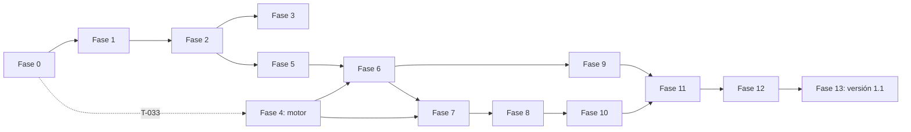

# Carabo · Especificación · 09 — Plan de implementación

> **PROMPT PARA EL AGENTE — léelo antes de seguir**
>
> Eres un agente de programación que trabaja en el repositorio de **Carabo**, un DAW de escritorio para Windows 11. Este documento dice **qué se construye y en qué orden**: fases y tareas (`T-nnn`) ordenadas por dependencias. Cada tarea está pensada para que un agente la complete en una sesión.
>
> - Trabaja en **una sola tarea por sesión**: la que te hayan indicado o, si no te han indicado ninguna, la primera sin hacer cuyas dependencias estén fusionadas en `main` (§1.2).
> - De este documento lee §1, §2 y tu tarea. No leas las demás tareas.
> - De los demás documentos lee solo lo que tu tarea cita en «Leer antes», además de `00-indice.md`.
> - Haz lo que dice la tarea y nada más. Lo que pertenece a otra tarea se deja para ella, aunque lo veas a medio hacer.
> - Una tarea está terminada cuando se cumple §1.3. Si no puedes terminarla, aplica §1.4: no la des por hecha.

---

## 1. Cómo se usa este plan

### 1.1 Antes de la primera tarea (lo hace el autor del proyecto)

1. Preparar la máquina de desarrollo con las herramientas de 07 §3.
2. Crear en GitHub un repositorio vacío llamado `carabo`, clonarlo en la máquina y dejar configurado el acceso para subir ramas y abrir solicitudes de integración.
3. Copiar los 11 documentos de la especificación a `docs/spec/` y subirlos a `main` en un primer commit.

### 1.2 Una sesión, una tarea

1. Lee `CLAUDE.md` (a partir de T-001 existe) y `docs/spec/00-indice.md`.
2. Localiza tu tarea. Comprueba que las tareas de «Depende de» están fusionadas en `main`. Si no lo están, para: no es tu turno.
3. Lee lo que cita «Leer antes» y, de 08, §1 a §3, §14 y el capítulo del nivel de tus pruebas.
4. Crea la rama `t-nnn-descripcion-corta` desde `main` (07 §10.1).
5. Escribe el código y sus pruebas. Toca solo lo que figura en «Archivos», con las excepciones de §1.3.
6. Ejecuta la comprobación completa (07 §9) hasta que pase entera.
7. Abre la solicitud de integración con el contenido que pide 07 §10.1: tarea, qué se ha hecho, cómo se ha comprobado cada criterio, entradas añadidas a `docs/DECISIONES-DE-IMPLEMENTACION.md` y lo que no se ha podido comprobar por falta de dispositivo de audio.
8. No fusiones la solicitud. La revisa y la fusiona el autor.

### 1.3 Reglas que valen para todas las tareas

Estas reglas no se repiten en cada tarea.

1. **Terminado significa:** se cumplen todos los «Criterios de aceptación» de la tarea; existen las pruebas que exige 08 §14, con los nombres de 08 §13.2; y pasa la comprobación completa de 07 §9.
2. **Criterios de 02.** Cuando una tarea dice «Cubre: RF-205 CA1», la tarea debe dejar escrita la prueba automática de ese criterio en el nivel que indica 08 §13.1. Si el mismo criterio aparece en dos tareas, cada una escribe la prueba de su nivel, que va entre paréntesis: «RF-023 CA1 (N)».
3. **Archivos que cualquier tarea puede tocar además de los suyos:** `src/i18n/es.json` y `en.json` (solo para corregir una clave que su componente usa, siempre según 03); `docs/DECISIONES-DE-IMPLEMENTACION.md`; los archivos de `fixtures/` que 08 §14 le obliga a actualizar; `package-lock.json` y `Cargo.lock` cuando la tarea añade una dependencia de 07 §2.
4. **Nunca se toca:** `docs/spec/`; la configuración de 07 §5 una vez creada, salvo que la tarea lo diga; ni el código de otra tarea para «mejorarlo».
5. **Lo que aún no existe.** Si tu código necesita algo que pertenece a una tarea posterior, no lo implementes: deja la llamada preparada y márcala con `// TODO(T-nnn)` (07 §8.1). Un control de la interfaz cuya orden aún no está implementada se muestra desactivado.
6. **Métodos del puente pendientes.** Desde T-008, `tauriBridge.ts` y `mockBridge.ts` contienen todos los métodos de `Bridge` (04 §6.1). Los que aún no tienen tarea hecha se rechazan con `{ code: "ENGINE_INTERNAL", detail: "not implemented: <método>" }`, y los `on…` devuelven una función de baja que no hace nada. Cada tarea sustituye los suyos.
7. **API del motor pendiente.** Desde T-006, `EngineHandle` tiene todas las firmas de 04 §5. Lo que aún no está implementado: los métodos sin resultado no hacen nada y los que devuelven `Result` devuelven `ENGINE_INTERNAL` con el detalle `not implemented`.
8. **Sin dispositivo de audio.** Lo que solo se puede comprobar oyendo o grabando se deja escrito en la solicitud de integración con el paso de la prueba manual que lo cubre (08 §12). Las pruebas `device_…` se escriben, pero no se ejecutan en la máquina de desarrollo ni en la integración continua.

### 1.4 Si algo no encaja

| Situación | Qué hacer |
|---|---|
| Falta un detalle o dos documentos se contradicen | Aplica 00 §6: elige lo más simple que respete los principios, impleméntalo y anótalo en `docs/DECISIONES-DE-IMPLEMENTACION.md` |
| La tarea no cabe en una sesión | Termina una parte coherente, con sus pruebas y con la comprobación completa pasando; abre la solicitud de integración diciendo qué criterios quedan pendientes. La tarea sigue en otra sesión, en una rama `t-nnn-b-…` |
| Una dependencia de 07 §2 no funciona como describe la especificación | Manda la documentación de la versión instalada (07 §2.1). Si cambia el comportamiento exigido, 00 §6 |
| Una prueba existente falla por tu cambio | Si tu cambio es correcto según la especificación y la prueba no, corrige la prueba y explícalo. Si no estás seguro, no la toques: descríbelo en la solicitud |
| No puedes cumplir un criterio | No lo des por cumplido. Deja la tarea abierta y explica qué lo impide |

## 2. Formato de una tarea

| Campo | Significado |
|---|---|
| **Objetivo** | Qué debe existir al terminar, en una frase |
| **Depende de** | Tareas que deben estar fusionadas antes |
| **Leer antes** | Secciones de la especificación que hay que leer para esta tarea, además de 00 y de lo que §1.2 pide de 08. «02: RF-201» significa leer ese requisito entero y el «Contexto» de su capítulo |
| **Archivos** | Archivos y módulos que la tarea crea o modifica |
| **Interfaces** | Tipos y funciones de otros módulos de los que depende, y dónde están definidos |
| **Resultado** | Lo que se puede hacer u observar al terminar |
| **Criterios de aceptación** | Comprobaciones concretas. «Cubre:» enumera los criterios de 02 cuya prueba escribe esta tarea (§1.3, regla 2) |
| **No tocar** | Lo que esta tarea no debe cambiar, además de §1.3 |

Las tareas marcadas con **[Autor]** las hace una persona, no un agente.

## 3. Fases

| Fase | Contenido | Tareas | Al terminar la fase… |
|---|---|---|---|
| 0 | Esqueleto de extremo a extremo | T-001 a T-010 | Se abre la aplicación, se crea una pista de ritmo, se marcan golpes y suena |
| 1 | El proyecto en memoria | T-011 a T-019 | Toda la lógica de edición, el historial y la instantánea existen y están probados, sin interfaz |
| 2 | Interfaz base | T-020 a T-027 | Ventana con sus tres barras, textos en dos idiomas, controles comunes, mensajes y puente simulado |
| 3 | Ritmo | T-030 a T-034 | La pestaña Ritmo está completa |
| 4 | Motor: reproducción completa | T-040 a T-049 | El motor reproduce canciones con audio, mezcla y efectos, y las calcula a un archivo WAV sin dispositivo |
| 5 | Archivos de proyecto | T-050 a T-056 | Se puede crear, guardar, abrir y recuperar un proyecto |
| 6 | Canción: línea de tiempo y bloques | T-060 a T-067 | Se arma una canción con bloques y se reproduce con cursor, tempo, compás, claqueta y bucle |
| 7 | Audio: importación y clips | T-070 a T-077 | Se importa audio y se editan clips |
| 8 | Grabación y dispositivos | T-080 a T-088 | Se graba una toma alineada con la canción |
| 9 | Mezcla | T-090 a T-092 | La pestaña Mezcla está completa |
| 10 | Exportación | T-100 a T-102 | Se exporta a WAV y a MP3 |
| 11 | Ajustes y robustez | T-110 a T-112 | Ajustes completos; reglas del hilo de audio y rendimiento comprobados |
| 12 | Cierre de la versión 1.0 | T-120 a T-125 | Pruebas de extremo a extremo, accesibilidad, empaquetado y pruebas de aceptación: versión 1.0.0 |
| 13 | Versión 1.1 | T-130 a T-141 | §17 |

El diagrama es orientativo: lo que manda es el campo «Depende de» de cada tarea.

**Dos líneas de trabajo.** Las tareas del motor (T-033, la fase 4 y las tareas «Motor:» de las fases 7, 8, 10 y 11) solo tocan `engine/`, y las de la interfaz no lo tocan. Si hay dos agentes a la vez, uno puede avanzar por el motor mientras el otro avanza por las fases 1 a 3 y 5. Con un solo agente, las tareas se hacen en orden numérico.

**Puntos de control del autor.** La máquina de desarrollo puede no tener sonido fiable, así que conviene que el autor pruebe el programa en un equipo real en estos momentos (`npm run tauri dev`, o `npm run package` cuando exista):

| Tras la fase | Qué probar a mano |
|---|---|
| 0 | Que suena: crear una pista de ritmo, marcar golpes y reproducir |
| 3 | La pestaña Ritmo entera, con los tres kits |
| 6 (con la 4 terminada) | Montar una canción con bloques; bucle, claqueta, tempo y compás |
| 8 | Grabar una toma. PA-05 y PA-02 (08 §12), aunque sea de forma informal |
| 10 | Exportar y escuchar el archivo en otro programa |
| 12 | Las seis pruebas de aceptación, formalmente (T-125) |

---

## 4. Fase 0 — Esqueleto de extremo a extremo

El objetivo de esta fase es tener cuanto antes todas las capas unidas, aunque cada una haga muy poco. Lo que se crea aquí queda en su sitio definitivo y las fases siguientes lo completan; no se reescribe.

### T-001 · Repositorio e interfaz mínima

- **Objetivo.** Crear el repositorio con las herramientas de la interfaz, la integración continua y una página mínima.
- **Depende de.** §1.1.
- **Leer antes.** 07 §2.1 a §2.3, §3, §4, §5.1 a §5.4, §5.8, §8.1 a §8.3, §10, §12.1.
- **Archivos.** De la raíz: `package.json`, `package-lock.json`, `.nvmrc`, `tsconfig.json`, `vite.config.ts`, `eslint.config.js`, `.prettierrc.json`, `.prettierignore`, `index.html`, `.gitignore`, `.gitattributes`, `CLAUDE.md`, `README.md`, `LICENSE`. Además: `docs/DECISIONES-DE-IMPLEMENTACION.md`, `src/main.tsx`, `src/vite-env.d.ts`, `src/ui/app/App.tsx`, `src/ui/app/App.test.tsx`, `src/test/setup.ts`, `.github/workflows/ci.yml`.
- **Interfaces.** Ninguna.
- **Resultado.** `npm run dev` muestra una página con el texto «Carabo». El repositorio tiene instaladas todas las dependencias de 07 §2.3.
- **Criterios de aceptación.** (1) `npm ci`, `npm run lint`, `npm run typecheck`, `npm test` y `npm run build` terminan sin errores. (2) `CLAUDE.md` es idéntico al de 07 §12.1. (3) `docs/DECISIONES-DE-IMPLEMENTACION.md` existe, con un título y la plantilla de entrada de 00 §6. (4) `ci.yml` contiene los pasos de 07 §10.3 que ya pueden pasar (hasta `npm run build`, sin los de Playwright) y la integración continua pasa en GitHub. (5) Las reglas `no-restricted-imports` de 07 §5.4 están configuradas: un archivo de prueba temporal que las incumple hace fallar `npm run lint` (se borra después).
- **No tocar.** No crees carpetas vacías ni archivos de módulos que pertenecen a otras tareas.

### T-002 · Espacio de trabajo de Rust y ventana de Tauri

- **Objetivo.** Que `npm run tauri dev` abra la ventana de Carabo con la página de T-001.
- **Depende de.** T-001.
- **Leer antes.** 02: RF-001, RF-009 · 04 §4 · 07 §2.2, §2.4, §5.5 a §5.7, §6.1, §8.4, §13.5 · 08 §10.
- **Archivos.** `Cargo.toml`, `Cargo.lock`, `rust-toolchain.toml`, `rustfmt.toml`, `engine/Cargo.toml`, `engine/src/lib.rs` (vacío salvo `#![forbid(unsafe_code)]`), `engine/CLAUDE.md`, `src-tauri/Cargo.toml`, `src-tauri/build.rs`, `src-tauri/tauri.conf.json`, `src-tauri/capabilities/default.json`, `src-tauri/src/main.rs`, `src-tauri/src/lib.rs`, `src-tauri/icons/`, `tools/gen-icon.mjs`, `assets/icon.png`, `tools/config.test.mjs`, `.github/workflows/ci.yml`.
- **Interfaces.** Ninguna.
- **Resultado.** Una ventana titulada «Carabo» que no se puede reducir por debajo de 1280 × 720. El motor aún no existe.
- **Criterios de aceptación.** (1) `npm run tauri dev` abre la ventana y muestra la página. (2) `rust-toolchain.toml` fija la versión estable instalada según 07 §2.2, y esa versión queda anotada en `docs/DECISIONES-DE-IMPLEMENTACION.md`. (3) `tauri.conf.json` y `capabilities/default.json` son los de 07 §5.6 y §5.7. (4) `engine/CLAUDE.md` es idéntico al de 07 §12.2. (5) `cargo fmt --all --check`, `cargo clippy --workspace --all-targets -- -D warnings` y `cargo test --workspace` pasan, y `ci.yml` los ejecuta. (6) Cubre: RF-001 CA1, RF-001 CA3 (S), RF-009 CA2, con `tools/config.test.mjs` (08 §10).
- **No tocar.** `package.json`, salvo que falte un paquete de 07 §2.3.

### T-003 · Scripts de comprobación: licencias y trazabilidad

- **Objetivo.** Tener las dos comprobaciones automáticas que forman parte de la comprobación completa desde el principio.
- **Depende de.** T-002.
- **Leer antes.** 07 §11, §13.3, §13.6 · 08 §13.
- **Archivos.** `tools/check-licenses.mjs`, `tools/check-licenses.test.mjs`, `tools/check-traceability.mjs`, `tools/check-traceability.test.mjs`, `fixtures/manual-coverage.json`, `.github/workflows/ci.yml`.
- **Interfaces.** Los scripts `licenses` y `traceability` de `package.json` (07 §5.1).
- **Resultado.** `npm run licenses` y `npm run traceability` funcionan y la integración continua los ejecuta.
- **Criterios de aceptación.** (1) `npm run licenses` pasa con las dependencias actuales. (2) La función que evalúa una expresión de licencia tiene pruebas: `MIT OR Apache-2.0` y `(MIT OR Apache-2.0) AND Unicode-3.0` se admiten; `Apache-2.0 WITH LLVM-exception` se admite; `GPL-3.0` y una licencia vacía se rechazan; `MPL-2.0` se admite. (3) `npm run traceability` escribe el informe de 08 §13.3 y termina con código 0; con `--strict` termina con código 1 mientras queden criterios sin cubrir. (4) El script reconoce las dos formas de nombre de 08 §13.2 (prueba con un archivo de ejemplo de cada lenguaje). (5) `fixtures/manual-coverage.json` contiene exactamente las 20 entradas `PA-…` de la tabla de 08 §13.1.
- **No tocar.** `package.json`.

### T-004 · Constantes y fórmulas de tiempo en los dos lenguajes

- **Objetivo.** Escribir las constantes de 00 §4 y las conversiones de 05 §2 una vez en TypeScript y una vez en Rust, con pruebas que las comparan.
- **Depende de.** T-002.
- **Leer antes.** 00 §4 · 04 §2 (AR-07) · 05 §2 · 07 §7 · 08 §7.
- **Archivos.** `src/core/constants.ts`, `src/core/constants.test.ts`, `src/core/time.ts`, `src/core/time.test.ts`, `engine/src/constants.rs`, `engine/src/time.rs`, `engine/src/lib.rs`, `engine/tests/contract_time.rs`, `fixtures/constants.json`, `fixtures/formulas/time.json`.
- **Interfaces.** Ninguna.
- **Resultado.** Los dos lados comparten constantes y fórmulas comprobadas.
- **Criterios de aceptación.** (1) Las tres primeras filas de la tabla de 08 §7 (constantes, fórmulas de tiempo, fórmulas en todo el rango) pasan. (2) A 97 negras por minuto, `stepToFrame(1)` es 7 423 y `stepToFrame(2)` es 14 845, en los dos lenguajes. (3) `time.ts` incluye la presentación de la posición de 05 §2.2. Cubre: RF-113 CA1. (4) `REPOSITORY_URL` vale lo que indica 07 §7.
- **No tocar.** Ningún otro archivo repite un valor de 00 §4.

### T-005 · Kits, sonidos sustitutos y tipos de la instantánea

- **Objetivo.** Tener en el repositorio los tres kits con sus sonidos sustitutos, y en el motor los tipos de la instantánea con su validación y la carga de kits.
- **Depende de.** T-004.
- **Leer antes.** 05 §8, §10.1 · 06 §5.5, §8.4 · 07 §13.1 · 08 §7, §10.
- **Archivos.** `assets/kits/{acoustic,electronic,percussion}/kit.json` y sus 24 WAV, `tools/gen-placeholder-kits.mjs`, `tools/gen-placeholder-kits.test.mjs`, `engine/src/error.rs`, `engine/src/snapshot.rs`, `engine/src/kits.rs`, `engine/src/lib.rs`.
- **Interfaces.** `EngineSnapshot` y sus tipos (05 §10.1); `EngineError` con los códigos de 04 §6.3; constantes de T-004.
- **Resultado.** `npm run kits` genera los 24 archivos; el motor sabe leer una instantánea en JSON, validarla y cargar los kits.
- **Criterios de aceptación.** (1) Los tres `kit.json` son los de 05 §8.2 y §8.3. (2) Dos ejecuciones de `npm run kits` producen archivos idénticos, y la prueba de 08 §10 («Sonidos sustitutos») pasa. (3) Cada WAV cumple 05 §8.3 y dura lo que indica su receta de 05 §8.4. (4) El ejemplo de 05 §10.4, completado con `strip`, `rows` y `steps` válidos, se deserializa y pasa la validación. (5) Por cada condición de 06 §5.5 hay una prueba con una instantánea que la incumple y da `INVALID_SNAPSHOT`. (6) La carga de kits lee los tres, convierte los grupos de corte según 06 §8.4 y falla con un kit incompleto.
- **No tocar.** Nada de `src/`.

### T-006 · Motor: salida de audio, `Processor` mínimo y tono de prueba

- **Objetivo.** Que el motor arranque, abra la salida predeterminada y emita el tono de prueba, con la estructura de hilos y colas definitiva.
- **Depende de.** T-005.
- **Leer antes.** 04 §5 · 06 §1 a §5.2, §5.7, §6.2, §7, §10.3, §12 (tono de prueba), §13.1, §13.2, §18, §19, §20 · 08 §8.1.
- **Archivos.** `engine/src/engine.rs`, `engine/src/telemetry.rs`, `engine/src/lib.rs`, `engine/src/rt/{mod,commands,processor,master,metronome}.rs`, `engine/src/io/{mod,devices,output}.rs`, `engine/tests/common/mod.rs`, `engine/tests/skeleton.rs`.
- **Interfaces.** API pública de 04 §5 completa en sus firmas (§1.3, regla 7); `RtCommand` completo (06 §5.2), aunque solo se atienda `TestTone`; `Telemetry` y `EngineEvent` completos (04 §6.4, 06 §18.2).
- **Resultado.** `Engine::start` crea el hilo de control y el flujo de salida; `test_tone()` suena. El módulo oculto `testing` y el arnés de 08 §8.1 existen.
- **Criterios de aceptación.** (1) Con el arnés: tras `TestTone`, la salida contiene un tono de 440 Hz y amplitud 0,25 ± 0,01 durante 48 000 frames, con fundidos de 240 frames, igual en los dos canales, y después silencio exacto. (2) El maestro recorta a ±1,0 y cuenta las muestras recortadas (prueba con dos tonos simultáneos fabricados en el búfer del maestro). (3) El reloj del motor avanza exactamente los frames calculados. (4) `Engine::start` no falla sin dispositivo de salida: `output_available` es `false` y `test_tone()` devuelve `NO_OUTPUT_DEVICE`. (5) Existe la prueba `device_output_plays_test_tone`, con `#[ignore]`. (6) Si el dispositivo no trabaja a 48 000 Hz, por ahora se usa tal cual; queda marcado con `TODO(T-080)`.
- **No tocar.** `engine/src/snapshot.rs`, `engine/src/kits.rs`.

### T-007 · Motor: golpes y modo patrón

- **Objetivo.** Que el motor haga sonar en bucle un patrón de una pista de ritmo.
- **Depende de.** T-006.
- **Leer antes.** 02: RF-101, RF-206, RF-211, RF-213 · 06 §5.1 a §5.5, §6.1 a §6.4, §7, §8, §10.1, §10.2 · 08 §8.1, §8.2.
- **Archivos.** `engine/src/project.rs`, `engine/src/engine.rs`, `engine/src/rt/{processor,transport,sequencer,sampler,strip}.rs`, `engine/tests/common/mod.rs`, `engine/tests/rhythm.rs`.
- **Interfaces.** `EngineSnapshot` y kits (T-005); `RtCommand::{SetProject, Play, Stop, Audition}`; `EngineHandle::{set_project, play, stop, audition}`.
- **Resultado.** Con una instantánea de una pista de ritmo, `play` en modo patrón suena en bucle y `stop` lo apaga con un fundido. En esta tarea el canal aplica solo volumen y panorama, sin rampas ni efectos (llegan en T-040), y la instantánea preparada solo contiene pistas de ritmo.
- **Criterios de aceptación.** (1) El kit de prueba de impulsos de 08 §8.1 existe en el arnés. (2) Las filas de 08 §8.2 «Frame exacto de cada golpe», «Volumen y silencio de fila», «Grupo de corte», «Límite de voces» y «Escucha» pasan en modo patrón. (3) Al llegar al final del patrón la posición vuelve a 0 y el paso 0 vuelve a sonar. (4) La fila «Parar» de 08 §8.2 pasa. (5) La telemetría da el estado, el modo, la posición y el paso que suena. Cubre: RF-211 CA1, RF-213 CA1, RF-206 CA1 (M), RF-101 CA2.
- **No tocar.** `engine/src/io/`. No implementes el modo canción, las ranuras con generación ni la cola de desechos más allá de lo necesario para compilar: son de T-033 y T-043.

### T-008 · Puente mínimo y programa nativo

- **Objetivo.** Unir la interfaz con el motor: tipos del puente, sus dos implementaciones y los primeros comandos.
- **Depende de.** T-007.
- **Leer antes.** 04 §3.3, §4, §6 · 07 §6 · 08 §7 (tipos del puente).
- **Archivos.** `src/bridge/{bridge,tauriBridge,mockBridge,index}.ts`, `src/store/engineStore.ts`, `src-tauri/src/{lib,state,error,paths,logging,telemetry}.rs`, `src-tauri/src/commands/{mod,system,engine,devices}.rs`, `src-tauri/tests/contract_bridge.rs`, `fixtures/bridge/telemetry.json`, `fixtures/bridge/bridge-error.json`.
- **Interfaces.** `Bridge` y todos sus tipos (04 §6.1 a §6.4); `EngineHandle` (04 §5).
- **Resultado.** Funcionan de extremo a extremo: `engineSetProject`, `enginePlay`, `engineStop`, `engineSeek`, `engineSetLoop`, `engineSetMetronome`, `engineAudition`, `engineInputOpen`, `engineInputClose`, `engineTestTone`, `appInfo`, `logWrite` y `onTelemetry`. Los demás métodos existen según §1.3, regla 6.
- **Criterios de aceptación.** (1) `bridge.ts` contiene, literalmente, la interfaz y los tipos de 04 §6. (2) `bridge/index.ts` elige el puente según 07 §6.5. (3) El programa nativo arranca el motor, resuelve la carpeta de kits según 07 §6.1 y emite `engine://telemetry` `TELEMETRY_HZ` veces por segundo. Los eventos del motor cuya tarea aún no ha llegado se escriben en el registro y no se emiten. (4) `BridgeError` se serializa con los campos `code` y `detail`, y las conversiones de 07 §6.2 tienen prueba. (5) `logging.rs` escribe líneas con fecha, hora, nivel y mensaje en el registro de 05 §7.3 (la rotación llega en T-051). (6) `engineStore` guarda la última telemetría. (7) La prueba de contrato de los tipos del puente (08 §7) pasa para `Telemetry` y `BridgeError` en los dos lados. (8) En `mockBridge`, los métodos de esta tarea guardan lo recibido y `onTelemetry` emite una telemetría en estado parado; el motor falso completo llega en T-023.
- **No tocar.** `engine/`.

### T-009 · Proyecto mínimo en la interfaz

- **Objetivo.** Tener en la interfaz el modelo de datos y lo justo para crear una pista de ritmo, marcar golpes y enviar la instantánea al motor.
- **Depende de.** T-008.
- **Leer antes.** 02: RF-201, RF-205 · 04 §2, §3.1, §3.2, §7.1 · 05 §3.1, §3.2, §3.4, §3.5, §10.
- **Archivos.** `src/core/{model,ids,factory,lanes,snapshot,kits}.ts`, `src/core/commands/tracks.ts` (solo `createRhythmTrack`), `src/core/commands/patterns.ts` (solo `toggleStep`), `src/store/{projectStore,uiStore,engineSync}.ts`, `src/services/playback.ts`, con sus pruebas.
- **Interfaces.** Tipos de 05 §3.1 y §10.1, completos; `Bridge` (T-008).
- **Resultado.** `projectStore.commit` aplica una operación con Immer y guarda sus parches; `engineSync` envía la instantánea; `playback` reproduce en modo patrón y para.
- **Criterios de aceptación.** (1) `model.ts` contiene todos los tipos de 05 §3.1 y §10.1. (2) `createRhythmTrack` crea la pista, su primer patrón vacío y su primer bloque según RF-201 y 05 §3.5. Cubre: RF-201 CA1. (3) `toggleStep` alterna entre nivel 0 y 2. (4) `resolveLane` implementa 05 §10.2 y pasa el ejemplo de esa sección. (5) `buildEngineSnapshot` produce, para las pistas de ritmo, lo que indica 05 §10.3. (6) Tras un `commit`, `engineSync` llama una vez a `engineSetProject` en el siguiente cuadro (prueba con temporizadores simulados). (7) `projectStore` implementa de 04 §3.2 `commit` y `load`; el resto llega en T-013.
- **No tocar.** `src/bridge/`. No implementes aún el resto de `core/commands/`.

### T-010 · Interfaz mínima: pestañas, Reproducir y rejilla

- **Objetivo.** Cerrar el esqueleto: abrir la aplicación, crear una pista de ritmo, marcar golpes y oírlos.
- **Depende de.** T-009.
- **Leer antes.** 02: RF-002, RF-003, RF-101, RF-102, RF-204, RF-205 · 03 §3, §8.1, §8.4 · 04 §3.5, §7.3 · 07 §8.2, §8.3.
- **Archivos.** `src/ui/app/{App,TopBar,TransportBar}.tsx`, `src/ui/rhythm/{RhythmTab,StepGrid}.tsx`, sus hojas de estilos y sus pruebas; `src/i18n/{index.ts,es.json,en.json}`, solo con las claves que esta tarea usa.
- **Interfaces.** `projectStore`, `uiStore`, `services/playback` (T-009); `core/kits.ts` para los nombres de las filas.
- **Resultado.** La ventana tiene las tres pestañas (Canción y Mezcla, vacías), un botón Reproducir/Parar y, en Ritmo, el botón «Nueva pista de ritmo» y una rejilla de 8 filas por 16 pasos en la que un clic marca o quita un golpe. Al pulsar Reproducir en Ritmo suena el patrón en bucle.
- **Criterios de aceptación.** (1) Prueba de componente con el puente simulado: tras «Nueva pista de ritmo», tres clics en la rejilla y Reproducir, el puente ha recibido una instantánea con esos tres golpes y un `enginePlay` en modo patrón; tras Parar, un `engineStop`. (2) El paso que suena se resalta a partir de la telemetría. (3) Los textos de esta tarea se escriben ya como claves de 03 en `src/i18n/es.json` y `en.json`, con una configuración mínima de i18next (se completa en T-020). (4) En la solicitud de integración queda anotado si se ha podido oír en un equipo real.
- **No tocar.** El aspecto definitivo de 03 (tema, medidas, controles comunes) llega en la fase 2: aquí basta con que funcione.

---

## 5. Fase 1 — El proyecto en memoria

Toda esta fase es TypeScript puro en `src/core/` y `src/store/`, sin interfaz. Sus pruebas son de nivel U.

### T-011 · Fábrica completa y ritmos hechos

- **Objetivo.** Poder crear cualquier elemento del proyecto con sus valores iniciales, y disponer de los 15 ritmos hechos.
- **Depende de.** T-009.
- **Leer antes.** 02: RF-209 · 03 §14.2 · 05 §3.2, §3.5, §8, §9.
- **Archivos.** `src/core/{factory,ids,kits,presets}.ts`, `assets/presets/presets.json`, con sus pruebas.
- **Interfaces.** Tipos de `model.ts`. Las funciones de la fábrica reciben el nombre por defecto ya traducido (lo da quien llama, según 03 §14.2): `core/` no conoce los idiomas.
- **Resultado.** `factory.ts` crea proyecto, pistas, patrones, bloques, clips, canales y fuentes con los valores de 05 §3.5; `presets.ts` da la lista de ritmos hechos de un compás y los pasos de cada uno.
- **Criterios de aceptación.** (1) Cada valor inicial de 05 §3.5 tiene una comprobación. (2) Los identificadores siguen 05 §3.2: únicos, con su prefijo, y `nextId` y `nextZ` crecen. (3) `presets.json` contiene los 15 ritmos de 05 §9.2 con el formato de 05 §9.1, y cada cadena mide lo que corresponde a su compás y a sus compases. Cubre: RF-209 CA1. (4) La prueba de contrato de kits de 08 §7 pasa en TypeScript.
- **No tocar.** `src/core/commands/`.

### T-012 · Validación y serialización del proyecto

- **Objetivo.** Leer y escribir `project.carabo`, y rechazar con su motivo todo archivo que no sea válido.
- **Depende de.** T-011.
- **Leer antes.** 02: RF-021, RF-023, RF-034 · 05 §4, §5 · 07 §7 · 08 §3, §4.1, §4.4.
- **Archivos.** `src/core/schema/project-1.schema.json`, `src/core/validate.ts`, `src/core/serialize.ts`, sus pruebas, `fixtures/projects/demo/project.carabo`, `fixtures/projects/invalid/*.carabo`.
- **Interfaces.** `ProjectDoc`, `ViewState` y `ProjectFile` (05 §3.1); Ajv con el esquema 2020-12 (07 §2.3).
- **Resultado.** `validate` devuelve el proyecto o un error que distingue «dañado» de «versión más nueva»; `checkInvariants` enumera los invariantes incumplidos; `serialize` produce el texto con las reglas de 05 §5.1.
- **Criterios de aceptación.** (1) El archivo del esquema es, literalmente, el de 05 §5.2, y `fixtures/projects/demo/project.carabo` es, literalmente, el ejemplo de 05 §5.3. (2) El proyecto `demo` se valida y su contenido coincide con lo descrito en 05 §5.3. Cubre: RF-021 CA1. (3) Existen los archivos no válidos de 08 §4.4 y cada uno se rechaza por su motivo. (4) Guardar y volver a leer da un proyecto igual, y dos serializaciones seguidas son idénticas. Cubre: RF-023 CA1 (U), RF-034 CA1.
- **No tocar.** `src/core/model.ts`: si un tipo no cuadra con el esquema, manda 05 y se aplica 00 §6.

### T-013 · Almacén del proyecto con historial

- **Objetivo.** Completar `projectStore` con el historial de deshacer, los gestos continuos y el control de cambios sin guardar.
- **Depende de.** T-009.
- **Leer antes.** 02: RF-025, RF-030 a RF-032 · 04 §3.2 · 08 §4.3.
- **Archivos.** `src/store/projectStore.ts` y su prueba.
- **Interfaces.** `HistoryEntry`, `Gesture` y el algoritmo de 04 §3.2; Immer con parches.
- **Resultado.** `commit`, `beginGesture`, `updateGesture`, `endGesture`, `cancelGesture`, `undo`, `redo`, `setView`, `load`, `markSaved`, `addMissingFiles`, `isDirty`, `canUndo` y `canRedo` se comportan como 04 §3.2.
- **Criterios de aceptación.** (1) Un gesto de 40 actualizaciones deja un solo paso de historial, y cancelarlo restaura el documento sin dejar ninguno. (2) Tras `HISTORY_LIMIT + 1` cambios solo se pueden deshacer `HISTORY_LIMIT`, y `savedIndex` se ajusta como indica 04 §3.2. (3) `setView` no crea pasos ni marca cambios. (4) `commit`, `undo` y `redo` durante un gesto lanzan un error de programación. Cubre: RF-025 CA1, RF-025 CA2, RF-030 CA2, RF-031 CA1, RF-031 CA2, RF-032 CA1.
- **No tocar.** `src/core/`.

### T-014 · Operaciones de pistas y patrones

- **Objetivo.** Implementar todas las funciones de `tracks.ts` y `patterns.ts`.
- **Depende de.** T-011, T-013.
- **Leer antes.** 02: RF-201 a RF-203, RF-207 a RF-210, RF-212, RF-301, RF-302 · 04 §3.1 · 05 §3.4, §4.
- **Archivos.** `src/core/commands/tracks.ts`, `src/core/commands/patterns.ts`, con sus pruebas.
- **Interfaces.** `factory.ts`, `ids.ts`, `presets.ts`; las cuatro reglas de 04 §3.1 para toda función de `core/commands/`.
- **Resultado.** Las 16 funciones de esos dos archivos (04 §3.1), con sus límites y sus motivos de rechazo.
- **Criterios de aceptación.** (1) Cada función tiene pruebas del caso normal, de cada límite (`MAX_TRACKS`, `MAX_PATTERNS_PER_TRACK`, `NAME_MAX_CHARS`, `PATTERN_BARS`, rangos de volumen de fila) y de cada motivo de rechazo. (2) `deletePattern` quita sus bloques y no deja borrar el único patrón; `deleteTrack` quita todo lo de la pista y las fuentes que queden sin uso. (3) Tras cada operación se cumplen los invariantes de 05 §4. Cubre: RF-201 CA2, RF-203 CA1, RF-207 CA1, RF-208 CA1, RF-209 CA2, RF-210 CA1, RF-212 CA1, RF-302 CA1, RF-302 CA2.
- **No tocar.** `factory.ts`, salvo para corregir un valor inicial que contradiga 05 §3.5.

### T-015 · Operaciones de bloques

- **Objetivo.** Implementar las funciones de `blocks.ts`.
- **Depende de.** T-014.
- **Leer antes.** 02: RF-112, RF-307 a RF-309, RF-320, RF-321 · 04 §3.1 · 05 §2.3, §3.4, §4.
- **Archivos.** `src/core/commands/blocks.ts` y su prueba.
- **Interfaces.** `PatternBlock` (05 §3.1); `time.ts`; `ids.ts` para `z`.
- **Resultado.** `addBlock`, `moveBlock`, `resizeBlock`, `duplicateBlock` y `deleteBlock`, siempre en compases enteros.
- **Criterios de aceptación.** (1) Añadir con el cursor en mitad de un compás coloca el bloque al principio de ese compás, con la longitud del patrón. (2) Crear, mover y redimensionar dan al bloque un `z` nuevo, mayor que todos (RF-309). (3) Ninguna operación deja un bloque terminando después de `MAX_SONG_FRAMES`: se limita y lo indica. (4) Duplicar coloca la copia justo después del original. Cubre: RF-307 CA1, RF-320 CA1.
- **No tocar.** `src/core/lanes.ts`.

### T-016 · Operaciones de clips

- **Objetivo.** Implementar las funciones de `clips.ts`.
- **Depende de.** T-014.
- **Leer antes.** 02: RF-112, RF-309, RF-316 a RF-321 · 04 §3.1 · 05 §2.3, §3.3, §4.
- **Archivos.** `src/core/commands/clips.ts` y su prueba.
- **Interfaces.** `AudioClip` y `AudioSource` (05 §3.1); la tabla de operaciones de 05 §3.3; `time.ts`.
- **Resultado.** `addClip`, `moveClip`, `trimClipLeft`, `trimClipRight`, `setClipRepeat`, `splitClip`, `duplicateClip` y `deleteClip`.
- **Criterios de aceptación.** (1) Cada fila de la tabla de 05 §3.3 tiene su prueba, con sus límites (`MIN_CLIP_FRAMES`, principio y final del archivo, límite de la canción). (2) Con «Repetir», alargar repite la región; al desactivarlo, el clip vuelve a medir su región. (3) Partir da dos clips cuyas regiones, juntas, son la original, y que suenan en los mismos frames. (4) Una fuente que se queda sin clips sale de `sources` (INV-11), y deshacer la devuelve. Cubre: RF-112 CA1, RF-316 CA1, RF-317 CA1, RF-317 CA2, RF-318 CA2, RF-321 CA1.
- **No tocar.** `src/core/commands/blocks.ts`.

### T-017 · Operaciones de mezcla, tempo y compás

- **Objetivo.** Implementar `mixer.ts` y `transport.ts`.
- **Depende de.** T-015, T-016.
- **Leer antes.** 02: RF-106 a RF-109, RF-112, RF-401 a RF-407 · 04 §3.1 · 05 §2, §3.1, §4.
- **Archivos.** `src/core/commands/mixer.ts`, `src/core/commands/transport.ts`, con sus pruebas.
- **Interfaces.** `ChannelStrip` y `EffectUnit` (05 §3.1); constantes de rangos (00 §4).
- **Resultado.** Las 9 funciones de mezcla, con sus rangos y pasos, y `setTempo` y `setTimeSignature` con todas las reglas de RF-106, RF-109 y RF-112.
- **Criterios de aceptación.** (1) Cada valor de mezcla se limita a su rango y se redondea a su paso. (2) `setTempo` conserva el tick inicial y la longitud en frames de cada clip. (3) `setTempo` y `setTimeSignature` no cambian nada y devuelven el motivo `songLimit` si algún bloque o clip quedaría terminando después del límite. (4) `setTimeSignature` convierte cada patrón compás a compás como indica RF-109, y deshacer restaura los pasos perdidos. Cubre: RF-107 CA1, RF-109 CA1, RF-109 CA2, RF-112 CA3.
- **No tocar.** Los avisos y cuadros de RF-107 y RF-109 son de T-065.

### T-018 · Instantánea completa y regla de tapado

- **Objetivo.** Completar `buildEngineSnapshot` con las pistas de audio y los archivos que faltan.
- **Depende de.** T-016.
- **Leer antes.** 02: RF-028, RF-308, RF-309 · 05 §10 · 08 §4.1.
- **Archivos.** `src/core/lanes.ts`, `src/core/snapshot.ts`, con sus pruebas.
- **Interfaces.** `EngineSnapshot` (05 §10.1); `resolveLane` (05 §10.2).
- **Resultado.** La instantánea de cualquier proyecto válido, con segmentos ordenados y sin solapes.
- **Criterios de aceptación.** (1) `resolveLane` pasa los cinco casos de 08 §4.1. (2) La fase de cada segmento (`phaseFrames`, `phaseSteps`) es la de 05 §10.3 también cuando un elemento queda partido en varios tramos visibles. (3) Los clips de archivos que faltan no producen segmentos. (4) Un patrón aparece una sola vez en la instantánea aunque tenga varios bloques. Cubre: RF-028 CA2 (U), RF-308 CA2, RF-309 CA1 (U), RF-309 CA2.
- **No tocar.** `src/core/commands/`.

### T-019 · Invariantes al azar y datos de prueba compartidos

- **Objetivo.** Proteger toda la lógica de edición con la prueba de invariantes, y generar los proyectos e instantáneas de ejemplo que comparten TypeScript y Rust.
- **Depende de.** T-012, T-017, T-018.
- **Leer antes.** 08 §3, §4.2, §7.
- **Archivos.** `src/core/commands/invariants.test.ts`, `src/test/{builders,fixtureRecipes}.ts`, `src/test/fixtures.test.ts`, `fixtures/projects/p01-rhythm/` a `p05-68/`, `fixtures/snapshots/*.json`, `engine/tests/contract_snapshot.rs`.
- **Interfaces.** Todas las funciones de `core/commands/`; `validate`, `serialize` y `buildEngineSnapshot`.
- **Resultado.** Los cinco proyectos de 08 §3.1 con su audio, sus instantáneas, y las pruebas que los protegen.
- **Criterios de aceptación.** (1) La prueba de invariantes de 08 §4.2 pasa con las 20 semillas e incluye las 40 funciones de `core/commands/`. Cubre: RF-030 CA1. (2) Con `UPDATE_FIXTURES=1` se escriben los proyectos y las instantáneas; sin ella, la prueba comprueba que no han cambiado. (3) Los archivos de audio de los proyectos son los de 08 §3.1. (4) En Rust, cada instantánea de `fixtures/snapshots/` se deserializa y pasa la validación de 06 §5.5 (el cálculo se añade en T-049).
- **No tocar.** `src/core/`, salvo para corregir un defecto que la prueba de invariantes descubra; en ese caso, descríbelo en la solicitud de integración.

---

## 6. Fase 2 — Interfaz base

### T-020 · Textos en español e inglés

- **Objetivo.** Tener todos los textos de 03 en los dos archivos de traducción, y las pruebas que los vigilan.
- **Depende de.** T-010.
- **Leer antes.** 02: RF-007, RF-701 · 03 §5 a §14 · 07 §7 · 08 §10.
- **Archivos.** `src/i18n/index.ts`, `src/i18n/es.json`, `src/i18n/en.json`, `src/i18n/i18n.test.ts`.
- **Interfaces.** i18next configurado como indica 07 §7.
- **Resultado.** Las claves de 03 (controles, menús, cuadros, mensajes `msg.E…`, nombres por defecto, nombres de los pasos de historial) existen en los dos idiomas.
- **Criterios de aceptación.** (1) Todas las claves de las tablas de 03 §5 a §14 están en los dos archivos, con los textos exactos de 03. (2) Las cuatro comprobaciones de textos de 08 §10 pasan. Cubre: RF-007 CA1. (3) Cambiar de idioma con i18next actualiza un componente ya montado sin recargar.
- **No tocar.** Los componentes: esta tarea solo crea textos.

### T-021 · Tema y controles comunes (I)

- **Objetivo.** Crear el tema visual y los primeros controles comunes.
- **Depende de.** T-020.
- **Leer antes.** 02: RF-007, RF-008 · 03 §1, §2, §4, §15 · 07 §7, §8.2, §8.3 · 08 §5.1.
- **Archivos.** `src/ui/theme.css`, `src/ui/base.css`, `src/ui/common/{Button,ToggleButton,OptionGroup,Tooltip,Dialog}.tsx`, sus hojas de estilos y sus pruebas.
- **Interfaces.** Variables CSS de 03 §2; comportamiento de cada control en 03 §4.
- **Resultado.** Botón, botón de dos estados, selector de opciones, explicación y cuadro de diálogo, con ratón, teclado, nombre y estado accesibles.
- **Criterios de aceptación.** (1) `theme.css` define todas las variables de 03 §2 y ningún componente contiene un color ni una medida de esa sección escritos a mano. (2) Cada control cumple su fila de 03 §4 con ratón y con teclado. (3) Un control desactivado sigue mostrando su explicación (RF-008). (4) El cuadro de diálogo retiene el foco, se cierra con `Esc` y devuelve el foco al control que lo abrió. Cubre: RF-007 CA2, RF-008 CA2.
- **No tocar.** `src/ui/app/`, `src/ui/rhythm/`.

### T-022 · Controles comunes (II)

- **Objetivo.** Completar los controles comunes, incluida la ayuda de arrastre que usan todos los gestos.
- **Depende de.** T-021.
- **Leer antes.** 02: RF-032, RF-401, RF-404 · 03 §4, §15 · 07 §6.4 (arrastres dentro de la ventana) · 08 §5.1.
- **Archivos.** `src/ui/common/{Slider,NumberField,Select,Menu,Meter,OverloadIndicator}.tsx`, `src/ui/common/usePointerDrag.ts`, sus hojas de estilos y sus pruebas.
- **Interfaces.** Las cuatro reglas comunes de arrastre de 03 §4; eventos de puntero (07 §6.4).
- **Resultado.** Deslizador, campo numérico, lista desplegable, menú, medidor e indicador de saturación; `usePointerDrag` implementa el umbral de 3 píxeles, la captura del puntero y la cancelación con `Esc`.
- **Criterios de aceptación.** (1) Cada control cumple su fila de 03 §4 con ratón y con teclado. (2) El deslizador avisa del principio, de cada cambio y del final del arrastre, para que quien lo usa abra y cierre un gesto (RF-032). (3) El campo numérico confirma con `Intro` y al perder el foco, y restaura con `Esc`. (4) El medidor dibuja en `<canvas>` las zonas de 03 §4 y la marca de pico retenida 1 segundo. (5) Ningún control usa la API de arrastrar y soltar de HTML5.
- **No tocar.** Los controles de T-021.

### T-023 · Puente simulado completo

- **Objetivo.** Completar `mockBridge` con su motor falso y su objeto de control, para que toda la interfaz pueda probarse sin Tauri.
- **Depende de.** T-008.
- **Leer antes.** 04 §6 · 08 §5.2, §7.
- **Archivos.** `src/bridge/mockBridge.ts`, `src/bridge/mockBridge.test.ts`, `src/bridge/bridge.contract.test.ts`, `fixtures/bridge/*.json`.
- **Interfaces.** `Bridge` (04 §6.1); `mockControl` (08 §5.2).
- **Resultado.** Todos los métodos de `Bridge` funcionan en memoria con las reglas de 04 §6.2, y `mockControl` ofrece todo lo de la tabla de 08 §5.2. En `npm run dev` queda accesible como `window.__caraboMock`.
- **Criterios de aceptación.** (1) Cada método responde con la forma de 04 §6.1 y con los errores de 04 §6.2 en los casos que el puente simulado puede reproducir. (2) Cada fila de la tabla de `mockControl` tiene una prueba. (3) El motor falso se comporta como describe 08 §5.2, con reloj automático y manual. (4) Existen los ocho archivos de `fixtures/bridge/` y la prueba de contrato de TypeScript pasa.
- **No tocar.** `src/bridge/bridge.ts`, `src/bridge/tauriBridge.ts`.

### T-024 · Avisos, diálogos de error y errores del puente

- **Objetivo.** Mostrar avisos en la barra de estado y cuadros de mensaje, y convertir cada error del puente en su mensaje.
- **Depende de.** T-021, T-023.
- **Leer antes.** 02: RF-006, RF-007 · 03 §7, §13 · 04 §3.2 (`uiStore`), §3.4, §6.5, §10.
- **Archivos.** `src/services/messages.ts`, `src/store/uiStore.ts`, `src/ui/app/{StatusBar,MessageDialog}.tsx`, con sus pruebas.
- **Interfaces.** Catálogo de 03 §13; tabla de 04 §6.5; `logWrite`.
- **Resultado.** `messages.notice(id, datos)` muestra un aviso durante 5 segundos; `messages.dialog(id, datos)` muestra un cuadro con los botones del catálogo y devuelve el pulsado; `messages.fromBridgeError(operación, error)` aplica 04 §6.5 y escribe `detail` en el registro. Un capturador global trata las excepciones inesperadas como indica 04 §10.
- **Criterios de aceptación.** (1) Cada fila de 04 §6.5 tiene una prueba. (2) Ningún cuadro muestra `detail`. (3) `uiStore` contiene todos los campos de 04 §3.2. Cubre: RF-006 CA1, RF-006 CA2.
- **No tocar.** `src/i18n/`, salvo §1.3.

### T-025 · Ventana: barra superior y barra de reproducción

- **Objetivo.** Dar a la ventana su estructura definitiva: las tres barras con todos sus controles.
- **Depende de.** T-022, T-024.
- **Leer antes.** 02: RF-001 a RF-003, RF-008, RF-100 a RF-103 · 03 §3, §5, §6, §7, §12.
- **Archivos.** `src/ui/app/{App,TopBar,TransportBar,StatusBar}.tsx`, sus hojas de estilos y sus pruebas.
- **Interfaces.** Controles comunes; `projectStore` (deshacer y rehacer, con el nombre del paso); `uiStore` (pestaña activa); `engineStore` (estado del transporte).
- **Resultado.** Barra superior con el menú Archivo, Deshacer, Rehacer, las tres pestañas y Ajustes; barra de reproducción con sus ocho elementos en el orden de RF-100; barra de estado. Funcionan ya: pestañas, Deshacer, Rehacer, Reproducir/Parar y el indicador de qué suena. Lo demás se muestra desactivado hasta su tarea (§1.3, regla 5).
- **Criterios de aceptación.** (1) Las medidas de las barras son las de 03 §3. (2) El menú Archivo contiene las órdenes de 03 §5 con sus atajos a la derecha. (3) Deshacer y Rehacer muestran el nombre del paso en su explicación y se desactivan cuando no hay nada. (4) El indicador muestra el texto de cada estado. Cubre: RF-103 CA1, RF-008 CA1.
- **No tocar.** `src/ui/rhythm/`.

### T-026 · Atajos de teclado

- **Objetivo.** Implementar la tabla de atajos de RF-703 en un único servicio.
- **Depende de.** T-025.
- **Leer antes.** 02: RF-101, RF-703 · 03 §12 · 08 §10.
- **Archivos.** `src/services/shortcuts.ts` y su prueba; una prueba de componente en `src/ui/app/`.
- **Interfaces.** Las órdenes de los servicios y de `projectStore`. Un atajo cuya orden aún no existe queda registrado y no hace nada (`TODO(T-nnn)`).
- **Resultado.** Un único manejador de teclado global que aplica la tabla de RF-703 y sus reglas: con un campo de texto enfocado, las teclas de escritura no disparan atajos.
- **Criterios de aceptación.** (1) La tabla del servicio coincide con la de RF-703. (2) Con el foco en un campo de texto, `Espacio`, `R` y `S` escriben y no ejecutan nada. Cubre: RF-703 CA1, RF-703 CA2, RF-101 CA1.
- **No tocar.** Los componentes no registran atajos por su cuenta.

### T-027 · Pruebas de extremo a extremo: base

- **Objetivo.** Poner en marcha Playwright y la primera prueba de extremo a extremo.
- **Depende de.** T-025.
- **Leer antes.** 02: RF-002, RF-003, RF-100 · 08 §6.
- **Archivos.** `playwright.config.ts`, `e2e/helpers.ts`, `e2e/app-shell.spec.ts`, `.github/workflows/ci.yml`.
- **Interfaces.** `window.__caraboMock` (T-023).
- **Resultado.** `npm run test:e2e` arranca `npm run dev`, abre Chromium a 1280 × 720 y ejecuta la prueba; la integración continua la incluye.
- **Criterios de aceptación.** (1) `e2e/helpers.ts` ofrece el reinicio del puente simulado y el acceso a `mockControl`. (2) Las pruebas no usan pausas fijas. Cubre: RF-002 CA1, RF-002 CA2, RF-003 CA1, RF-100 CA1. (3) `ci.yml` queda con todos los pasos de 07 §10.3.
- **No tocar.** `src/`.

---

## 7. Fase 3 — Ritmo

### T-030 · Pestaña Ritmo: barra de herramientas y lista de patrones

- **Objetivo.** Dar a la pestaña Ritmo su disposición definitiva, con su barra de herramientas y la lista de patrones.
- **Depende de.** T-014, T-025.
- **Leer antes.** 02: RF-200 a RF-203, RF-207, RF-208 · 03 §8.1 a §8.3, §12.
- **Archivos.** `src/ui/rhythm/{RhythmTab,RhythmToolbar,PatternList}.tsx`, sus hojas de estilos y sus pruebas.
- **Interfaces.** `createRhythmTrack`, `setKit`, `createPattern`, `duplicatePattern`, `renamePattern`, `deletePattern` y `setPatternBars` (04 §3.1); `uiStore` (pista de ritmo y patrón seleccionados); `core/kits.ts`.
- **Resultado.** «Nueva pista de ritmo», el selector de pista, el de kit y el de compases del patrón funcionan; la lista de patrones permite crear, duplicar, renombrar (`F2`) y eliminar. «Cargar ritmo hecho…» y «Borrar golpes» quedan para T-032.
- **Criterios de aceptación.** (1) Los controles y su orden son los de 03 §8.2. (2) En un proyecto sin pistas de ritmo, todo salvo «Nueva pista de ritmo» está desactivado y lo explica. (3) Al eliminar el patrón seleccionado se selecciona el que indica 03 §8.3. Cubre: RF-200 CA1, RF-202 CA1, RF-208 CA2.
- **No tocar.** `StepGrid.tsx`.

### T-031 · Rejilla de pasos completa

- **Objetivo.** Completar la rejilla: cabeceras de fila, agrupación por pulsos, teclado y resaltado del paso que suena.
- **Depende de.** T-030.
- **Leer antes.** 02: RF-204 a RF-206, RF-210, RF-211 · 03 §8.4, §15.
- **Archivos.** `src/ui/rhythm/{StepGrid,RowHeader}.tsx`, sus hojas de estilos y sus pruebas.
- **Interfaces.** `toggleStep`, `setRowGain`, `setRowMute`; `bridge.engineAudition` a través de `services/playback`; telemetría (`patternStep`).
- **Resultado.** La rejilla de 03 §8.4 completa: nombre de fila que hace sonar el sonido, silenciar y volumen por fila, pasos agrupados según el compás, navegación con flechas y `Espacio`.
- **Criterios de aceptación.** (1) Un patrón de 2 compases muestra 32 pasos por fila en 4/4 y 24 en 3/4, con las separaciones de 03 §8.4. (2) Estando parado, crear un golpe hace sonar su sonido una vez; quitarlo, no. (3) El paso que suena se resalta solo en modo patrón y solo si el patrón que suena es el que se ve. (4) Cada paso es un botón con nombre accesible y estado pulsado. Cubre: RF-204 CA1, RF-205 CA1, RF-205 CA2.
- **No tocar.** `src/core/`.

### T-032 · Ritmos hechos y borrar golpes

- **Objetivo.** Implementar el cuadro «Cargar ritmo hecho» y la orden «Borrar golpes».
- **Depende de.** T-031.
- **Leer antes.** 02: RF-209, RF-212 · 03 §8.5.
- **Archivos.** `src/ui/rhythm/PresetDialog.tsx`, `src/ui/rhythm/RhythmToolbar.tsx`, con sus pruebas.
- **Interfaces.** `core/presets.ts`; `loadPreset`, `clearPattern`.
- **Resultado.** El cuadro lista los ritmos hechos del compás del proyecto; al elegir uno, sustituye el contenido del patrón seleccionado en un solo paso de historial.
- **Criterios de aceptación.** (1) El cuadro es el de 03 §8.5, con sus textos. (2) «Borrar golpes» está desactivado con el patrón vacío y lo explica. (3) Cargar un ritmo de 2 compases cambia la longitud del patrón, y un Deshacer restaura contenido y longitud.
- **No tocar.** `src/core/presets.ts`.

### T-033 · Motor: modo patrón completo

- **Objetivo.** Completar en el motor el cambio de patrón en marcha, el cambio de tempo y la adopción de instantáneas, con ranuras y cola de desechos.
- **Depende de.** T-007.
- **Leer antes.** 02: RF-102, RF-106 · 06 §5.3, §5.4, §5.6, §6.3, §6.6, §7 · 08 §8.2.
- **Archivos.** `engine/src/project.rs`, `engine/src/engine.rs`, `engine/src/rt/{processor,transport,sampler}.rs`, `engine/tests/pattern_mode.rs`.
- **Interfaces.** `pattern_target`, ranuras y generaciones (06 §5.3, §5.4); reubicación de la posición (06 §6.3).
- **Resultado.** Las instantáneas se adoptan según 06 §6.6; las anteriores vuelven al hilo de control por la cola de desechos; el estado de cada pista sobrevive a los cambios de instantánea en su ranura.
- **Criterios de aceptación.** (1) Las filas «Modo patrón» y «Cambio de tempo» de 08 §8.2 pasan. (2) Al adoptar una instantánea en la que el patrón que suena ya no existe, el motor para. (3) Una pista nueva que ocupa la ranura de otra eliminada empieza con el estado a cero. (4) Tras cien cambios de instantánea, las cien anteriores han llegado a la cola de desechos. (5) En modo patrón, las pistas no elegidas tienen `audible` 0. Cubre: RF-102 CA1, RF-106 CA2.
- **No tocar.** `engine/src/io/`.

### T-034 · Reproducción según la pestaña

- **Objetivo.** Completar `services/playback` para el modo patrón y la decisión de modo.
- **Depende de.** T-031.
- **Leer antes.** 02: RF-101 a RF-103, RF-105 · 04 §7.3.
- **Archivos.** `src/services/playback.ts` y su prueba; `src/ui/app/TransportBar.tsx`.
- **Interfaces.** `bridge.enginePlay`, `engineStop`, `engineAudition`; `uiStore` (pestaña activa y selección de Ritmo); `engineStore`.
- **Resultado.** Reproducir decide el modo por la pestaña activa (el modo canción se completa en T-064); en modo patrón, cambiar de patrón o de pista vuelve a llamar a `enginePlay`; sin pistas de ritmo, Reproducir en Ritmo está desactivado y lo explica.
- **Criterios de aceptación.** (1) Empezar a reproducir en Ritmo y cambiar de pestaña no produce ninguna llamada nueva al puente. (2) Cambiar el patrón seleccionado durante la reproducción produce un `enginePlay` con el patrón nuevo, sin `engineStop`. (3) El indicador muestra «Suena: patrón «<nombre>»». Cubre: RF-102 CA2.
- **No tocar.** `src/bridge/`.

---

## 8. Fase 4 — Motor: reproducción completa y cálculo sin dispositivo

Todas las tareas de esta fase tocan solo `engine/` y se prueban con el arnés de 08 §8.1, sin dispositivo.

### T-040 · Motor: canal de mezcla y maestro

- **Objetivo.** Implementar volumen, panorama, rampas, silenciar y solo, medidores y el canal maestro.
- **Depende de.** T-033.
- **Leer antes.** 02: RF-401 a RF-405, RF-408, RF-603 · 06 §7, §10, §18.1 · 08 §8.2 (canal y efectos).
- **Archivos.** `engine/src/dsp/{mod,ramp}.rs`, `engine/src/rt/{strip,master,processor}.rs`, `engine/src/project.rs`, `engine/tests/mixer.rs`.
- **Interfaces.** Ganancias objetivo y `audible` (06 §7, §10.2); valores atómicos de picos (06 §18.1).
- **Resultado.** Cada pista pasa por su canal con rampas de 480 frames; el maestro aplica su volumen, recorta, mide y cuenta las muestras recortadas.
- **Criterios de aceptación.** Las filas «Volumen», «Panorama», «Silenciar y solo», «Medidores» y «Maestro» de 08 §8.2 pasan. Cubre: RF-401 CA1, RF-401 CA2, RF-402 CA1, RF-402 CA2, RF-403 CA1, RF-403 CA2, RF-404 CA1, RF-405 CA1, RF-603 CA1 (M).
- **No tocar.** `engine/src/rt/sequencer.rs`, `engine/src/rt/sampler.rs`.

### T-041 · Motor: ecualizador

- **Objetivo.** Implementar el ecualizador de tres bandas.
- **Depende de.** T-040.
- **Leer antes.** 02: RF-406 · 06 §11.1, §11.2 · 08 §8.2.
- **Archivos.** `engine/src/dsp/{biquad,eq}.rs`, `engine/src/rt/strip.rs`, `engine/src/project.rs`, `engine/tests/eq.rs`.
- **Interfaces.** Coeficientes calculados en la preparación de la instantánea (06 §5.3); mezcla con rampa (06 §11.2).
- **Resultado.** El ecualizador de 06 §11.2, con activación y desactivación sin clics.
- **Criterios de aceptación.** La fila «Ecualizador» de 08 §8.2 pasa, para las tres bandas. Cubre: RF-406 CA1, RF-406 CA2.
- **No tocar.** El orden del canal (06 §10.1).

### T-042 · Motor: reverb

- **Objetivo.** Implementar la reverb.
- **Depende de.** T-041.
- **Leer antes.** 02: RF-407, RF-408 · 06 §11.3 · 08 §8.2.
- **Archivos.** `engine/src/dsp/reverb.rs`, `engine/src/rt/strip.rs`, `engine/src/project.rs`, `engine/tests/reverb.rs`.
- **Interfaces.** Parámetros de la reverb en la instantánea preparada.
- **Resultado.** La reverb de 06 §11.3, con sus longitudes de línea exactas, su rampa de cantidad y su apagado en 960 frames.
- **Criterios de aceptación.** Las filas «Reverb» y «Orden» de 08 §8.2 pasan. Cubre: RF-407 CA1, RF-407 CA2, RF-408 CA1.
- **No tocar.** `engine/src/dsp/eq.rs`.

### T-043 · Motor: modo canción

- **Objetivo.** Reproducir la canción: segmentos de ritmo, posición y límite.
- **Depende de.** T-033.
- **Leer antes.** 02: RF-112, RF-308 · 06 §6.1 a §6.4, §7, §8.1 · 08 §8.2.
- **Archivos.** `engine/src/rt/{transport,sequencer,processor}.rs`, `engine/src/engine.rs`, `engine/tests/song_mode.rs`.
- **Interfaces.** `RhythmSegment` (05 §10.1); `PlayMode::Song`.
- **Resultado.** `play` en modo canción desde cualquier frame; cada pista de ritmo suena según sus segmentos; al llegar a `MAX_SONG_FRAMES` el motor para.
- **Criterios de aceptación.** (1) Las filas «Bloque más largo que el patrón» y «Fase tras un tapado» de 08 §8.2 pasan. (2) La instantánea de `p02-rhythm-34` suena con el segundo patrón en los compases que tapa. (3) Reproduciendo desde `MAX_SONG_FRAMES − 1000`, el estado pasa a parado a los 1 000 frames. (4) Empezar a reproducir en mitad de un segmento hace sonar el paso que corresponde. Cubre: RF-308 CA1, RF-112 CA2 (parte de reproducción).
- **No tocar.** `engine/src/rt/strip.rs`.

### T-044 · Motor: audio en memoria

- **Objetivo.** Implementar el almacén de audio, el hilo cargador y la adopción en dos fases.
- **Depende de.** T-043.
- **Leer antes.** 02: RF-028 · 04 §5 · 06 §3, §5.3, §9.1, §18.2.
- **Archivos.** `engine/src/audio_pool.rs`, `engine/src/files/{mod,wav}.rs`, `engine/src/project.rs`, `engine/src/engine.rs`, `engine/tests/audio_pool.rs`.
- **Interfaces.** `AudioPool`, `LoadedAudio`, `PoolEntry` (06 §9.1); `EngineEvent::AudioUnavailable`; `EngineHandle::audio_pool()`.
- **Resultado.** Al recibir una instantánea con audio, el motor la entrega de inmediato con lo ya cargado, carga el resto en el hilo cargador y vuelve a entregarla completa.
- **Criterios de aceptación.** (1) Un archivo que cumple 05 §6.2 se carga; uno con otra frecuencia, otro formato o inexistente da `Failed`. (2) Mientras un archivo se carga, la instantánea preparada no contiene sus segmentos; al terminar, se prepara de nuevo y los contiene. (3) Un archivo fallido produce una sola vez `AudioUnavailable` con su texto `file`, y no se reintenta mientras siga en la instantánea. (4) Las entradas que ya no aparecen en la última instantánea salen del almacén. (5) La reserva de memoria usa una función que devuelve error en lugar de abortar. Cubre: RF-028 CA2 (M).
- **No tocar.** `engine/src/rt/`: el cálculo de los segmentos es de T-045.

### T-045 · Motor: segmentos de audio y microfundidos

- **Objetivo.** Hacer sonar los segmentos de audio con sus microfundidos.
- **Depende de.** T-044.
- **Leer antes.** 02: RF-309, RF-318, RF-319, RF-322 · 06 §9.2 · 08 §8.2 (pistas de audio).
- **Archivos.** `engine/src/rt/{audio_track,processor}.rs`, `engine/tests/audio_track.rs`.
- **Interfaces.** `AudioSegment` (05 §10.1); `LoadedAudio`.
- **Resultado.** Las pistas de audio suenan según 06 §9.2, en mono y en estéreo. La ganancia de salto vale 1 hasta T-046.
- **Criterios de aceptación.** Todas las filas de «Pistas de audio» de 08 §8.2 pasan. Cubre: RF-322 CA1, RF-318 CA1, RF-309 CA1 (M), RF-319 CA1.
- **No tocar.** `engine/src/audio_pool.rs`.

### T-046 · Motor: bucle, mover el cursor y envolvente de salto

- **Objetivo.** Implementar el bucle, `Seek` y la envolvente de salto con sus cambios pendientes.
- **Depende de.** T-045.
- **Leer antes.** 02: RF-111, RF-114 · 06 §6.3 a §6.6, §9.2 · 08 §8.2 (transporte).
- **Archivos.** `engine/src/rt/{transport,processor,audio_track}.rs`, `engine/src/project.rs` (`audio_changed`), `engine/src/engine.rs`, `engine/tests/jumps.rs`.
- **Interfaces.** `RtCommand::{Seek, SetLoop}`; `jump_level` y cambio pendiente (06 §6.5).
- **Resultado.** El bucle salta sin cortes; un `Seek` y una instantánea con el audio cambiado se aplican en el punto cero de la envolvente.
- **Criterios de aceptación.** Las filas «Bucle», «Mover el cursor» e «Instantánea con el audio cambiado» de 08 §8.2 pasan; el audio entra con fundido al empezar a reproducir; al llegar a `Stopped` con un cambio pendiente, se aplica como indica 06 §6.5. Cubre: RF-111 CA1, RF-111 CA2.
- **No tocar.** `engine/src/rt/sampler.rs`, salvo para apagar las voces en un salto.

### T-047 · Motor: claqueta y cuenta atrás

- **Objetivo.** Implementar la claqueta y los estados de cuenta atrás y grabación, todavía sin captura.
- **Depende de.** T-043.
- **Leer antes.** 02: RF-110, RF-311 · 06 §6.1, §6.3, §6.4, §12 · 08 §8.2.
- **Archivos.** `engine/src/rt/{metronome,transport,processor}.rs`, `engine/src/engine.rs`, `engine/tests/metronome.rs`.
- **Interfaces.** `RtCommand::{SetMetronome, RecordStart}`.
- **Resultado.** Clics en cada pulso en reproducción; `RecordStart` produce la cuenta atrás y pasa a `Recording`, estado en el que la pista indicada no suena. La captura de la entrada llega en T-082 y T-083.
- **Criterios de aceptación.** Las filas «Claqueta» y «Cuenta atrás» de 08 §8.2 pasan. Cubre: RF-110 CA1, RF-311 CA1.
- **No tocar.** `engine/src/io/`.

### T-048 · Motor: cálculo sin dispositivo, WAV y programa `render`

- **Objetivo.** Calcular una instantánea a un archivo WAV sin dispositivo.
- **Depende de.** T-042, T-046, T-047.
- **Leer antes.** 02: RF-110, RF-601, RF-603 · 04 §5 · 06 §16.1, §16.2, §16.4, §21 · 08 §8.2 (archivos).
- **Archivos.** `engine/src/offline.rs`, `engine/src/files/wav.rs`, `engine/src/bin/render.rs`, `engine/src/lib.rs`, `engine/tests/offline.rs`.
- **Interfaces.** `render_offline`, `AudioSink`, `RenderStats` (04 §5, 06 §16).
- **Resultado.** `render_offline` con destino WAV de 24 bits y destino en memoria; el programa `render` de 06 §21.
- **Criterios de aceptación.** La fila «Exportar» de 08 §8.2 pasa; una instantánea con la claqueta activada no contiene clics; `render` escribe el archivo y la línea de resumen. Cubre: RF-601 CA1, RF-601 CA2, RF-601 CA3, RF-110 CA2.
- **No tocar.** `engine/src/rt/`: si el cálculo sin dispositivo necesita algo distinto del directo, el diseño es incorrecto (06 §1).

### T-049 · Motor: huellas, determinismo y tamaño de bloque

- **Objetivo.** Proteger el sonido del motor frente a cambios involuntarios.
- **Depende de.** T-019, T-048.
- **Leer antes.** 06 §16.4 · 08 §3.3, §7, §8.3, §8.4.
- **Archivos.** `engine/tests/{golden,determinism,contract_snapshot}.rs`, `fixtures/golden/*.json`.
- **Interfaces.** `render_offline` a memoria; instantáneas de `fixtures/snapshots/`.
- **Resultado.** Una huella por instantánea, y las pruebas de determinismo y de independencia del tamaño de bloque.
- **Criterios de aceptación.** (1) Las huellas se generan con `CARABO_UPDATE_GOLDEN=1` y la prueba pasa sin esa variable. (2) Las dos pruebas de 08 §8.4 pasan con las cinco instantáneas. (3) `contract_snapshot.rs` calcula además cada instantánea sin error. (4) La solicitud de integración explica, para cada huella, por qué el resultado es razonable (duración, pico, pistas que suenan).
- **No tocar.** `engine/src/`: esta tarea solo añade pruebas. Si una prueba descubre un defecto, se corrige y se explica.

---

## 9. Fase 5 — Archivos de proyecto

### T-050 · Programa nativo: escritura atómica y comandos de proyecto

- **Objetivo.** Implementar los comandos que crean, leen, escriben, copian y limpian carpetas de proyecto.
- **Depende de.** T-008.
- **Leer antes.** 02: RF-020, RF-023, RF-024, RF-029, RNF-13 · 04 §4, §6.2 (archivos de proyecto), §6.3 · 05 §6, §7 · 07 §6.2, §6.6 · 08 §11.
- **Archivos.** `src-tauri/src/atomic.rs`, `src-tauri/src/paths.rs`, `src-tauri/src/commands/project.rs`, `src-tauri/src/lib.rs`, `src-tauri/tests/project_files.rs`, `src/bridge/tauriBridge.ts`.
- **Interfaces.** Comandos `project_create_temp`, `project_read`, `project_check_files`, `project_cleanup`, `project_write`, `project_save_as`, `project_discard_temp` y `default_projects_dir` (04 §6.2); `SaveAsRequest` (04 §6.1).
- **Resultado.** Los ocho comandos y sus métodos de `tauriBridge`. Cada comando delega en una función normal de Rust que recibe rutas (08 §11).
- **Criterios de aceptación.** Las filas de 08 §11 de `project_create_temp`, `project_write` y `project_read`, `project_save_as`, `project_cleanup`, `project_discard_temp`, `project_check_files` y «Escritura atómica» pasan. Cubre: RF-020 CA2, RF-023 CA1 (N), RF-023 CA2 (N), RF-024 CA1 (N), RF-024 CA2, RF-024 CA3 (N), RF-029 CA1 (N).
- **No tocar.** Los comandos no interpretan el contenido del proyecto: para ellos es un texto (04 §4, regla 1).

### T-051 · Programa nativo: recuperación, sesión, ajustes, registro y ventana

- **Objetivo.** Completar los comandos de archivos de la aplicación y las funciones de ventana y cuadros nativos del puente.
- **Depende de.** T-050.
- **Leer antes.** 02: RF-026, RF-027, RF-702, RNF-13, RNF-20 · 04 §6.1, §6.2 · 05 §6.4, §7 · 07 §6.4 · 08 §11.
- **Archivos.** `src-tauri/src/commands/project.rs`, `src-tauri/src/logging.rs`, `src-tauri/tests/app_files.rs`, `src/bridge/tauriBridge.ts`.
- **Interfaces.** Comandos `recovery_write`, `recovery_read`, `recovery_delete`, `session_get`, `session_set`, `settings_read` y `settings_write`; métodos `pickProjectFile`, `pickFolder`, `pickAudioFile`, `pickExportPath`, `revealInExplorer`, `setWindowTitle`, `closeWindow` y `onCloseRequested` (07 §6.4).
- **Resultado.** Copia de recuperación, sesión y ajustes se leen y se escriben de forma atómica; el registro rota; `tauriBridge` implementa los cuadros nativos y las funciones de ventana.
- **Criterios de aceptación.** (1) Las filas «Copia de recuperación y sesión» y «Registro» de 08 §11 pasan. (2) `settings_read` devuelve `null` si no hay archivo, y `settings_write` usa escritura atómica. (3) Cada función de la tabla de 07 §6.4, salvo `onFileDrop`, está implementada como indica esa tabla. (4) En la solicitud de integración queda anotado qué funciones de ventana se han probado a mano en `npm run tauri dev`.
- **No tocar.** `engine/`.

### T-052 · Ajustes y recientes en la interfaz

- **Objetivo.** Implementar el almacén de ajustes y la lista de proyectos recientes.
- **Depende de.** T-024, T-051.
- **Leer antes.** 02: RF-022, RF-701, RF-702 · 04 §3.2, §7.5 · 05 §7.1.
- **Archivos.** `src/store/settingsStore.ts` y su prueba.
- **Interfaces.** Formato de `settings.json` (05 §7.1); `settingsRead`, `settingsWrite`, `appInfo`.
- **Resultado.** Los ajustes se leen al arrancar y se escriben en cada cambio; sin archivo o con uno ilegible, se usan los valores iniciales; la lista de recientes cumple RF-022.
- **Criterios de aceptación.** (1) El idioma inicial es español si el idioma de Windows empieza por `es`, e inglés en otro caso. (2) Un `settings.json` que no es JSON válido se sustituye por los valores iniciales y se anota en el registro, sin mensaje. (3) Cada cambio produce un `settingsWrite` con el formato de 05 §7.1. Cubre: RF-022 CA1, RF-022 CA2, RF-702 CA1 (U).
- **No tocar.** `src/i18n/index.ts`, salvo para tomar el idioma del almacén.

### T-053 · Pantalla de inicio y proyecto nuevo

- **Objetivo.** Implementar el arranque, la pantalla de inicio y la orden «Nuevo proyecto».
- **Depende de.** T-052.
- **Leer antes.** 02: RF-004, RF-005, RF-020 · 03 §11.1 · 04 §3.4, §7.5.
- **Archivos.** `src/services/projectFiles.ts` y su prueba, `src/ui/app/StartScreen.tsx` y su prueba, `src/ui/app/{App,TopBar}.tsx`.
- **Interfaces.** `projectCreateTemp`, `projectDiscardTemp`, `sessionGet`, `sessionSet`; `factory.newProject`; `projectStore.load`.
- **Resultado.** Al arrancar se ejecutan los pasos 1, 4 y 5 de 04 §7.5 (los pasos 2 y 3 llegan en T-088 y T-055) y aparece la pantalla de inicio; «Nuevo proyecto» crea un proyecto vacío en una carpeta temporal.
- **Criterios de aceptación.** (1) La pantalla de inicio es la de 03 §11.1, con la lista de recientes. (2) `Esc` equivale a «Nuevo proyecto». (3) Tras «Nuevo proyecto», el proyecto no tiene pistas, Deshacer está desactivado y la pestaña activa es Ritmo. (4) Al sustituir un proyecto temporal que nunca se guardó, su carpeta se borra con `projectDiscardTemp`. Cubre: RF-020 CA1.
- **No tocar.** Guardar, abrir y la pregunta de cambios sin guardar son de T-054 y T-055.

### T-054 · Guardar, guardar como y abrir

- **Objetivo.** Implementar las órdenes de archivo del menú, con sus errores.
- **Depende de.** T-012, T-053.
- **Leer antes.** 02: RF-001, RF-021 a RF-025, RF-028, RF-029, RF-034 · 03 §5, §11.2, §13 · 04 §6.5, §7.6.
- **Archivos.** `src/services/projectFiles.ts` y su prueba, `src/ui/app/SaveAsDialog.tsx` y su prueba, `src/ui/app/TopBar.tsx`.
- **Interfaces.** `projectRead`, `projectCheckFiles`, `projectCleanup`, `projectWrite`, `projectSaveAs`, `defaultProjectsDir`, `pickProjectFile`, `pickFolder`, `setWindowTitle`; `validate`, `serialize`; `messages`.
- **Resultado.** «Abrir proyecto…», «Abrir reciente», «Guardar» y «Guardar como…» siguen 04 §7.6; el título de la ventana sigue a RF-001.
- **Criterios de aceptación.** (1) El cuadro «Guardar como» es el de 03 §11.2, con el error de nombre junto al campo. (2) Abrir un archivo dañado muestra E-100 y no cambia el proyecto abierto; uno de versión más nueva, E-101; un reciente que ya no existe, E-102 con «Quitar de la lista». (3) Al abrir se llama a `projectCleanup` con los archivos de `sources`, una vez resuelta la recuperación, y en ningún otro momento. (4) Si faltan archivos, se muestra E-106 con su lista y quedan en `missingFiles`. (5) Deshacer una grabación no llama a ningún comando de borrado. Cubre: RF-001 CA2, RF-021 CA2, RF-023 CA2 (C), RF-024 CA3 (C), RF-029 CA1 (U), RF-029 CA2.
- **No tocar.** `src-tauri/`.

### T-055 · Cambios sin guardar, copia de recuperación y recuperación

- **Objetivo.** Proteger el trabajo del usuario: preguntar antes de perder cambios, escribir la copia de recuperación y ofrecerla tras un cierre inesperado.
- **Depende de.** T-054.
- **Leer antes.** 02: RF-010, RF-026, RF-027 · 03 §13 (E-170, E-171) · 04 §7.5, §7.6.
- **Archivos.** `src/services/projectFiles.ts` y su prueba; una prueba de componente en `src/ui/app/`.
- **Interfaces.** `recoveryWrite`, `recoveryRead`, `recoveryDelete`, `sessionGet`, `sessionSet`, `onCloseRequested`, `closeWindow`; `RECOVERY_INTERVAL_S`.
- **Resultado.** Con cambios sin guardar, cerrar, crear o abrir otro proyecto pregunta antes (E-170); la copia de recuperación se escribe y se borra según RF-026; el arranque ejecuta el paso 3 de 04 §7.5.
- **Criterios de aceptación.** (1) La copia no se escribe durante un gesto ni durante una grabación. (2) Una copia no válida se borra y se anota en el registro, sin cuadro. (3) «Descartar» borra la copia y, si la carpeta era temporal, la carpeta. Cubre: RF-010 CA1, RF-026 CA1, RF-026 CA2, RF-026 CA3, RF-027 CA1 (U), RF-027 CA2, RF-027 CA3.
- **No tocar.** `src/store/projectStore.ts`.

### T-056 · Pruebas de extremo a extremo de los archivos de proyecto

- **Objetivo.** Recorrer de extremo a extremo el arranque y las órdenes de archivo.
- **Depende de.** T-027, T-055.
- **Leer antes.** 02: RF-004, RF-005, RF-010, RF-024 · 08 §6.
- **Archivos.** `e2e/project-files.spec.ts`, `e2e/app-shell.spec.ts`.
- **Interfaces.** `mockControl.files`, `queuePick`, `requestClose` (08 §5.2).
- **Resultado.** La fila `project-files` de la tabla de 08 §6, y las comprobaciones de pantalla de inicio y proyecto vacío en `app-shell`.
- **Criterios de aceptación.** Cubre: RF-004 CA1, RF-004 CA2, RF-005 CA1, RF-005 CA2, RF-010 CA2, RF-024 CA1 (E).
- **No tocar.** `src/`, salvo para corregir un defecto que estas pruebas descubran.

---

## 10. Fase 6 — Canción: línea de tiempo y bloques

### T-060 · Pestaña Canción: disposición, barra de herramientas y cabeceras

- **Objetivo.** Dar a la pestaña Canción su disposición, con las cabeceras de pista y las órdenes de pista.
- **Depende de.** T-014, T-025.
- **Leer antes.** 02: RF-300 a RF-303, RF-310 · 03 §9.1 a §9.3, §12 · 04 §3.2 (`uiStore`), §3.4.
- **Archivos.** `src/ui/song/{SongTab,SongToolbar,TrackHeader}.tsx`, sus hojas de estilos y sus pruebas; `src/services/recording.ts` (solo armar y desarmar) y su prueba.
- **Interfaces.** `createAudioTrack`, `renameTrack`, `moveTrack`, `deleteTrack`; `uiStore` (pista seleccionada, pista armada); `engineInputOpen`, `engineInputClose`.
- **Resultado.** La pestaña muestra una cabecera por pista y un carril vacío; «Nueva pista de audio» crea la pista, que queda armada; el menú «Pista» renombra, sube, baja y elimina; armar una pista desarma la otra y abre o cierra la entrada.
- **Criterios de aceptación.** (1) La barra de herramientas tiene los nueve controles de 03 §9.2 en su orden; los que aún no tienen tarea están desactivados. (2) La cabecera es la de 03 §9.3: en las pistas de ritmo, el selector de patrón y «Añadir bloque»; en las de audio, «Armar». (3) Con una pista armada se ha llamado a `engineInputOpen`; al desarmarla, a `engineInputClose`. (4) Eliminar la pista armada la desarma. Cubre: RF-301 CA2, RF-303 CA1, RF-310 CA1, RF-310 CA2.
- **No tocar.** El medidor de entrada y los mensajes de «sin entrada» son de T-087 y T-088.

### T-061 · Regla, rejilla, zoom y desplazamiento

- **Objetivo.** Dibujar la línea de tiempo: regla con compases, rejilla, zoom y desplazamiento.
- **Depende de.** T-060.
- **Leer antes.** 02: RF-003, RF-304, RF-305 · 03 §9.1, §9.4, §9.6.
- **Archivos.** `src/ui/song/{Timeline,Ruler}.tsx`, `src/ui/song/timelineGeometry.ts`, sus hojas de estilos y sus pruebas.
- **Interfaces.** `ZOOM_LEVELS`; `view.zoom` (estado de vista); `time.ts`.
- **Resultado.** La regla numera los compases; la rejilla marca compases y pulsos según el compás y el zoom; «Acercar», «Alejar» y `Ctrl` + rueda cambian el zoom; la línea de tiempo se desplaza en horizontal y en vertical.
- **Criterios de aceptación.** (1) `timelineGeometry.ts` contiene, como funciones puras con pruebas, la conversión entre píxeles y ticks para cada nivel de zoom. (2) En 3/4 hay una línea de compás cada 3 negras. (3) Seis pulsaciones de «Acercar» desde el zoom mínimo llegan al máximo y desactivan el botón. (4) El zoom no crea pasos de historial. Cubre: RF-304 CA1, RF-305 CA1.
- **No tocar.** `src/core/time.ts`.

### T-062 · Bloques: dibujo, selección y «Añadir bloque»

- **Objetivo.** Dibujar los bloques de patrón en sus carriles, seleccionarlos y añadirlos.
- **Depende de.** T-015, T-061.
- **Leer antes.** 02: RF-306, RF-307, RF-309 · 03 §9.3, §9.5 · 05 §10.2.
- **Archivos.** `src/ui/song/{Lane,BlockView}.tsx`, sus hojas de estilos y sus pruebas; `src/store/uiStore.ts`.
- **Interfaces.** `resolveLane` para dibujar solo los tramos visibles; `addBlock`; `uiStore` (elemento seleccionado).
- **Resultado.** Cada bloque se dibuja con el nombre de su patrón y solo en los tramos no tapados; un clic lo selecciona; «Añadir bloque» coloca un bloque del patrón elegido en el cursor.
- **Criterios de aceptación.** (1) El aspecto es el de 03 §9.5. (2) Solo puede haber un elemento seleccionado; seleccionar otro o pulsar en una zona vacía cambia o quita la selección. (3) Un bloque tapado por completo no se dibuja ni se puede seleccionar. Cubre: RF-306 CA1.
- **No tocar.** `src/core/lanes.ts`.

### T-063 · Bloques: mover, alargar, duplicar y eliminar

- **Objetivo.** Editar bloques con el puntero y con el teclado.
- **Depende de.** T-062.
- **Leer antes.** 02: RF-032, RF-308, RF-320, RF-321, RF-324 · 03 §4 (arrastre), §9.5, §12, §15.
- **Archivos.** `src/ui/song/{BlockView,Lane,SongToolbar}.tsx`, `src/ui/song/useLaneDrag.ts`, con sus pruebas.
- **Interfaces.** `usePointerDrag` (T-022); gestos de `projectStore`; `moveBlock`, `resizeBlock`, `duplicateBlock`, `deleteBlock`.
- **Resultado.** Arrastrar un bloque lo mueve por compases enteros; arrastrar su borde derecho lo alarga o lo acorta; «Duplicar» y «Eliminar» actúan sobre el seleccionado; todo tiene su equivalente de teclado (03 §12).
- **Criterios de aceptación.** (1) Cada arrastre es un gesto: un solo paso de historial al soltar y ninguno si no hay cambio. (2) `Esc` durante el arrastre deja el bloque donde estaba. (3) Durante el arrastre, el motor recibe las instantáneas intermedias. (4) Las órdenes de teclado de 03 §12 para bloques funcionan con el bloque seleccionado. Cubre: RF-032 CA2.
- **No tocar.** `src/core/commands/blocks.ts`.

### T-064 · Cursor y reproducción en modo canción

- **Objetivo.** Implementar el cursor de reproducción y completar `services/playback` con el modo canción.
- **Depende de.** T-034, T-061.
- **Leer antes.** 02: RF-030, RF-104, RF-105, RF-113, RF-114 · 03 §6, §9.4, §9.6 · 04 §7.3.
- **Archivos.** `src/services/playback.ts` y su prueba, `src/ui/song/Playhead.tsx`, `src/ui/song/Ruler.tsx`, `src/ui/app/TransportBar.tsx`, con sus pruebas.
- **Interfaces.** `enginePlay` en modo canción, `engineSeek`, `engineStop`; `uiStore` (cursor y posición de vuelta); telemetría.
- **Resultado.** Un clic en la regla coloca el cursor (parado) o mueve la reproducción (reproduciendo); `Inicio` lo lleva al compás 1; al parar, vuelve a la posición de vuelta; la barra de reproducción muestra la posición en los dos formatos; la vista sigue al cursor como indica 03 §9.6.
- **Criterios de aceptación.** (1) Durante la reproducción en modo canción, la posición mostrada es la de la telemetría. (2) Un clic en la regla mientras se reproduce cambia la posición de vuelta. (3) Deshacer durante la reproducción envía una instantánea y ninguna orden de transporte. Cubre: RF-104 CA1, RF-104 CA2, RF-105 CA1, RF-114 CA1, RF-030 CA3.
- **No tocar.** `engine/`.

### T-065 · Tempo y compás

- **Objetivo.** Hacer funcionar los controles de tempo y de compás de la barra de reproducción, con sus avisos.
- **Depende de.** T-017, T-064.
- **Leer antes.** 02: RF-106 a RF-109, RF-112 · 03 §6, §13.
- **Archivos.** `src/ui/app/TransportBar.tsx` y su prueba; `src/services/playback.ts`.
- **Interfaces.** `setTempo`, `setTimeSignature`; `messages`.
- **Resultado.** Tempo con campo y botones «−» y «+»; compás con su lista; los cuadros de aviso de RF-107 y RF-109; el aviso de RF-112 cuando el cambio no se aplica.
- **Criterios de aceptación.** (1) Un valor fuera de rango se ajusta al límite y muestra su aviso. (2) El cuadro de RF-107 aparece solo en el primer cambio de tempo con clips desde que se abrió o creó el proyecto. (3) El cuadro de RF-109 aparece siempre que haya golpes o clips. (4) El tempo está desactivado durante la cuenta atrás y la grabación; el compás, además, mientras se reproduce. (5) Tras cambiar el compás, el cursor va al compás 1. Cubre: RF-106 CA1, RF-107 CA2, RF-108 CA1.
- **No tocar.** `src/core/commands/transport.ts`.

### T-066 · Claqueta y bucle

- **Objetivo.** Hacer funcionar la claqueta y el bucle, con su franja en la regla.
- **Depende de.** T-064.
- **Leer antes.** 02: RF-110, RF-111 · 03 §6, §9.4 · 04 §3.2 (`engineSync`).
- **Archivos.** `src/ui/song/LoopStrip.tsx`, `src/ui/app/TransportBar.tsx`, `src/store/engineSync.ts`, con sus pruebas.
- **Interfaces.** `view.metronomeEnabled`, `view.loopEnabled`, `view.loopStartBar`, `view.loopEndBar`; `engineSetMetronome`, `engineSetLoop`.
- **Resultado.** Los botones «Claqueta» y «Bucle» cambian el estado de vista; el tramo de bucle se crea y se ajusta arrastrando en su franja, en compases enteros; `engineSync` reenvía claqueta y bucle al motor.
- **Criterios de aceptación.** (1) El tramo se envía en frames con `stepToFrame(barToStep(compás))` y se vuelve a enviar al cambiar el tempo o el compás. (2) Ni la claqueta ni el bucle crean pasos de historial ni marcan cambios sin guardar. (3) El tramo mide al menos un compás y no pasa del límite de la canción. (4) La franja es la de 03 §9.4 y se maneja también con el teclado.
- **No tocar.** `src/services/playback.ts`.

### T-067 · Pruebas de extremo a extremo de la pestaña Canción (bloques)

- **Objetivo.** Recorrer de extremo a extremo la edición de bloques y la navegación por la línea de tiempo.
- **Depende de.** T-027, T-063, T-066.
- **Leer antes.** 02: RF-003, RF-300 · 08 §6.
- **Archivos.** `e2e/song-editing.spec.ts`, `e2e/app-shell.spec.ts`.
- **Interfaces.** `mockControl`.
- **Resultado.** La parte de bloques de la fila `song-editing` de 08 §6.
- **Criterios de aceptación.** (1) Añadir, mover, alargar, duplicar y eliminar un bloque con arrastres de puntero reales, y comprobar el proyecto resultante y las llamadas al puente. (2) El desplazamiento de la línea de tiempo se conserva al cambiar de pestaña y volver. Cubre: RF-300 CA1, RF-003 CA2.
- **No tocar.** `src/`, salvo para corregir un defecto que estas pruebas descubran.

---

## 11. Fase 7 — Audio: importación y clips

### T-070 · Motor: importación y picos

- **Objetivo.** Convertir un archivo WAV o MP3 en un archivo de audio del proyecto y calcular sus picos.
- **Depende de.** T-044.
- **Leer antes.** 02: RF-315 · 04 §5 · 05 §6.2, §6.3 · 06 §17 · 08 §8.2 (archivos).
- **Archivos.** `engine/src/files/{decode,peaks}.rs`, `engine/src/lib.rs`, `engine/tests/import.rs`.
- **Interfaces.** `import_audio`, `ensure_peaks`, `ImportedAudio` (04 §5); `symphonia` y `rubato` (07 §2.4).
- **Resultado.** `import_audio` y `ensure_peaks` de 06 §17.
- **Criterios de aceptación.** Las filas «Importar» y «Picos» de 08 §8.2 pasan; `progress` recibe valores crecientes entre 0 y 1; un fallo no deja archivos. Cubre: RF-315 CA1, RF-315 CA2 (M).
- **No tocar.** `engine/src/rt/`.

### T-071 · Programa nativo y puente: importar, descartar y picos

- **Objetivo.** Exponer la importación, el descarte de tomas y los picos a la interfaz.
- **Depende de.** T-050, T-070.
- **Leer antes.** 04 §4, §6.1, §6.2 (audio en archivos), §6.4 · 07 §6.2 a §6.4 · 08 §7, §11.
- **Archivos.** `src-tauri/src/commands/audio_files.rs`, `src-tauri/src/lib.rs`, `src-tauri/tests/audio_files.rs`, `src-tauri/tests/contract_bridge.rs`, `src/bridge/tauriBridge.ts`.
- **Interfaces.** Comandos `audio_import`, `audio_discard` y `peaks_get`; evento `import://progress`; `onFileDrop` (07 §6.4).
- **Resultado.** Los tres comandos y sus métodos de `tauriBridge`, además de `onImportProgress` y `onFileDrop`.
- **Criterios de aceptación.** (1) `audio_import` se ejecuta fuera del hilo principal, emite el progreso como indica 07 §6.3 y da `BUSY` si ya hay una importación en curso. (2) `peaks_get` devuelve los bytes del archivo de picos y lo calcula antes si falta. (3) La fila `audio_discard` de 08 §11 pasa. (4) `onFileDrop` entrega la posición en píxeles lógicos. (5) El contrato de `ImportedAudio` pasa en Rust.
- **No tocar.** `engine/`.

### T-072 · Servicio de importación

- **Objetivo.** Importar un archivo desde el botón o arrastrándolo, y crear su clip en el destino correcto.
- **Depende de.** T-016, T-061, T-071.
- **Leer antes.** 02: RF-315 · 03 §9.2, §13 · 04 §7.7.
- **Archivos.** `src/services/importer.ts` y su prueba, `src/ui/song/{SongToolbar,SongTab}.tsx`.
- **Interfaces.** `pickAudioFile`, `audioImport`, `onImportProgress`, `onFileDrop`; `addClip`, `createAudioTrack`; `messages`; `timelineGeometry.ts`.
- **Resultado.** «Importar audio…» y el arrastre desde el Explorador siguen las reglas de destino de RF-315; el progreso se muestra en la barra de estado; fuente, clip y pista nueva, si la hay, entran en un solo paso de historial.
- **Criterios de aceptación.** (1) Cada regla de destino de RF-315 tiene una prueba. (2) Un archivo no admitido muestra E-120 y no cambia el proyecto; un error de escritura, E-121. (3) Si la importación se recortó, se muestra su aviso. (4) Durante una importación, otra muestra el aviso de «ya hay una en curso». Cubre: RF-315 CA2 (C).
- **No tocar.** `src/core/commands/clips.ts`.

### T-073 · Clips: dibujo, onda y archivos que faltan

- **Objetivo.** Dibujar los clips de audio con su forma de onda.
- **Depende de.** T-062, T-071.
- **Leer antes.** 02: RF-028, RF-323 · 03 §9.5 · 05 §6.3, §10.2.
- **Archivos.** `src/core/peaks.ts` y su prueba, `src/ui/song/{ClipView,Lane}.tsx`, `src/ui/song/usePeaks.ts`, con sus pruebas.
- **Interfaces.** `peaksGet`; formato de 05 §6.3; `resolveLane`.
- **Resultado.** `core/peaks.ts` lee el archivo de picos y da, para una región y un ancho en píxeles, el mínimo y el máximo de cada columna; cada clip dibuja su onda en `<canvas>`, solo en sus tramos visibles; un clip de un archivo que falta se dibuja como «Archivo no encontrado».
- **Criterios de aceptación.** (1) `core/peaks.ts` es puro y tiene pruebas con un archivo de picos fabricado, incluida la repetición de la región. (2) Los picos de cada archivo se piden una sola vez y se guardan en memoria. (3) Mientras no hay picos, el clip se dibuja liso. Cubre: RF-323 CA1, RF-028 CA1.
- **No tocar.** `src/core/lanes.ts`.

### T-074 · Clips: mover y recortar

- **Objetivo.** Mover clips y recortar sus extremos con el puntero y con el teclado.
- **Depende de.** T-063, T-073.
- **Leer antes.** 02: RF-316, RF-317, RF-324 · 03 §4 (arrastre), §9.2, §9.5, §12 · 05 §3.3.
- **Archivos.** `src/ui/song/{ClipView,Lane,SongToolbar}.tsx`, `src/ui/song/useLaneDrag.ts`, con sus pruebas.
- **Interfaces.** `moveClip`, `trimClipLeft`, `trimClipRight`; `view.snapEnabled`; gestos de `projectStore`.
- **Resultado.** Arrastrar un clip lo mueve dentro de su carril; arrastrar un borde lo recorta; el botón «Ajuste a la rejilla» decide si las posiciones se redondean al paso.
- **Criterios de aceptación.** (1) Con el ajuste activado, las posiciones se redondean al paso más cercano; desactivado, al tick del píxel. (2) Un borde no pasa del principio ni del final del archivo, ni deja el clip por debajo de `MIN_CLIP_FRAMES`. (3) Cada arrastre es un gesto, y `Esc` lo cancela. (4) Las órdenes de teclado de 03 §12 para mover y recortar funcionan.
- **No tocar.** `src/core/commands/clips.ts`.

### T-075 · Clips: repetir, partir, duplicar y eliminar

- **Objetivo.** Completar la edición de clips.
- **Depende de.** T-074.
- **Leer antes.** 02: RF-318 a RF-321, RF-324 · 03 §9.2, §9.5, §12.
- **Archivos.** `src/ui/song/{ClipView,SongToolbar}.tsx`, con sus pruebas.
- **Interfaces.** `setClipRepeat`, `splitClip`, `duplicateClip`, `deleteClip`.
- **Resultado.** «Repetir» (botón de dos estados sobre el clip seleccionado), «Partir» en el cursor, «Duplicar» y «Eliminar», con sus estados desactivados y sus explicaciones.
- **Criterios de aceptación.** (1) «Partir» solo está activo si el cursor cae dentro del clip seleccionado, a `MIN_CLIP_FRAMES` o más de cada borde. (2) Con «Repetir» activado, el clip dibuja la línea de cada repetición (03 §9.5). (3) «Duplicar» y «Eliminar» sirven igual para bloques y para clips. (4) Las órdenes de teclado de 03 §12 funcionan.
- **No tocar.** `src/core/`.

### T-076 · Audio que el motor no puede cargar

- **Objetivo.** Tratar un archivo que el motor no consigue cargar igual que un archivo que falta.
- **Depende de.** T-054, T-073.
- **Leer antes.** 02: RF-028 · 04 §6.4, §6.5, §7.6 · 06 §9.1, §18.2.
- **Archivos.** `src-tauri/src/telemetry.rs`, `src-tauri/tests/events.rs`, `src/bridge/tauriBridge.ts`, `src/services/projectFiles.ts` y su prueba.
- **Interfaces.** `EngineEvent::AudioUnavailable`; evento `engine://audio-unavailable` y método `onAudioUnavailable`; `projectStore.addMissingFiles`.
- **Resultado.** El evento del motor llega a la interfaz, sus archivos pasan a `missingFiles` y se muestra E-106 con su lista.
- **Criterios de aceptación.** (1) Cada ruta recibida se convierte en la ruta relativa de su fuente. (2) Tras el evento, la siguiente instantánea no contiene los segmentos de esos archivos y sus clips se dibujan como «Archivo no encontrado». (3) La fila «Eventos» de 08 §11 pasa para este evento.
- **No tocar.** `engine/`.

### T-077 · Pruebas de extremo a extremo de clips e importación

- **Objetivo.** Recorrer de extremo a extremo la edición de clips y los errores de importación.
- **Depende de.** T-067, T-072, T-075, T-076.
- **Leer antes.** 02: RF-315 · 08 §6.
- **Archivos.** `e2e/song-editing.spec.ts`, `e2e/errors.spec.ts`.
- **Interfaces.** `mockControl.dropFiles`, `setImportResult`, `emitAudioUnavailable`.
- **Resultado.** La parte de clips de `song-editing` y la parte de importación de `errors` (08 §6).
- **Criterios de aceptación.** (1) Importar, mover, recortar, repetir, partir, duplicar y eliminar un clip con arrastres de puntero reales. (2) Soltar un archivo sobre las pestañas Ritmo y Mezcla no produce ninguna llamada al puente. Cubre: RF-315 CA3.
- **No tocar.** `src/`, salvo para corregir un defecto que estas pruebas descubran.

---

## 12. Fase 8 — Grabación y dispositivos

Las tareas T-080 a T-085 son del motor. Sus pruebas automáticas trabajan con datos fabricados; lo que solo se puede comprobar con dispositivos reales queda cubierto por PA-02 y PA-05 (08 §12).

### T-080 · Motor: dispositivos y conversión de frecuencia en la salida

- **Objetivo.** Enumerar y elegir dispositivos, y convertir la frecuencia cuando la salida no trabaja a 48 000 Hz.
- **Depende de.** T-046.
- **Leer antes.** 02: RF-500 a RF-502, RF-508 · 04 §5, §6.1 · 06 §13.1, §13.2, §13.4, §19 · 08 §8.2 (conversión de frecuencia).
- **Archivos.** `engine/src/io/{devices,output,resample}.rs`, `engine/src/engine.rs`, `engine/tests/resample.rs`.
- **Interfaces.** `EngineHandle::{devices, select_devices}`; `DeviceList`, `ActiveDevices`; `rubato` (07 §2.4).
- **Resultado.** `devices()` y `select_devices()`; un `Processor` nuevo por cada flujo de salida; el adaptador de salida de 06 §13.4; el contador de cortes de audio.
- **Criterios de aceptación.** (1) La fila «Conversión de frecuencia» de 08 §8.2 pasa para la salida, sin reservar memoria dentro del adaptador. (2) Al abrir un flujo nuevo, el hilo de control reenvía la última instantánea, el bucle y la claqueta. (3) Con un nombre de dispositivo que no existe se usa el predeterminado y se marca `output_fell_back`. (4) El contador de cortes vuelve a 0 con cada `Play`. (5) El reparto de canales y la conversión de formato de muestra de 06 §13.2 tienen pruebas. Cubre: RF-502 CA1 (M).
- **No tocar.** `engine/src/rt/`.

### T-081 · Motor: entrada, medidor de entrada y relación de relojes

- **Objetivo.** Abrir la entrada, medir su pico y relacionar su reloj con el de la salida.
- **Depende de.** T-080.
- **Leer antes.** 02: RF-310, RF-502, RF-505, RF-509 · 06 §7, §13.3, §13.4, §14.2, §18.1 · 08 §8.2 (captura, relojes y calibración).
- **Archivos.** `engine/src/io/{input,clock,resample}.rs`, `engine/src/engine.rs`, `engine/src/telemetry.rs`, `engine/tests/clock.rs`.
- **Interfaces.** `EngineHandle::{input_open, input_close}`; valores atómicos `DSalida` y `DEntrada`.
- **Resultado.** El flujo de entrada con su adaptador de frecuencia; `input_peak` en la telemetría; las ventanas de 64 valores de 06 §14.2 en los dos hilos de audio.
- **Criterios de aceptación.** (1) La fila «Relación de relojes» de 08 §8.2 pasa. (2) El adaptador de entrada pasa la prueba de conversión de frecuencia. (3) Solo se usa el primer canal del dispositivo. (4) `input_open` es idempotente y devuelve `NO_INPUT_DEVICE` si no hay entrada. (5) Con la entrada cerrada, `input_peak` es `None`. (6) Ningún camino del código lleva muestras de la entrada al `Processor` ni a la salida (RF-509): el hilo de entrada solo escribe en el medidor, en los relojes y en la cola de captura. Cubre: RF-502 CA2 (M).
- **No tocar.** `engine/src/rt/`, salvo para publicar `DSalida` al principio de cada llamada de salida.

### T-082 · Motor: captura y escritor

- **Objetivo.** Trasladar un tramo exacto de la entrada a un archivo o a memoria.
- **Depende de.** T-081.
- **Leer antes.** 06 §14.1, §14.3, §18.1, §19 · 08 §8.2 (captura).
- **Archivos.** `engine/src/io/input.rs`, `engine/src/record/{mod,writer}.rs`, `engine/src/telemetry.rs`, `engine/tests/capture.rs`.
- **Interfaces.** Valores atómicos `capture_start`, `capture_end`, `capture_abort` y `capture_done`; cola de frames capturados.
- **Resultado.** La función de captura del hilo de entrada (accesible desde `testing`) y el hilo escritor, con sus dos destinos.
- **Criterios de aceptación.** Las filas «Captura» y «Escritor» de 08 §8.2 pasan; si la cola se llena, se activa la bandera de desbordamiento y se deja de enviar; el archivo escrito cumple 05 §6.2.
- **No tocar.** `engine/src/rt/`.

### T-083 · Motor: grabar

- **Objetivo.** Completar la grabación: del `record_start` al evento `RecordingFinished`.
- **Depende de.** T-047, T-082.
- **Leer antes.** 02: RF-112, RF-311 a RF-314 · 04 §6.4 · 05 §6.2 · 06 §14.4, §14.5, §18.2.
- **Archivos.** `engine/src/record/recorder.rs`, `engine/src/engine.rs`, `engine/src/rt/transport.rs`, `engine/tests/recording.rs`.
- **Interfaces.** `RecordRequest`, `RecordStarted`, `EngineEvent::RecordingFinished`, `RecordEndReason`.
- **Resultado.** `record_start` elige el nombre de la toma, prepara la captura y arranca la cuenta atrás; el hilo de salida publica `capture_start` y `capture_end`; el hilo de control dirige el final y emite el evento una sola vez.
- **Criterios de aceptación.** (1) Con el arnés y una entrada fabricada: la toma contiene exactamente los frames que corresponden al tramo grabado, y el frame `k` de la toma es el frame de entrada que corresponde al reloj de inicio más `k`. (2) Cada fila de la tabla de 06 §14.5 tiene una prueba con su motivo. (3) Una cuenta atrás cancelada no deja archivo y da `frames` 0. (4) El nombre de la toma se elige mirando la carpeta `audio/`, según 05 §6.2. (5) El evento llega después de cerrar el archivo y de calcular sus picos. Cubre: RF-112 CA2 (parte de grabación), RF-314 CA1 (M).
- **No tocar.** `engine/src/io/clock.rs`.

### T-084 · Motor: desconexión de dispositivos

- **Objetivo.** Reaccionar a la pérdida de un dispositivo en uso sin cerrar el programa.
- **Depende de.** T-083.
- **Leer antes.** 02: RF-503, RF-504 · 04 §6.4 · 06 §13.5, §20.
- **Archivos.** `engine/src/io/{output,input,devices}.rs`, `engine/src/engine.rs`, `engine/tests/device_loss.rs`.
- **Interfaces.** `EngineEvent::DevicesChanged`; bandera atómica de error de flujo.
- **Resultado.** Salida perdida y entrada perdida se tratan como indica 06 §13.5; el hilo de control detecta también una salida que deja de pedir audio (06 §20).
- **Criterios de aceptación.** (1) La lógica que decide qué hacer ante cada pérdida es una función que se prueba sin dispositivo: dado el estado y la bandera, devuelve las acciones. (2) Con una grabación en curso, la toma se conserva con el motivo `inputLost` o `outputLost`. (3) Existen las pruebas `device_…` correspondientes, con `#[ignore]`.
- **No tocar.** `engine/src/rt/`.

### T-085 · Motor: calibración

- **Objetivo.** Medir el retardo de ida y vuelta.
- **Depende de.** T-083.
- **Leer antes.** 02: RF-506 · 06 §10.3, §15 · 08 §8.2 (calibración).
- **Archivos.** `engine/src/calibration.rs`, `engine/src/engine.rs`, `engine/src/rt/{processor,master}.rs`, `engine/tests/calibration.rs`.
- **Interfaces.** `EngineHandle::calibrate`; `RtCommand::Calibration`; captura con destino en memoria (T-082).
- **Resultado.** `calibrate()` de 06 §15: genera la señal, la emite, captura la entrada y analiza.
- **Criterios de aceptación.** (1) La fila «Calibración» de 08 §8.2 pasa: el análisis es una función pura sobre un vector de captura. (2) La señal generada tiene los 8 clics en sus frames y cada clic cumple la fórmula de 06 §15. (3) La señal se suma después del volumen maestro y, al terminar, vuelve por la cola de desechos. (4) Si la captura no termina en 8 segundos: `CALIBRATION_FAILED`. Cubre: RF-506 CA2 (M).
- **No tocar.** `engine/src/record/`.

### T-086 · Programa nativo y puente: grabación y dispositivos

- **Objetivo.** Exponer a la interfaz la grabación, los dispositivos y la calibración.
- **Depende de.** T-084, T-085.
- **Leer antes.** 04 §4, §6.1, §6.2 (motor), §6.4 · 07 §6.2, §6.3 · 08 §7, §11.
- **Archivos.** `src-tauri/src/commands/{engine,devices}.rs`, `src-tauri/src/telemetry.rs`, `src-tauri/src/lib.rs`, `src-tauri/tests/{events,contract_bridge}.rs`, `src/bridge/tauriBridge.ts`.
- **Interfaces.** Comandos `engine_record_start`, `devices_list`, `devices_select` y `calibration_run`; eventos `engine://recording-finished` y `engine://devices-changed`.
- **Resultado.** Los cuatro comandos y los dos eventos, con sus métodos de `tauriBridge`.
- **Criterios de aceptación.** (1) `calibration_run` se ejecuta fuera del hilo principal. (2) La fila «Eventos» de 08 §11 pasa para estos dos eventos. (3) Los contratos de `RecordingFinished`, `DevicesChanged`, `DeviceList` y `ActiveDevices` pasan en Rust. (4) `engine_audition` y `engine_test_tone` devuelven `NO_OUTPUT_DEVICE` sin salida.
- **No tocar.** `engine/`.

### T-087 · Interfaz: armar y grabar

- **Objetivo.** Grabar una toma desde la interfaz y convertirla en un clip.
- **Depende de.** T-055, T-060, T-073, T-086.
- **Leer antes.** 02: RF-301, RF-310 a RF-314, RF-505, RF-507 · 03 §6, §9.3, §9.5, §13 · 04 §7.4 · 05 §7.1.
- **Archivos.** `src/services/recording.ts` y su prueba, `src/ui/song/{TrackHeader,RecordingBlock}.tsx`, `src/ui/app/TransportBar.tsx`, con sus pruebas.
- **Interfaces.** `engineRecordStart`, `engineStop`, `onRecordingFinished`, `audioDiscard`; `addClip`; retardo por pareja de dispositivos en `settingsStore`; `DEFAULT_LATENCY_FRAMES`; `MIN_CLIP_FRAMES`.
- **Resultado.** «Grabar» sigue los pasos de RF-311; durante la grabación crece el bloque rojo y los controles que modifican el proyecto están desactivados; al terminar se crea el clip según 04 §7.4, se escribe la copia de recuperación y el cursor vuelve.
- **Criterios de aceptación.** (1) Cada caso de RF-311 (sin pistas de audio, ninguna armada, sin entrada) muestra su cuadro con su botón. (2) El clip se crea con `regionStartFrame` igual al retardo de la pareja de dispositivos en uso, convertido de milisegundos a frames como indica 04 §7.4. (3) Una toma que, descontado el retardo, mide menos de `MIN_CLIP_FRAMES` se descarta con `audioDiscard` y muestra su aviso. (4) Los motivos `inputLost` y `diskError` muestran E-116 y E-117. (5) La cabecera de la pista armada muestra el medidor de entrada y su indicador de saturación (RF-505). (6) La primera grabación con una pareja sin retardo propio muestra una sola vez el cuadro de RF-507. Cubre: RF-301 CA1 (C), RF-311 CA2, RF-312 CA1, RF-313 CA2, RF-507 CA1 (U), RF-507 CA2.
- **No tocar.** `engine/`, `src-tauri/`.

### T-088 · Interfaz: dispositivos al arrancar, cambios y estado del audio

- **Objetivo.** Elegir los dispositivos al arrancar, reaccionar cuando uno desaparece y mostrar el estado del audio.
- **Depende de.** T-053, T-086.
- **Leer antes.** 02: RF-500, RF-503, RF-504, RF-508 · 03 §7, §13 · 04 §7.5.
- **Archivos.** `src/services/devices.ts` y su prueba, `src/ui/app/StatusBar.tsx`, `src/services/projectFiles.ts` (paso 2 del arranque), `e2e/errors.spec.ts`.
- **Interfaces.** `devicesList`, `devicesSelect`, `onDevicesChanged`; ajustes de dispositivos (05 §7.1); telemetría (`xruns`, `outputAvailable`).
- **Resultado.** Al arrancar se eligen los dispositivos guardados (paso 2 de 04 §7.5); sin salida o sin entrada se muestran los cuadros de RF-503; una desconexión muestra los mensajes de RF-504 y desarma la pista si se pierde la entrada; la barra de estado muestra el estado del audio.
- **Criterios de aceptación.** (1) Si un dispositivo guardado ya no existe, se muestra el aviso que lo nombra. (2) «Reintentar» del cuadro de «sin entrada» vuelve a enumerar los dispositivos. (3) El indicador muestra «Audio: correcto», «Audio: sin salida» o «Audio: N cortes». (4) En `e2e/errors.spec.ts`: sin salida, se puede editar y guardar. Cubre: RF-503 CA1, RF-504 CA1 (C), RF-508 CA1.
- **No tocar.** El cuadro de ajustes es de T-110.

---

## 13. Fase 9 — Mezcla

### T-090 · Pestaña Mezcla: canales y maestro

- **Objetivo.** Dar a la pestaña Mezcla sus canales, con volumen, panorama, silenciar y solo, y el canal maestro.
- **Depende de.** T-017, T-025.
- **Leer antes.** 02: RF-400 a RF-403, RF-405 · 03 §10, §12.
- **Archivos.** `src/ui/mix/{MixTab,ChannelStrip,MasterStrip}.tsx`, sus hojas de estilos y sus pruebas; `e2e/app-shell.spec.ts`.
- **Interfaces.** `setStripGain`, `setStripPan`, `setStripMute`, `setStripSolo`, `setMasterGain`; `Slider` y `ToggleButton`; gestos de `projectStore`.
- **Resultado.** Un canal por pista, en el orden de las pistas, y el maestro fijo a la derecha; los deslizadores son gestos continuos.
- **Criterios de aceptación.** (1) La disposición y las medidas son las de 03 §10.1. (2) El volumen muestra «−∞» en su posición más baja y el panorama, «C», «I n» o «D n». (3) Arrastrar un deslizador envía instantáneas mientras se arrastra y deja un solo paso de historial. (4) En `e2e/app-shell.spec.ts`, con 16 pistas a 1280 × 720, el canal maestro sigue visible sin desplazar. Cubre: RF-400 CA1.
- **No tocar.** `src/core/commands/mixer.ts`.

### T-091 · Medidores e indicador de saturación

- **Objetivo.** Mostrar los niveles de cada canal y del maestro.
- **Depende de.** T-090.
- **Leer antes.** 02: RF-404, RF-405 · 03 §4 (medidor, indicador de saturación), §10.2.
- **Archivos.** `src/ui/mix/{ChannelStrip,MasterStrip}.tsx`, `src/store/engineStore.ts`, con sus pruebas.
- **Interfaces.** Telemetría (`trackPeaks`, `masterPeak`); `Meter` y `OverloadIndicator` (T-022).
- **Resultado.** Medidor estéreo por canal con el pico retenido 1 segundo, e indicador de saturación que sigue encendido hasta que se pulsa o empieza una nueva reproducción.
- **Criterios de aceptación.** (1) Un pico de 0,5 se dibuja en −6,0 dBFS. (2) El indicador se enciende con un pico de 1,0 o mayor. (3) Los medidores se dibujan sin provocar que React vuelva a pintar el canal en cada telemetría. Cubre: RF-404 CA2.
- **No tocar.** `src/ui/common/Meter.tsx`, salvo defectos.

### T-092 · Ecualizador y reverb en el canal

- **Objetivo.** Añadir a cada canal sus secciones de ecualizador y reverb.
- **Depende de.** T-090.
- **Leer antes.** 02: RF-406, RF-407 · 03 §10.2.
- **Archivos.** `src/ui/mix/{EqSection,ReverbSection,ChannelStrip}.tsx`, con sus pruebas.
- **Interfaces.** `setEqEnabled`, `setEqBand`, `setReverbEnabled`, `setReverbParam`.
- **Resultado.** Las dos secciones de 03 §10.2, con su botón de dos estados y sus deslizadores.
- **Criterios de aceptación.** (1) Los rangos, pasos y valores iniciales son los de RF-406 y RF-407. (2) Desactivar una sección conserva sus valores. (3) Cada deslizador es un gesto continuo.
- **No tocar.** `engine/`.

---

## 14. Fase 10 — Exportación

### T-100 · Motor: MP3

- **Objetivo.** Añadir el destino MP3 al cálculo sin dispositivo.
- **Depende de.** T-048.
- **Leer antes.** 02: RF-601 · 06 §16.2, §16.3 · 07 §2.4, §11.3, §11.4 · 08 §8.2 (archivos).
- **Archivos.** `engine/src/files/mp3.rs`, `engine/Cargo.toml`, `engine/tests/mp3.rs`, `THIRD-PARTY-NOTICES.md`, `tools/check-licenses.mjs`.
- **Interfaces.** `AudioSink` (06 §16.2); el crate del codificador, aislado tras la interfaz de tres operaciones de 06 §16.3.
- **Resultado.** `render_offline` puede escribir un MP3 de 320 kbps constantes.
- **Criterios de aceptación.** (1) La fila «MP3» de 08 §8.2 pasa. (2) Ningún archivo fuera de `files/mp3.rs` nombra el crate del codificador. (3) `THIRD-PARTY-NOTICES.md` existe con el contenido de 07 §11.4 y `npm run licenses` pasa con las excepciones de 07 §11.3. (4) Si el codificador previsto no compila, se aplica la alternativa de 07 §11.3 y queda anotado.
- **No tocar.** `engine/src/offline.rs`, salvo para aceptar el destino nuevo.

### T-101 · Programa nativo y puente: exportar

- **Objetivo.** Exponer la exportación a la interfaz, con progreso y cancelación.
- **Depende de.** T-051, T-100.
- **Leer antes.** 02: RF-602 · 04 §4, §5, §6.1, §6.2 (audio en archivos), §6.4 · 07 §6.2, §6.3 · 08 §11.
- **Archivos.** `src-tauri/src/commands/export.rs`, `src-tauri/src/state.rs`, `src-tauri/src/lib.rs`, `src-tauri/tests/{export,contract_bridge}.rs`, `src/bridge/tauriBridge.ts`.
- **Interfaces.** Comandos `export_start` y `export_cancel`; evento `export://progress`; `render_offline` con el almacén de audio del motor (`audio_pool()`).
- **Resultado.** `exportStart`, `exportCancel` y `onExportProgress`.
- **Criterios de aceptación.** La fila «Exportación» de 08 §11 pasa; el archivo incompleto se borra al cancelar y al fallar; el contrato de `ExportResult` pasa en Rust. Cubre: RF-602 CA1.
- **No tocar.** `engine/`.

### T-102 · Interfaz: exportar audio

- **Objetivo.** Implementar la orden «Exportar audio…» con su cuadro.
- **Depende de.** T-064, T-101.
- **Leer antes.** 02: RF-600 a RF-603 · 03 §11.3, §13 · 04 §7.8.
- **Archivos.** `src/services/exporter.ts` y su prueba, `src/ui/app/ExportDialog.tsx` y su prueba, `src/ui/app/TopBar.tsx`.
- **Interfaces.** `pickExportPath`, `exportStart`, `exportCancel`, `onExportProgress`, `revealInExplorer`; `buildEngineSnapshot`; `services/playback` (para parar antes).
- **Resultado.** El cuadro de 03 §11.3 con sus tres estados: elección de formato, progreso con «Cancelar» y final con «Abrir carpeta» y «Cerrar».
- **Criterios de aceptación.** (1) Sin bloques ni clips se muestra E-130 y no se exporta. (2) Si se estaba reproduciendo, antes se para. (3) Un error de escritura muestra E-131. (4) Con muestras recortadas, el estado final añade el texto E-132. Cubre: RF-600 CA1, RF-603 CA1 (C).
- **No tocar.** `src-tauri/`.

---

## 15. Fase 11 — Ajustes y robustez

### T-110 · Cuadro de ajustes

- **Objetivo.** Implementar el cuadro de ajustes completo: idioma, audio y «Acerca de».
- **Depende de.** T-088, T-091.
- **Leer antes.** 02: RF-501, RF-505 a RF-507, RF-700 a RF-702, RF-704 · 03 §11.4, §13 · 05 §7.1.
- **Archivos.** `src/ui/app/SettingsDialog.tsx` y su prueba, `src/services/devices.ts` y su prueba, `src/ui/app/TopBar.tsx`, `src-tauri/tests/system.rs`.
- **Interfaces.** `devicesList`, `devicesSelect`, `engineTestTone`, `calibrationRun`, `engineInputOpen`, `engineInputClose`, `appInfo`; `settingsStore`; `REPOSITORY_URL`.
- **Resultado.** El cuadro de 03 §11.4. Elegir un dispositivo se aplica al momento; «Probar salida» emite el tono; «Calibrar retardo» guarda el valor para la pareja de dispositivos en uso; el campo de retardo admite de 0 a 500 ms; el idioma cambia al momento.
- **Criterios de aceptación.** (1) Mientras el cuadro está abierto, la entrada está abierta; al cerrarlo se cierra, salvo que haya una pista armada. (2) Una calibración fallida muestra E-140 y conserva el valor anterior. (3) El cuadro no contiene ningún control que no figure en 03 §11.4. (4) El botón «Ajustes» está desactivado durante la grabación. (5) La versión que devuelve `app_info` es la de `package.json`. Cubre: RF-700 CA1, RF-506 CA2 (C), RF-704 CA1 (N).
- **No tocar.** `src/store/settingsStore.ts`, salvo para añadir lo que 05 §7.1 ya define.

### T-111 · Reglas del hilo de audio y errores internos

- **Objetivo.** Demostrar que el motor cumple las reglas del hilo de audio y que un error interno no cierra el programa.
- **Depende de.** T-085, T-100.
- **Leer antes.** 02: RNF-11, RNF-12 · 03 §13 (E-150) · 04 §10 · 06 §4, §20 · 08 §8.5, §8.6.
- **Archivos.** `engine/tests/{rt_no_alloc,fault_injection}.rs`, lo que haya que corregir en `engine/src/`, `src-tauri/src/telemetry.rs`, `src-tauri/tests/events.rs`, `src/bridge/tauriBridge.ts`, `src/services/messages.ts` y su prueba.
- **Interfaces.** Módulo `testing`; `EngineEvent::InternalError`; evento `engine://error` y método `onEngineError`.
- **Resultado.** La prueba del asignador de memoria con el guion completo de 08 §8.5; las pruebas de errores provocados de 08 §8.6; el evento `engine://error` llega a la interfaz y muestra E-150 con el botón «Guardar».
- **Criterios de aceptación.** (1) El contador de la prueba del asignador es 0. (2) Las cuatro filas de 08 §8.6 pasan. (3) Tras un error interno, el motor sigue aceptando órdenes y la interfaz permite guardar. (4) La revisión manual de RT-01 a RT-10 queda escrita en la solicitud de integración, archivo por archivo.
- **No tocar.** No se relaja ninguna prueba para que pase: se corrige el motor.

### T-112 · Motor: rendimiento

- **Objetivo.** Comprobar que el motor calcula el proyecto de carga máxima con el margen exigido.
- **Depende de.** T-111.
- **Leer antes.** 02: RNF-04, RNF-08 · 08 §8.7, §9.
- **Archivos.** `engine/tests/perf.rs`, `engine/tests/common/mod.rs`, lo que haya que optimizar en `engine/src/`.
- **Interfaces.** `render_offline` a memoria; constructor de la instantánea de carga máxima.
- **Resultado.** Las dos pruebas `perf_…` de 08 §8.7, ejecutadas por la integración continua.
- **Criterios de aceptación.** (1) Las dos pruebas pasan en modo optimizado. (2) Cualquier optimización conserva las huellas de T-049 y las pruebas de 08 §8.4. (3) La solicitud de integración anota los tiempos medidos.
- **No tocar.** Las fórmulas de 06: una optimización no puede cambiar el resultado.

---

## 16. Fase 12 — Cierre de la versión 1.0

### T-120 · Recorridos de extremo a extremo completos

- **Objetivo.** Completar las pruebas de extremo a extremo de 08 §6.
- **Depende de.** T-077, T-087, T-092, T-102, T-110.
- **Leer antes.** 01 §3, §5 · 02: RF-701 · 08 §6.
- **Archivos.** `e2e/first-song.spec.ts`, `e2e/errors.spec.ts`, `e2e/language.spec.ts`.
- **Interfaces.** `mockControl`.
- **Resultado.** Las filas `first-song`, `errors` y `language` de 08 §6, completas.
- **Criterios de aceptación.** (1) `first-song` recorre los siete hitos de 01 §5 con el puente simulado. (2) `errors` cubre todo lo que enumera su fila. Cubre: RF-701 CA1.
- **No tocar.** `src/`, salvo para corregir un defecto que estas pruebas descubran.

### T-121 · Accesibilidad

- **Objetivo.** Comprobar y corregir la accesibilidad de toda la interfaz.
- **Depende de.** T-120.
- **Leer antes.** 02: RF-324, RNF-16 · 03 §12, §15 · 08 §5.1, §6, §12 (PA-04).
- **Archivos.** `e2e/accessibility.spec.ts`, y las correcciones necesarias en `src/ui/`.
- **Interfaces.** `@axe-core/playwright`.
- **Resultado.** La fila `accessibility` de 08 §6.
- **Criterios de aceptación.** (1) El análisis no da infracciones de nivel A ni AA en ninguna pestaña ni cuadro. (2) El recorrido de `first-song` se completa solo con el teclado. (3) Toda operación de la tabla de acciones de 03 §12 tiene su vía de teclado comprobada. Cubre: RF-324 CA1 (E).
- **No tocar.** Los colores de 03 §2: si un contraste no cumple, se aplica 00 §6.

### T-122 · Proyecto de carga máxima y fluidez de la interfaz

- **Objetivo.** Generar el proyecto de carga máxima y comprobar que la interfaz se mueve con fluidez con él.
- **Depende de.** T-120.
- **Leer antes.** 02: RNF-05 · 07 §13.2 · 08 §6, §9.
- **Archivos.** `tools/gen-max-load-project.mjs`, `tools/gen-max-load-project.test.mjs`, `e2e/performance.spec.ts`, `src/test/builders.ts`, y las optimizaciones necesarias en `src/ui/`.
- **Interfaces.** Formato del proyecto (05 §5) y de los archivos de audio (05 §6.2).
- **Resultado.** El generador de 07 §13.2 y la prueba de fluidez de 08 §6.
- **Criterios de aceptación.** (1) El proyecto generado con `--minutes 0.1` se abre con `core/validate`. (2) `e2e/performance.spec.ts` pasa con el criterio de 08 §6. (3) Si hay que optimizar, el comportamiento no cambia y las pruebas existentes siguen pasando.
- **No tocar.** El criterio de 08 §6: no se relaja.

### T-123 · Empaquetado y material de las pruebas manuales

- **Objetivo.** Poder entregar el programa y ejecutar las pruebas de aceptación.
- **Depende de.** T-122.
- **Leer antes.** 01 §7 · 07 §9, §13.4, §13.7 · 08 §12.
- **Archivos.** `tools/package.mjs`, `tools/measure-offset.mjs`, `tools/measure-offset.test.mjs`, `docs/pruebas/README.md`, `docs/pruebas/plantilla-PA-01.md` a `plantilla-PA-06.md`, `README.md`.
- **Interfaces.** La orden `npm run package`.
- **Resultado.** `npm run package` deja la carpeta de 07 §13.4; `measure-offset.mjs` mide desfases y tonos; hay una plantilla de registro por prueba de aceptación, con sus pasos de 08 §12 en una tabla para rellenar.
- **Criterios de aceptación.** (1) La carpeta generada contiene exactamente lo que indica 07 §13.4. (2) `measure-offset.mjs` tiene pruebas con archivos WAV fabricados: un desfase conocido de 100 frames y un tono de 440 Hz. (3) `README.md` explica cómo compilar, empaquetar y ejecutar, y enlaza `docs/spec/00-indice.md`.
- **No tocar.** `src/`, `engine/`, `src-tauri/`.

### T-124 · Trazabilidad estricta

- **Objetivo.** Dejar cubierto cada criterio de aceptación de la versión 1.0 y hacer obligatoria la comprobación.
- **Depende de.** T-111, T-112, T-121, T-123.
- **Leer antes.** 02: RNF-21 · 08 §13.
- **Archivos.** Las pruebas que falten, `fixtures/manual-coverage.json`, `.github/workflows/ci.yml`, `CLAUDE.md`.
- **Interfaces.** `npm run traceability -- --strict`.
- **Resultado.** El informe no deja ningún criterio [1.0] sin cubrir; la integración continua y la lista de la comprobación completa de `CLAUDE.md` usan la opción `--strict`.
- **Criterios de aceptación.** (1) `npm run traceability -- --strict` termina con código 0. (2) Cada criterio tiene su prueba en el nivel de 08 §13.1; los que solo son manuales están en `fixtures/manual-coverage.json`. (3) Esta es la única tarea que modifica `CLAUDE.md`: solo la línea de la comprobación completa.
- **No tocar.** `docs/spec/`: si una prueba prevista resulta imposible, 00 §6.

### T-125 · [Autor] Pruebas de aceptación y versión 1.0.0

- **Objetivo.** Decidir que la versión 1.0 está terminada.
- **Depende de.** T-124.
- **Leer antes.** 08 §12.
- **Archivos.** `docs/pruebas/PA-nn-AAAA-MM-DD.md` (un registro por ejecución), `package.json` (campo `version`).
- **Interfaces.** La carpeta que produce `npm run package`.
- **Resultado.** Las seis pruebas de aceptación ejecutadas y registradas en un equipo real.
- **Criterios de aceptación.** (1) PA-01 a PA-06 superadas, con su registro. (2) Cada prueba no superada ha dado lugar a una tarea de corrección (numerada a partir de T-150) y se ha repetido. (3) Solo entonces: `version` pasa a `1.0.0`, se crea la etiqueta `v1.0.0` y se genera el paquete definitivo.
- **No tocar.** —

---

## 17. Fase 13 — Versión 1.1

La versión 1.1 se construye solo cuando la 1.0 está terminada (T-125). Sus requisitos están en 02 y sus puntos de encaje están ya previstos: campos de datos en 05 §3.6 y §10.5, algoritmos en 06 §11.4, interfaz en 03 §16 y módulos en 04 §11. Lo que falta por fijar (textos y medidas exactos, esquema del formato 2, criterios de trazabilidad y el detalle de cada tarea) lo produce la primera tarea de la fase.

Las tareas T-131 a T-141 se dan aquí como esbozo: objetivo, requisitos y dónde encajan. **No se empiezan hasta que T-130 las haya completado con todos los campos de §2.**

### T-130 · [Autor] Completar la especificación de la versión 1.1

- **Objetivo.** Escribir `docs/spec/11-version-1-1.md`, con el mismo nivel de detalle que los documentos 02 a 08, para todo lo que la 1.1 añade.
- **Depende de.** T-125.
- **Leer antes.** 01 §6.2 · 02: RF-033, RF-115, RF-250 a RF-252, RF-350 a RF-353, RF-450 a RF-452, RF-800, RF-801 · 03 §16 · 04 §11 · 05 §3.6, §10.5 · 06 §11.4.
- **Archivos.** `docs/spec/11-version-1-1.md`; en `00-indice.md`, una fila nueva en el mapa de documentos.
- **Interfaces.** —
- **Resultado.** Un documento con: textos y medidas de cada control nuevo en los dos idiomas; el esquema del formato de proyecto 2 y la conversión de un proyecto de formato 1 al abrirlo; la instantánea de versión 2; los comandos y eventos nuevos del puente; el nivel de prueba de cada criterio de los requisitos [1.1]; y las tareas T-131 a T-141 con todos sus campos.
- **Criterios de aceptación.** (1) Un agente puede hacer cada tarea de la 1.1 leyendo solo ese documento y las secciones que cite. (2) Un proyecto guardado con la 1.0 se abre en la 1.1 sin perder nada. (3) Ningún requisito de la 1.0 cambia de comportamiento.
- **No tocar.** Es la única tarea que añade un documento a `docs/spec/`. No modifica los documentos 01 a 10, salvo el mapa de 00.

### Esbozo de las tareas de construcción

| Tarea | Objetivo | Requisitos | Dónde encaja |
|---|---|---|---|
| T-131 | Formato de proyecto 2 e instantánea 2: campos nuevos, esquema, validación y conversión al abrir | — | 05 §3.6, §10.5; `core/model`, `core/validate`, `core/snapshot`, `engine/src/snapshot.rs` |
| T-132 | Intensidad por golpe en tres niveles y swing por patrón | RF-250, RF-251 | Barra de herramientas de Ritmo y rejilla (03 §16); secuenciador (06 §11.4) |
| T-133 | Sonidos propios en una fila | RF-252 | Cabecera de fila (03 §16); carga de sonidos por pista en el motor |
| T-134 | Fundidos ajustables, fundido cruzado y volumen por clip | RF-350 a RF-352 | Clips (03 §16); cálculo de segmentos (06 §11.4) |
| T-135 | Marcadores de sección | RF-353 | Regla de la pestaña Canción (03 §16); modelo de datos |
| T-136 | Pinchazo | RF-115 | Barra de reproducción (03 §16); grabación (06 §14) |
| T-137 | Compresor y delay por pista | RF-450, RF-451 | Canal de mezcla (03 §16); lista de unidades de efecto (06 §11.4) |
| T-138 | Limitador en el canal maestro | RF-452 | Canal maestro (03 §16; 06 §11.4) |
| T-139 | Pestaña Afinador | RF-800, RF-801 | Pestaña nueva y comandos nuevos (04 §11); detección de la nota (06 §11.4) |
| T-140 | Empaquetar el proyecto en un solo archivo | RF-033 | Menú Archivo (03 §16); comando nuevo del programa nativo |
| T-141 | Cierre de la 1.1: trazabilidad estricta de los criterios [1.1], pruebas de aceptación repetidas y versión 1.1.0 | RNF-21 | 08 §12, §13 |

## 18. Versiones posteriores

No tienen tareas. Lo que se esboza para más adelante (instrumentos virtuales y MIDI, entre otros) está en 01 §6.3, y los puntos de la arquitectura que lo dejan abierto, en 04 §11. Antes de construir algo de ahí hay que especificarlo con el mismo detalle que la 1.0.

## 19. Requisitos y tareas

Para cada requisito de la versión 1.0, las tareas que lo tratan: las que lo citan en «Leer antes» o escriben la prueba de alguno de sus criterios. Los requisitos de la 1.1 están en la tabla de §17.

| Requisito | Tareas | Requisito | Tareas |
|---|---|---|---|
| RF-001 | T-002, T-025, T-054 | RF-300 | T-060, T-067 |
| RF-002 | T-010, T-025, T-027 | RF-301 | T-014, T-060, T-087 |
| RF-003 | T-010, T-025, T-027, T-061, T-067 | RF-302 | T-014, T-060 |
| RF-004 | T-053, T-056 | RF-303 | T-060 |
| RF-005 | T-053, T-056 | RF-304 | T-061 |
| RF-006 | T-024 | RF-305 | T-061 |
| RF-007 | T-020, T-021, T-024 | RF-306 | T-062 |
| RF-008 | T-021, T-025 | RF-307 | T-015, T-062 |
| RF-009 | T-002 | RF-308 | T-015, T-018, T-043, T-063 |
| RF-010 | T-055, T-056 | RF-309 | T-015, T-016, T-018, T-045, T-062 |
| RF-020 | T-050, T-053 | RF-310 | T-060, T-081, T-087 |
| RF-021 | T-012, T-054 | RF-311 | T-047, T-083, T-087 |
| RF-022 | T-052, T-054 | RF-312 | T-083, T-087 |
| RF-023 | T-012, T-050, T-054 | RF-313 | T-083, T-087 |
| RF-024 | T-050, T-054, T-056 | RF-314 | T-083, T-087 |
| RF-025 | T-013, T-054 | RF-315 | T-070, T-072, T-077 |
| RF-026 | T-051, T-055 | RF-316 | T-016, T-074 |
| RF-027 | T-051, T-055 | RF-317 | T-016, T-074 |
| RF-028 | T-018, T-044, T-054, T-073, T-076 | RF-318 | T-016, T-045, T-075 |
| RF-029 | T-050, T-054 | RF-319 | T-016, T-045, T-075 |
| RF-030 | T-013, T-019, T-064 | RF-320 | T-015, T-016, T-063, T-075 |
| RF-031 | T-013 | RF-321 | T-015, T-016, T-063, T-075 |
| RF-032 | T-013, T-022, T-063 | RF-322 | T-045 |
| RF-034 | T-012, T-054 | RF-323 | T-073 |
| RF-100 | T-025, T-027 | RF-324 | T-063, T-074, T-075, T-121 |
| RF-101 | T-007, T-010, T-025, T-026, T-034 | RF-400 | T-090 |
| RF-102 | T-010, T-025, T-033, T-034 | RF-401 | T-017, T-022, T-040, T-090 |
| RF-103 | T-025, T-034 | RF-402 | T-017, T-040, T-090 |
| RF-104 | T-064 | RF-403 | T-017, T-040, T-090 |
| RF-105 | T-034, T-064 | RF-404 | T-017, T-022, T-040, T-091 |
| RF-106 | T-017, T-033, T-065 | RF-405 | T-017, T-040, T-090, T-091 |
| RF-107 | T-017, T-065 | RF-406 | T-017, T-041, T-092 |
| RF-108 | T-017, T-065 | RF-407 | T-017, T-042, T-092 |
| RF-109 | T-017, T-065 | RF-408 | T-040, T-042 |
| RF-110 | T-047, T-048, T-066 | RF-500 | T-080, T-088 |
| RF-111 | T-046, T-066 | RF-501 | T-080, T-110 |
| RF-112 | T-015, T-016, T-017, T-043, T-065, T-083 | RF-502 | T-080, T-081 |
| RF-113 | T-004, T-064 | RF-503 | T-084, T-088 |
| RF-114 | T-046, T-064 | RF-504 | T-084, T-088 |
| RF-200 | T-030 | RF-505 | T-081, T-087, T-110 |
| RF-201 | T-009, T-014, T-030 | RF-506 | T-085, T-110 |
| RF-202 | T-014, T-030 | RF-507 | T-087, T-110 |
| RF-203 | T-014, T-030 | RF-508 | T-080, T-088 |
| RF-204 | T-010, T-031 | RF-509 | T-081 |
| RF-205 | T-009, T-010, T-031 | RF-600 | T-102 |
| RF-206 | T-007, T-031 | RF-601 | T-048, T-100, T-102 |
| RF-207 | T-014, T-030 | RF-602 | T-101, T-102 |
| RF-208 | T-014, T-030 | RF-603 | T-040, T-048, T-102 |
| RF-209 | T-011, T-014, T-032 | RF-700 | T-110 |
| RF-210 | T-014, T-031 | RF-701 | T-020, T-052, T-110, T-120 |
| RF-211 | T-007, T-031 | RF-702 | T-051, T-052, T-110 |
| RF-212 | T-014, T-032 | RF-703 | T-026 |
| RF-213 | T-007 | RF-704 | T-110 |

Requisitos no funcionales: RNF-04 y RNF-08, T-112; RNF-05, T-122; RNF-11 y RNF-12, T-111; RNF-13, T-050 y T-051; RNF-14, T-049; RNF-16, T-121; RNF-17, T-020; RNF-18 y RNF-19, T-002 y T-003; RNF-20, T-051; RNF-21, T-124; RNF-22, T-014 a T-017 y T-005. Los demás se comprueban con las pruebas de aceptación manuales (T-125).
